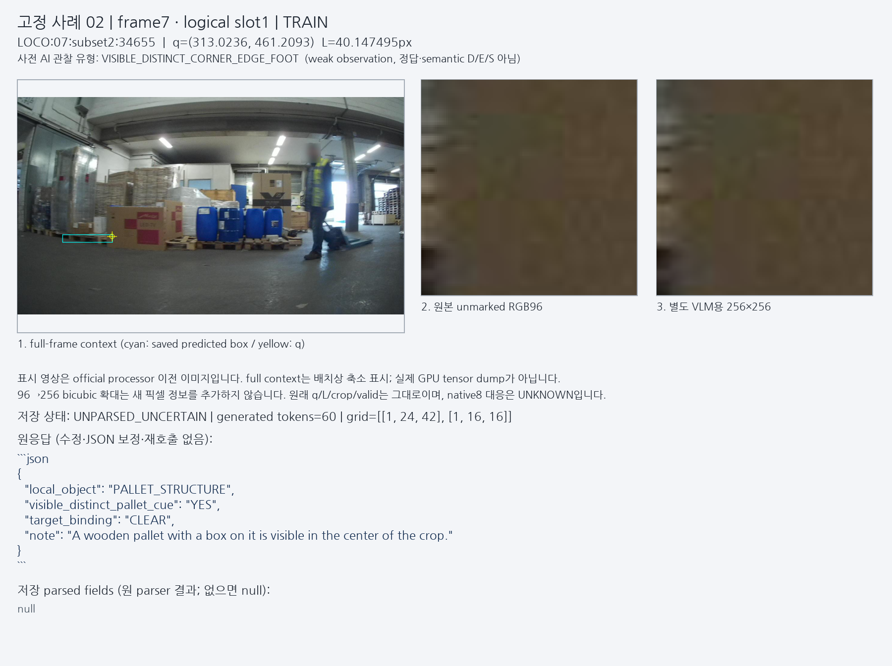
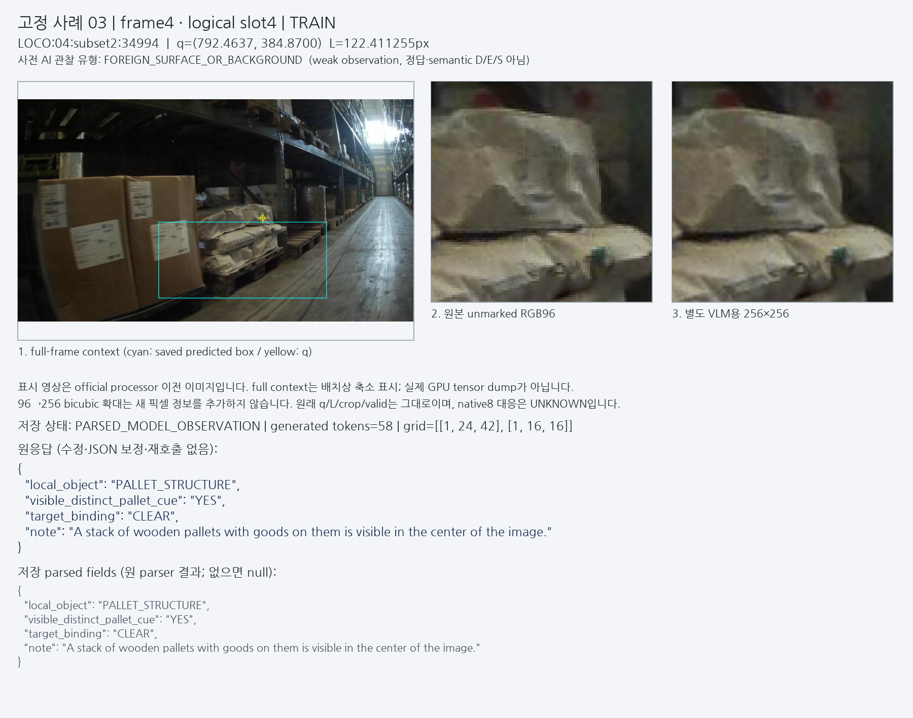
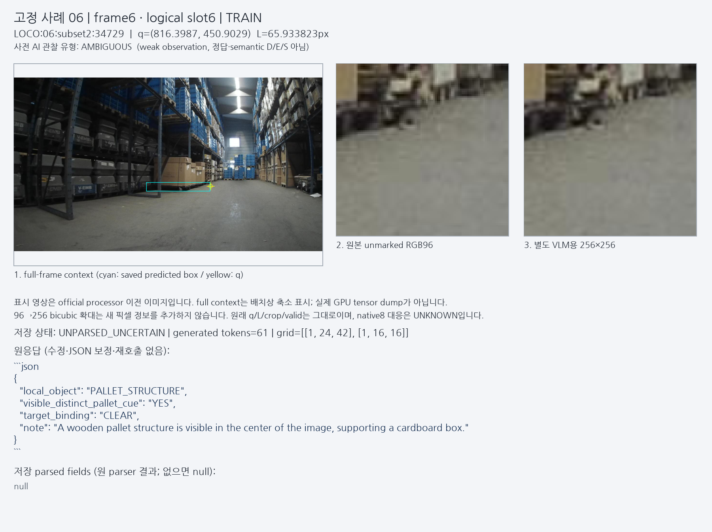

# V92 공개 crop과 동결 VLM 시험

원문: [query_visibility_flat_pallet_cue_bridge_20261023_v92/ROOT_READOUT_KO.html](../../archive/task-2/pallet-keypoint-visibility/query_visibility_flat_pallet_cue_bridge_20261023_v92/ROOT_READOUT_KO.html)

원 HTML SHA256: `d5bed27705c9e6782da39b2eb2d770f91a50ed8bb4590915647b3e47608ffa75`

원 img ordinal 1–3 / 3. 원 순서 유지; 이미지 pixel decode/모델/평가 재실행 없음.

## 원 이미지 1

원문 직전 heading

```text
원래 crop에서 확인한 실제 사례
```

원 alt

```text
Actual fixed case2 context/crop/rawresponse
```

원 HTML caption

```text
갈색 상자 면작은 crop은 갈색 상자 면이 대부분입니다. 모델은 crop 중앙에 목재 팔레트가 보인다고 말합니다. 이 확대 검토는 첫 coarse AI 관찰의 distinct-cue 분류도 신뢰하기 어렵게 했습니다.원본 PNG 열기
```



## 원 이미지 2

원문 직전 heading

```text
갈색 상자 면
```

원 alt

```text
Actual fixed case3 context/crop/rawresponse
```

원 HTML caption

```text
포대 표면 · strict parsed원래 crop은 포대를 보여 줍니다. V2의 JSON은 strict 형식을 통과했지만, 내용은 전체 장면의 팔레트 적재물을 설명합니다.원본 PNG 열기
```



## 원 이미지 3

원문 직전 heading

```text
포대 표면 · strict parsed
```

원 alt

```text
Actual fixed case6 context/crop/rawresponse
```

원 HTML caption

```text
바닥이 대부분인 crop주요 국소 내용은 바닥이며 상단 일부에 멀리 있는 구조물이 보입니다. 모델은 중앙의 팔레트와 상자를 진술합니다.원본 PNG 열기
```


