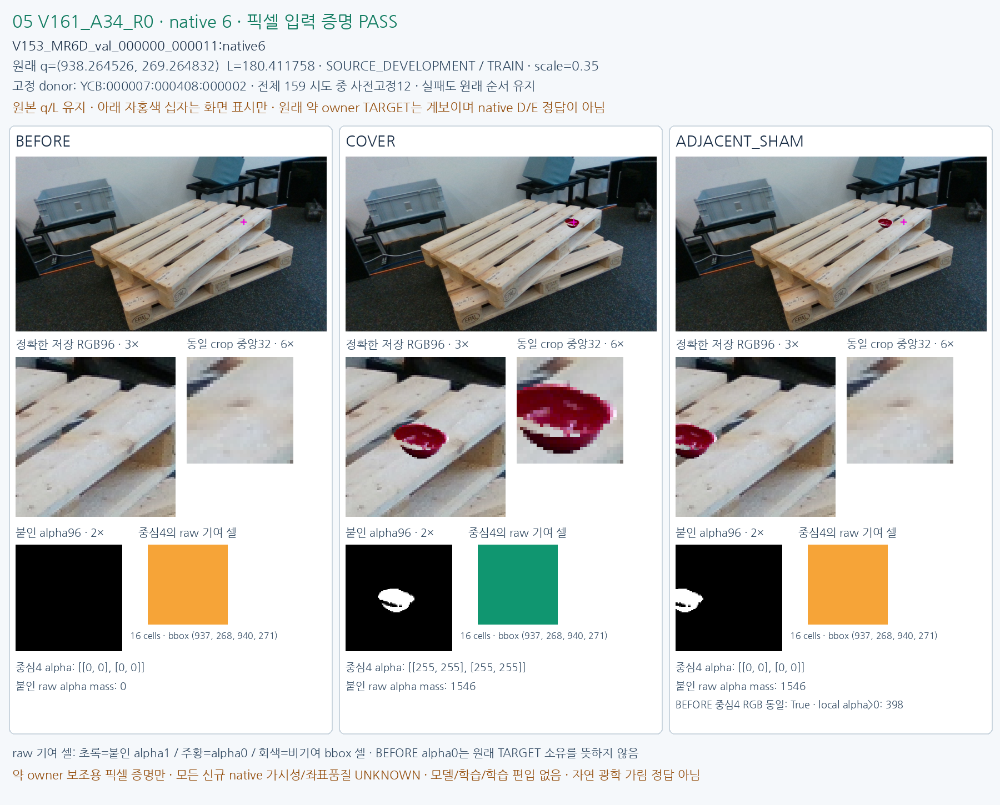
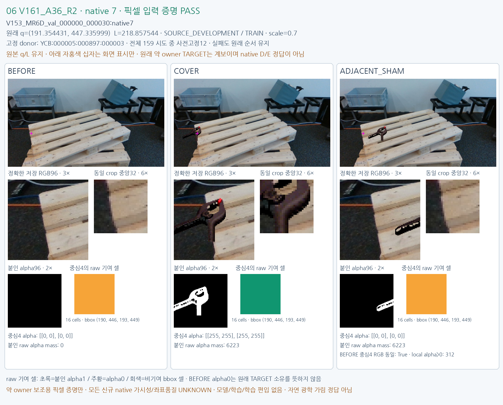
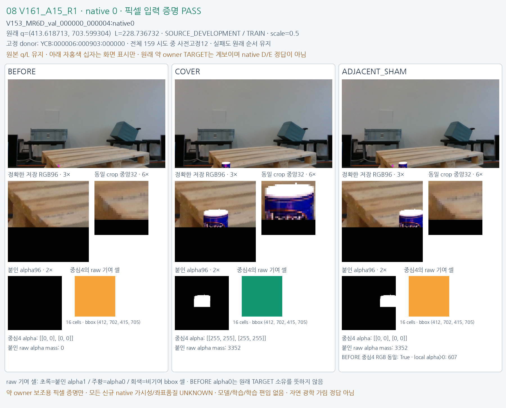
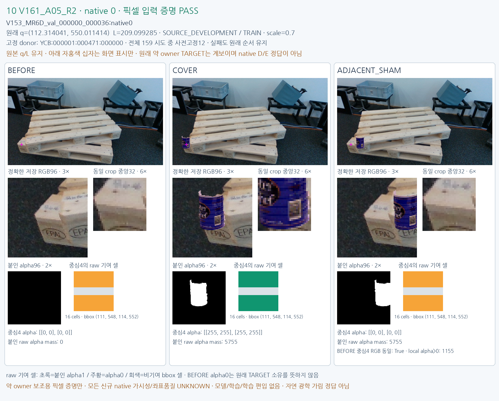
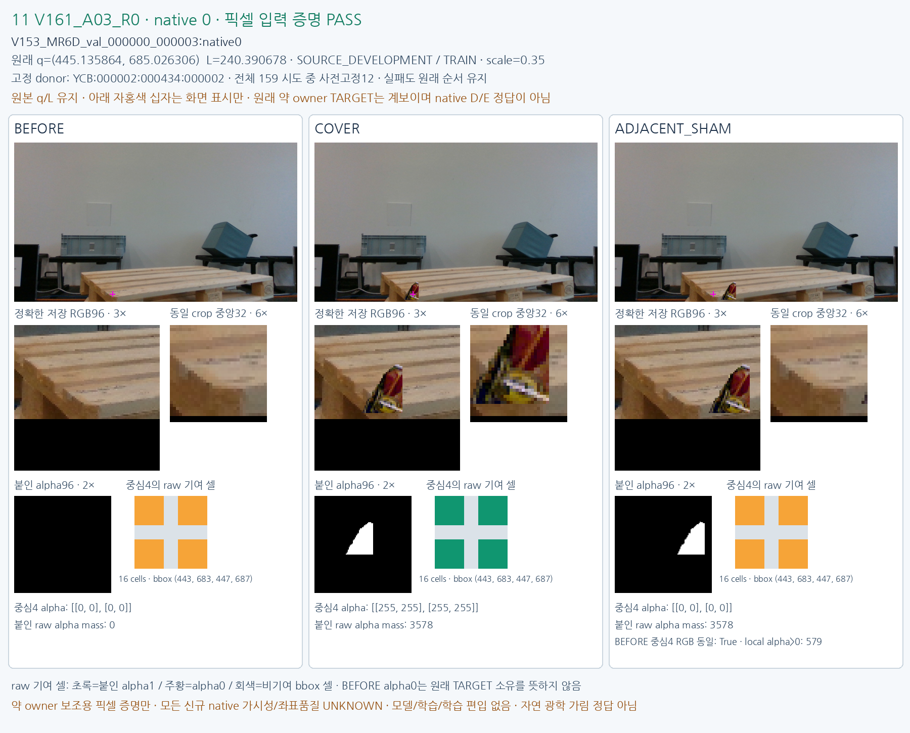

# V161 fixed12 source pixel proof

원문: [query_visibility_public_train_owner_counterfactual_20261024_v161/fixed12_visual_v1/index.html](../../archive/task-2/pallet-keypoint-visibility/query_visibility_public_train_owner_counterfactual_20261024_v161/fixed12_visual_v1/index.html)

원 HTML SHA256: `39dddaf021fe7711d383295e50ad2814fb724fa4dfb0be09d2e924ffd4ad963c`

원 img ordinal 1–12 / 12. 원 순서 유지; 이미지 pixel decode/모델/평가 재실행 없음.

## 원 이미지 1

원문 직전 heading

```text
01 V161_A38_R1 — pixel proof PASS
```

원 alt

```text
BEFORE COVER SHAM exact same-q source comparison
```


## 원 이미지 2

원문 직전 heading

```text
02 V161_A32_R1 — pixel proof PASS
```

원 alt

```text
BEFORE COVER SHAM exact same-q source comparison
```


## 원 이미지 3

원문 직전 heading

```text
03 V161_A20_R0 — pixel proof PASS
```

원 alt

```text
BEFORE COVER SHAM exact same-q source comparison
```


## 원 이미지 4

원문 직전 heading

```text
04 V161_A42_R2 — pixel proof PASS
```

원 alt

```text
BEFORE COVER SHAM exact same-q source comparison
```


## 원 이미지 5

원문 직전 heading

```text
05 V161_A34_R0 — pixel proof PASS
```

원 alt

```text
BEFORE COVER SHAM exact same-q source comparison
```



## 원 이미지 6

원문 직전 heading

```text
06 V161_A36_R2 — pixel proof PASS
```

원 alt

```text
BEFORE COVER SHAM exact same-q source comparison
```



## 원 이미지 7

원문 직전 heading

```text
07 V161_A47_R0 — pixel proof PASS
```

원 alt

```text
BEFORE COVER SHAM exact same-q source comparison
```


## 원 이미지 8

원문 직전 heading

```text
08 V161_A15_R1 — pixel proof PASS
```

원 alt

```text
BEFORE COVER SHAM exact same-q source comparison
```



## 원 이미지 9

원문 직전 heading

```text
09 V161_A49_R0 — pixel proof PASS
```

원 alt

```text
BEFORE COVER SHAM exact same-q source comparison
```


## 원 이미지 10

원문 직전 heading

```text
10 V161_A05_R2 — pixel proof PASS
```

원 alt

```text
BEFORE COVER SHAM exact same-q source comparison
```



## 원 이미지 11

원문 직전 heading

```text
11 V161_A03_R0 — pixel proof PASS
```

원 alt

```text
BEFORE COVER SHAM exact same-q source comparison
```



## 원 이미지 12

원문 직전 heading

```text
12 V161_A51_R2 — pixel proof PASS
```

원 alt

```text
BEFORE COVER SHAM exact same-q source comparison
```


