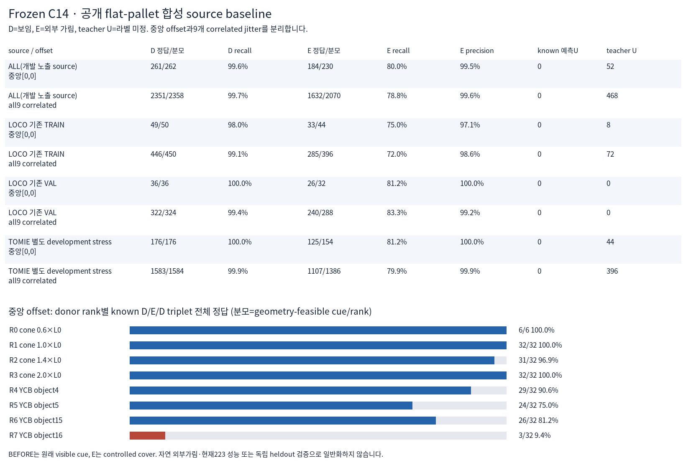
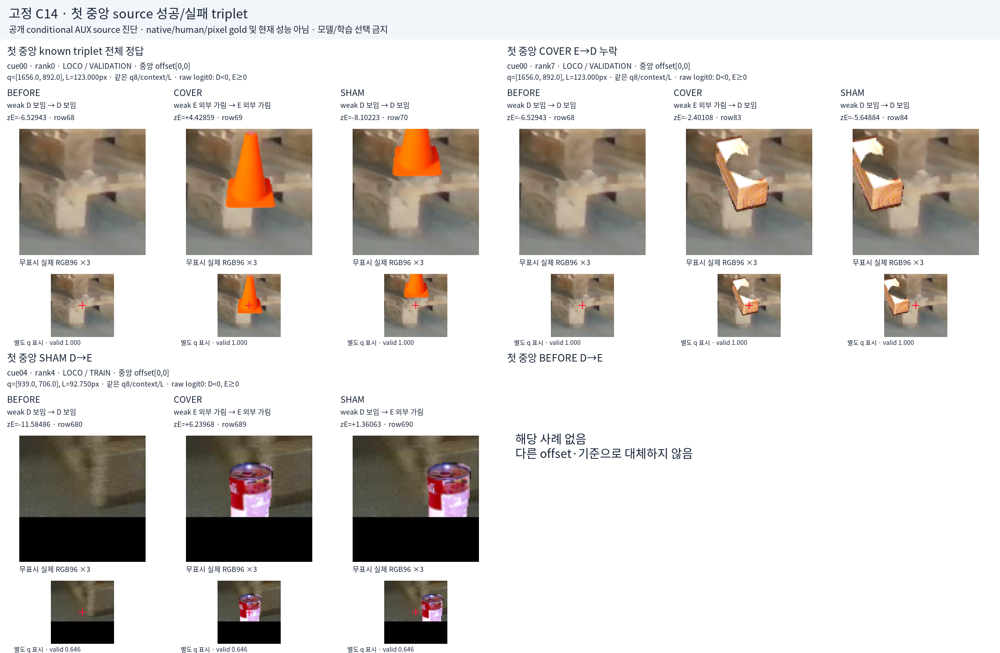
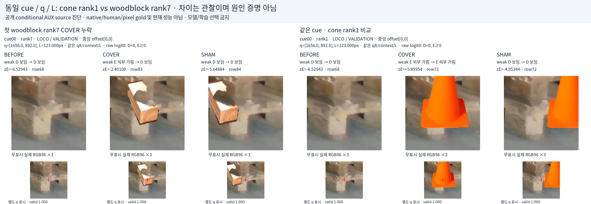
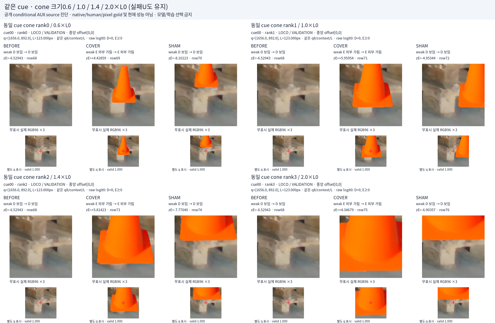

# V122 source frozen C14

원문: [query_visibility_flat_pallet_cue_source_20261023_v122/source_prediction_visual_review/READOUT_KO.html](../../archive/task-2/pallet-keypoint-visibility/query_visibility_flat_pallet_cue_source_20261023_v122/source_prediction_visual_review/READOUT_KO.html)

원 HTML SHA256: `e77a115c8e6f2e14888997691f4a39ba80014035313fb095f5be059b4f825465`

원 img ordinal 1–4 / 4. 원 순서 유지; 이미지 pixel decode/모델/평가 재실행 없음.

## 원 이미지 1

원문 직전 heading

```text
저장 source 수치
```

원 alt

```text
source metrics
```



## 원 이미지 2

원문 직전 heading

```text
첫 성공·실패 사례
```

원 alt

```text
source success failure
```



## 원 이미지 3

원문 직전 heading

```text
같은 cue: cone과 woodblock
```

원 alt

```text
same cue cone and wood
```



## 원 이미지 4

원문 직전 heading

```text
같은 cue cone rank0–3
```

원 alt

```text
cone scale counterparts
```


