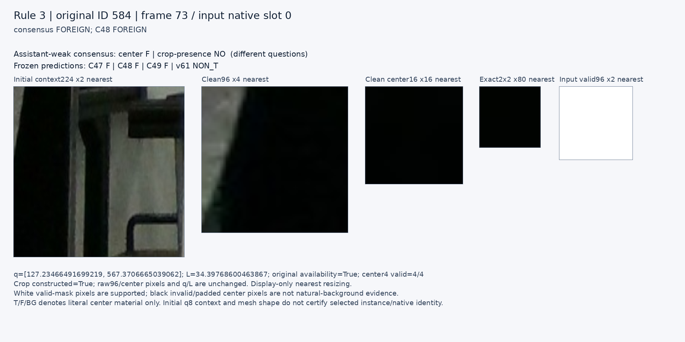
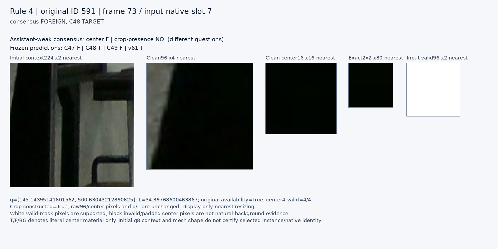
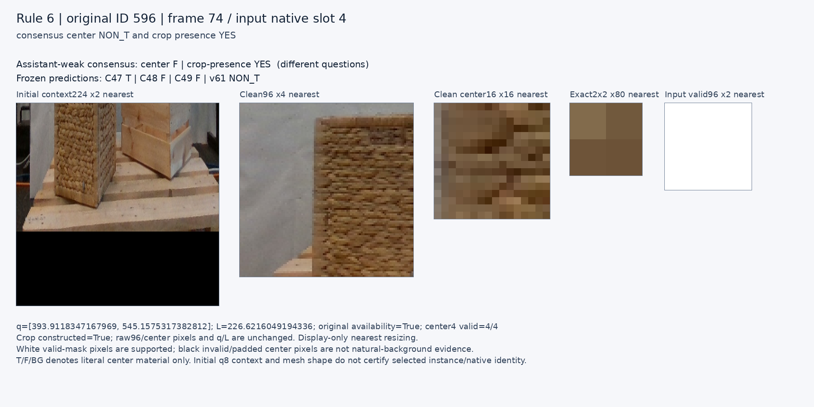
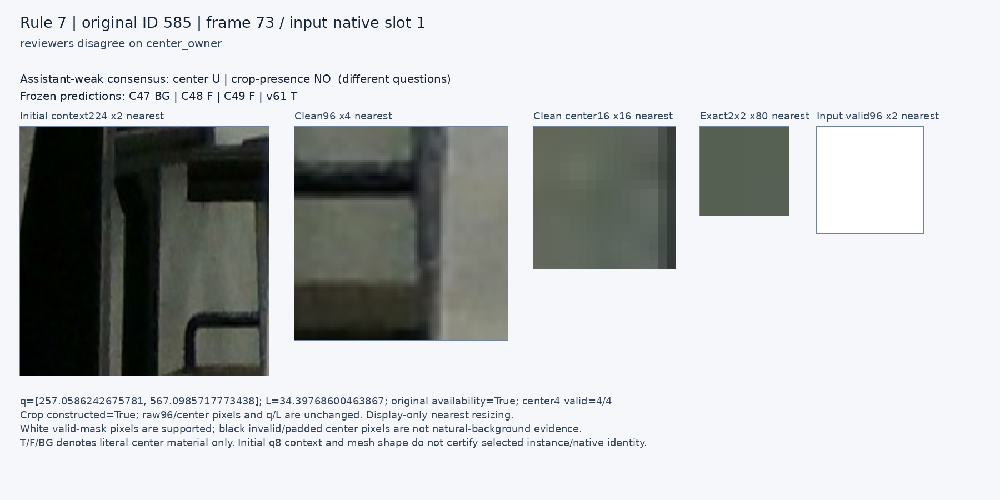
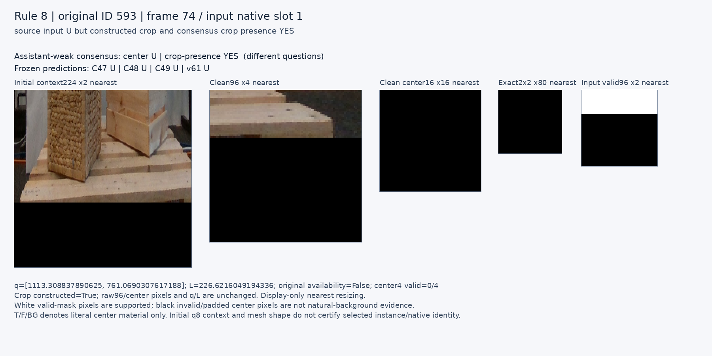

# V177 공개 중심소속 평가

원문: [query_visibility_public_held_blind_center_owner_review_20261024_v177/ROOT_READOUT_KO.html](../../archive/task-2/pallet-keypoint-visibility/query_visibility_public_held_blind_center_owner_review_20261024_v177/ROOT_READOUT_KO.html)

원 HTML SHA256: `8cf0e762024a204b7601a0cff2cdff8a0fa446a67f954ee22139b2061784b9a2`

원 img ordinal 1–7 / 7. 원 순서 유지; 이미지 pixel decode/모델/평가 재실행 없음.

## 원 이미지 1

원문 직전 heading

```text
고정 출력 비교
```

원 alt

```text
Literal center owner scientific diagnostic plot
```


## 원 이미지 2

원문 직전 heading

```text
규칙 1 · 원 ID 598
```

원 alt

```text
고정 규칙의 원본 crop 및 중심 확대
```


## 원 이미지 3

원문 직전 heading

```text
규칙 3 · 원 ID 584
```

원 alt

```text
고정 규칙의 원본 crop 및 중심 확대
```



## 원 이미지 4

원문 직전 heading

```text
규칙 4 · 원 ID 591
```

원 alt

```text
고정 규칙의 원본 crop 및 중심 확대
```



## 원 이미지 5

원문 직전 heading

```text
규칙 6 · 원 ID 596
```

원 alt

```text
고정 규칙의 원본 crop 및 중심 확대
```



## 원 이미지 6

원문 직전 heading

```text
규칙 7 · 원 ID 585
```

원 alt

```text
고정 규칙의 원본 crop 및 중심 확대
```



## 원 이미지 7

원문 직전 heading

```text
규칙 8 · 원 ID 593
```

원 alt

```text
고정 규칙의 원본 crop 및 중심 확대
```


