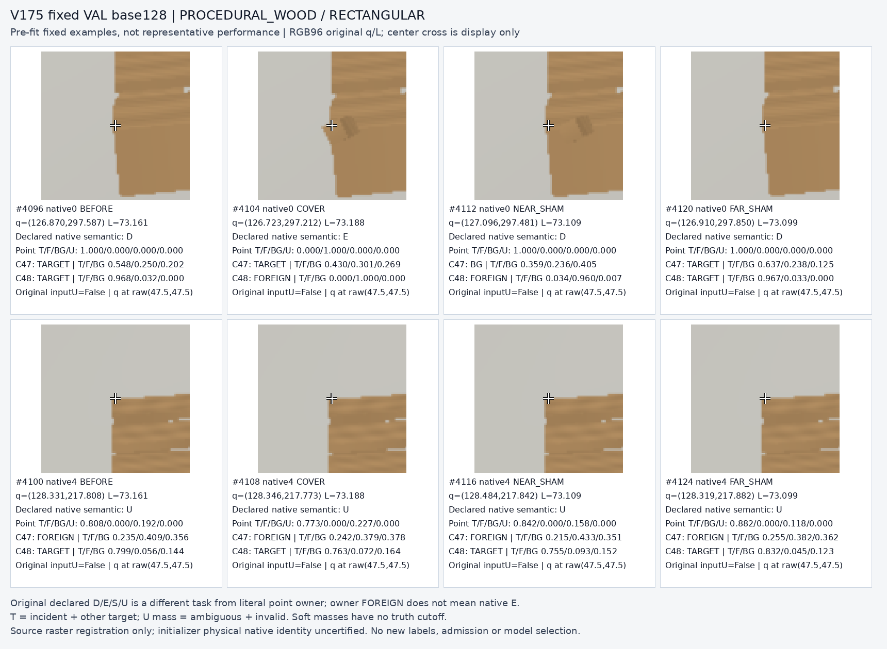
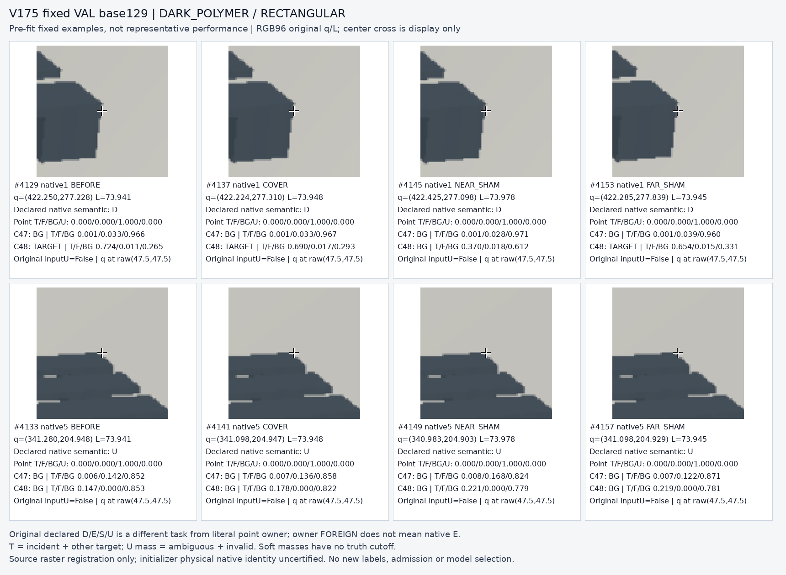
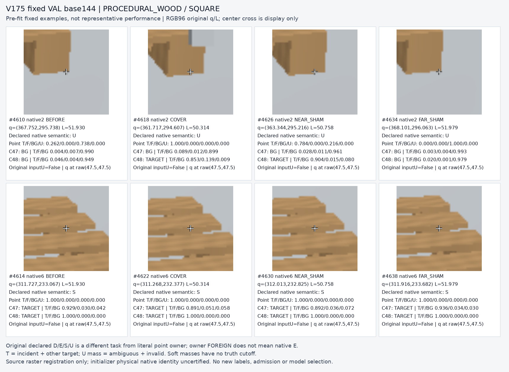
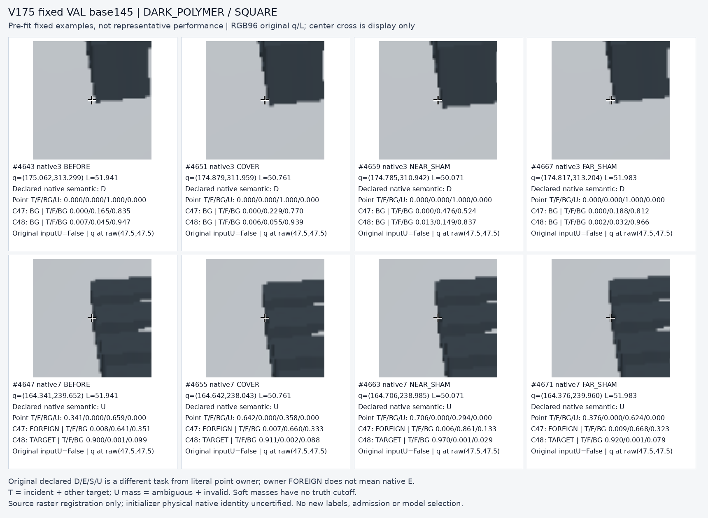

# V175 fixed32 source crops

원문: [query_visibility_direct_query_owner_control_20261024_v175/fixed32_source_crop_review_v2/index.html](../../archive/task-2/pallet-keypoint-visibility/query_visibility_direct_query_owner_control_20261024_v175/fixed32_source_crop_review_v2/index.html)

원 HTML SHA256: `83a5e10735fcfd4b72264e14942f753d50b0d25b27c1e6f17368f03d30b4a8d7`

원 img ordinal 1–4 / 4. 원 순서 유지; 이미지 pixel decode/모델/평가 재실행 없음.

## 원 이미지 1

원문 직전 heading

```text
base 128
```

원 alt

```text
fixed8 crops base128
```



## 원 이미지 2

원문 직전 heading

```text
base 129
```

원 alt

```text
fixed8 crops base129
```



## 원 이미지 3

원문 직전 heading

```text
base 144
```

원 alt

```text
fixed8 crops base144
```



## 원 이미지 4

원문 직전 heading

```text
base 145
```

원 alt

```text
fixed8 crops base145
```


