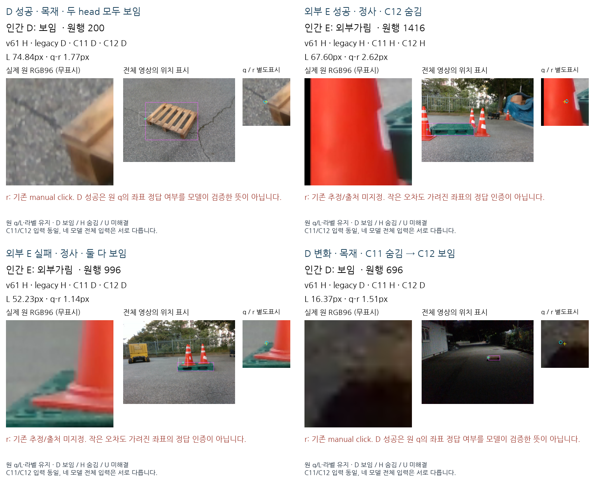
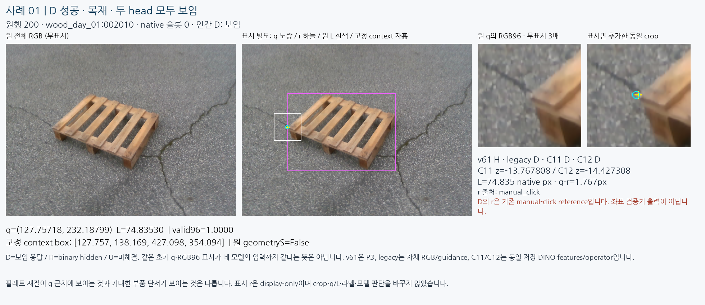
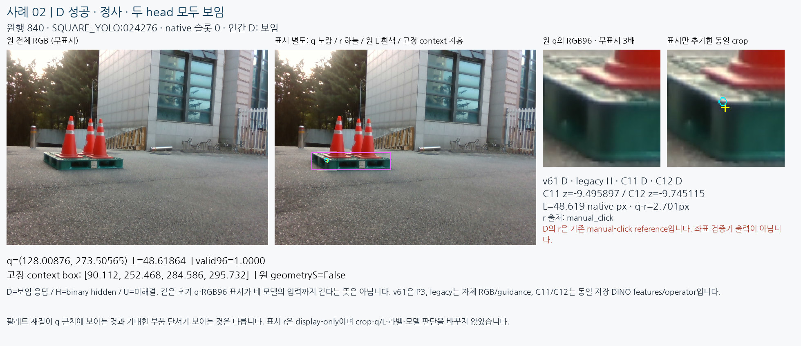
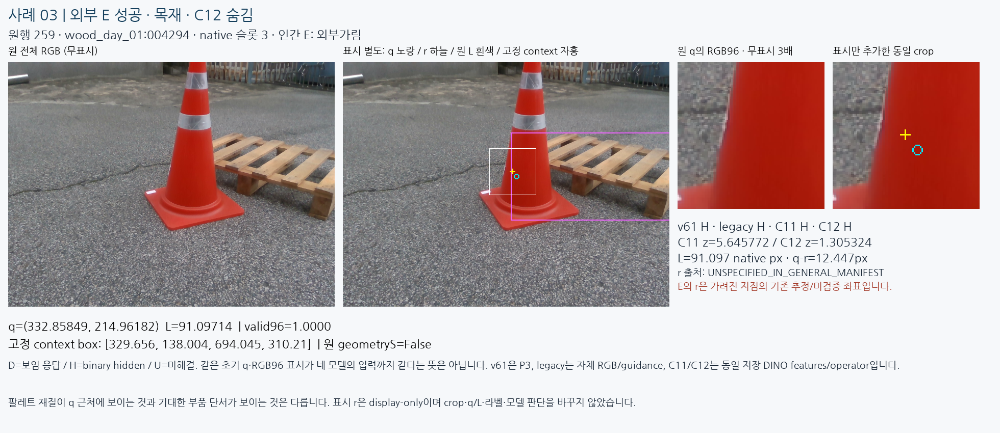
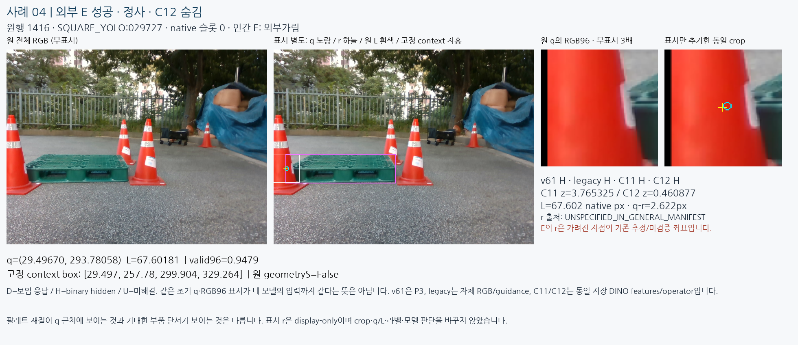
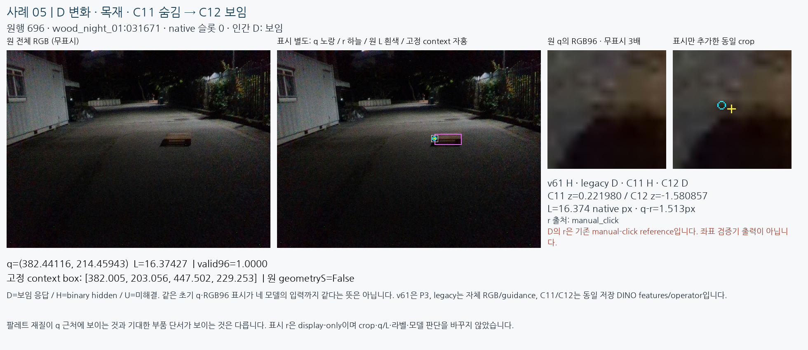
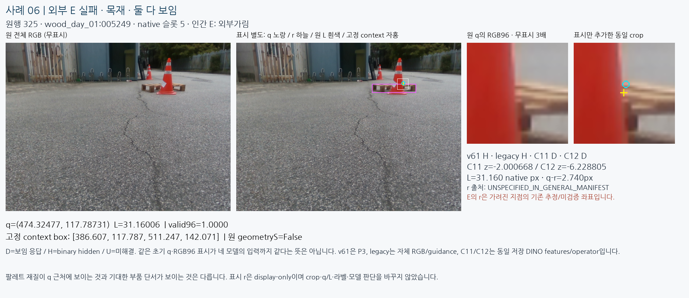
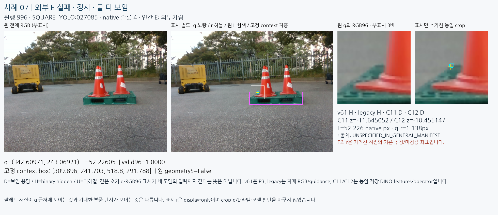
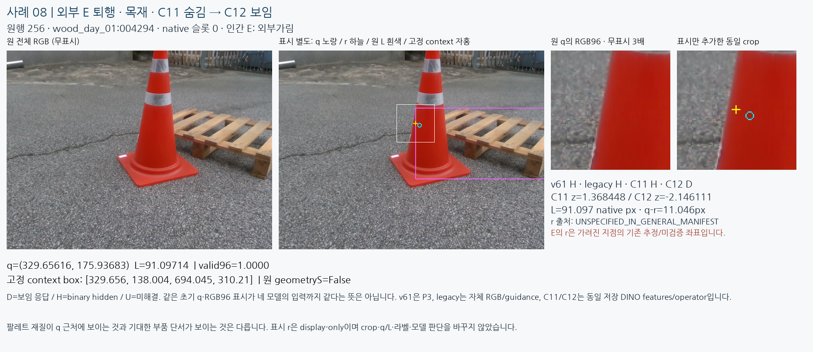
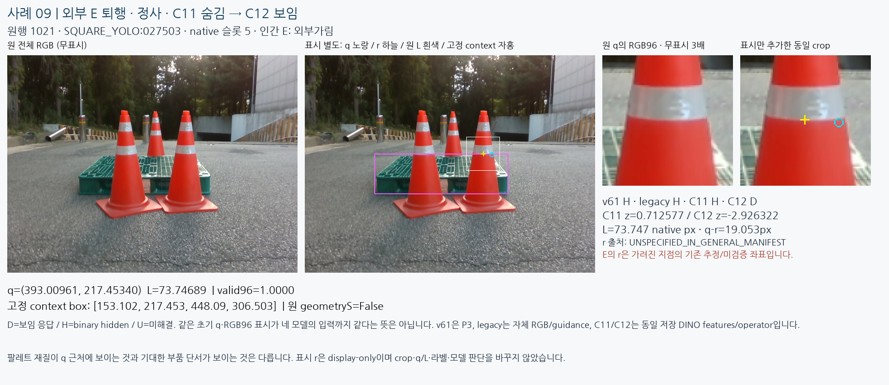

# 보임·외부가림 성공/실패 실제 이미지 비교

원문: [query_visibility_success_failure_visual_review_20261023_v117/ROOT_READOUT_KO.html](../../archive/task-2/pallet-keypoint-visibility/query_visibility_success_failure_visual_review_20261023_v117/ROOT_READOUT_KO.html)

원 HTML SHA256: `7fc20782288711b1135ae5bb4eeb9eb7f400b1cd7f4c2903df08c8f8f600a9c9`

원 img ordinal 1–10 / 10. 원 순서 유지; 이미지 pixel decode/모델/평가 재실행 없음.

## 원 이미지 1

원문 직전 heading

```text
한눈에 보는 고정4사례
```

원 alt

```text
실제 저장 crop의 고정4 성공실패 사례
```



## 원 이미지 2

원문 직전 heading

```text
01. D 성공 · 목재 · 두 head 모두 보임
```

원 alt

```text
사례1 원 전체RGB와 원 q RGB96의 무표시·별도표시 비교
```

원 HTML caption

```text
클릭하면 원 크기. raw96은 저장 배열과 byte-exact. 노랑q / 하늘r / 흰L범위 / 자홍 frozen context. 원 RGB에는 표시를 넣지 않았습니다.
```



## 원 이미지 3

원문 직전 heading

```text
02. D 성공 · 정사 · 두 head 모두 보임
```

원 alt

```text
사례2 원 전체RGB와 원 q RGB96의 무표시·별도표시 비교
```

원 HTML caption

```text
클릭하면 원 크기. raw96은 저장 배열과 byte-exact. 노랑q / 하늘r / 흰L범위 / 자홍 frozen context. 원 RGB에는 표시를 넣지 않았습니다.
```



## 원 이미지 4

원문 직전 heading

```text
03. 외부 E 성공 · 목재 · C12 숨김
```

원 alt

```text
사례3 원 전체RGB와 원 q RGB96의 무표시·별도표시 비교
```

원 HTML caption

```text
클릭하면 원 크기. raw96은 저장 배열과 byte-exact. 노랑q / 하늘r / 흰L범위 / 자홍 frozen context. 원 RGB에는 표시를 넣지 않았습니다.
```



## 원 이미지 5

원문 직전 heading

```text
04. 외부 E 성공 · 정사 · C12 숨김
```

원 alt

```text
사례4 원 전체RGB와 원 q RGB96의 무표시·별도표시 비교
```

원 HTML caption

```text
클릭하면 원 크기. raw96은 저장 배열과 byte-exact. 노랑q / 하늘r / 흰L범위 / 자홍 frozen context. 원 RGB에는 표시를 넣지 않았습니다.
```



## 원 이미지 6

원문 직전 heading

```text
05. D 변화 · 목재 · C11 숨김 → C12 보임
```

원 alt

```text
사례5 원 전체RGB와 원 q RGB96의 무표시·별도표시 비교
```

원 HTML caption

```text
클릭하면 원 크기. raw96은 저장 배열과 byte-exact. 노랑q / 하늘r / 흰L범위 / 자홍 frozen context. 원 RGB에는 표시를 넣지 않았습니다.
```



## 원 이미지 7

원문 직전 heading

```text
06. 외부 E 실패 · 목재 · 둘 다 보임
```

원 alt

```text
사례6 원 전체RGB와 원 q RGB96의 무표시·별도표시 비교
```

원 HTML caption

```text
클릭하면 원 크기. raw96은 저장 배열과 byte-exact. 노랑q / 하늘r / 흰L범위 / 자홍 frozen context. 원 RGB에는 표시를 넣지 않았습니다.
```



## 원 이미지 8

원문 직전 heading

```text
07. 외부 E 실패 · 정사 · 둘 다 보임
```

원 alt

```text
사례7 원 전체RGB와 원 q RGB96의 무표시·별도표시 비교
```

원 HTML caption

```text
클릭하면 원 크기. raw96은 저장 배열과 byte-exact. 노랑q / 하늘r / 흰L범위 / 자홍 frozen context. 원 RGB에는 표시를 넣지 않았습니다.
```



## 원 이미지 9

원문 직전 heading

```text
08. 외부 E 퇴행 · 목재 · C11 숨김 → C12 보임
```

원 alt

```text
사례8 원 전체RGB와 원 q RGB96의 무표시·별도표시 비교
```

원 HTML caption

```text
클릭하면 원 크기. raw96은 저장 배열과 byte-exact. 노랑q / 하늘r / 흰L범위 / 자홍 frozen context. 원 RGB에는 표시를 넣지 않았습니다.
```



## 원 이미지 10

원문 직전 heading

```text
09. 외부 E 퇴행 · 정사 · C11 숨김 → C12 보임
```

원 alt

```text
사례9 원 전체RGB와 원 q RGB96의 무표시·별도표시 비교
```

원 HTML caption

```text
클릭하면 원 크기. raw96은 저장 배열과 byte-exact. 노랑q / 하늘r / 흰L범위 / 자홍 frozen context. 원 RGB에는 표시를 넣지 않았습니다.
```


