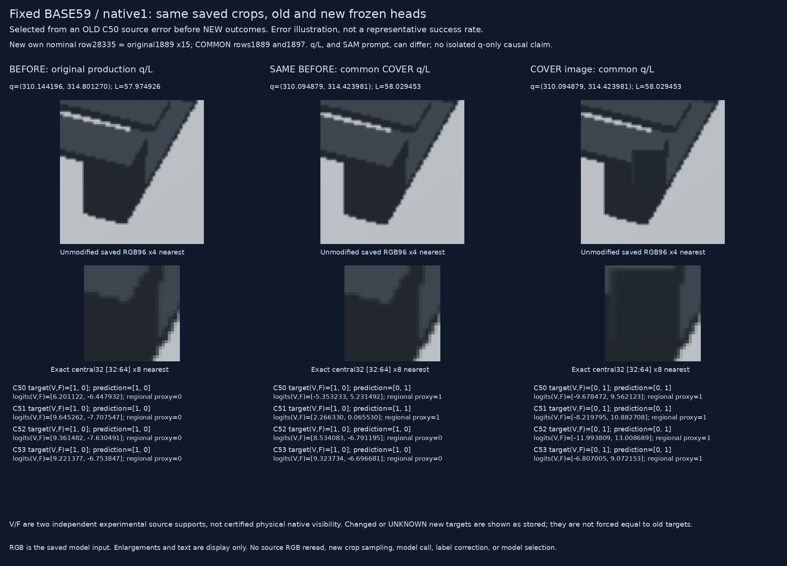
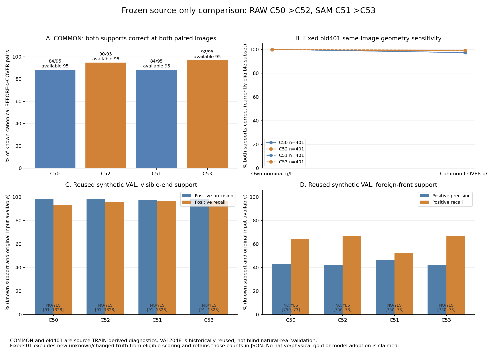

# Fixed source case and saved comparison

원문: [query_visibility_query_jitter_paired_source_training_20261024_v183/fixed_source_case_and_plot_v1/index.html](../../archive/task-2/pallet-keypoint-visibility/query_visibility_query_jitter_paired_source_training_20261024_v183/fixed_source_case_and_plot_v1/index.html)

원 HTML SHA256: `631c511f68b44410366dd93b94840c9e1640070723beabb0c140f67fe0275cea`

원 img ordinal 1–2 / 2. 원 순서 유지; 이미지 pixel decode/모델/평가 재실행 없음.

## 원 이미지 1

원문 직전 heading

```text
Fixed source error case and frozen comparisons
```



## 원 이미지 2

원문 직전 heading

```text
Source diagnostics and reused synthetic validation
```


