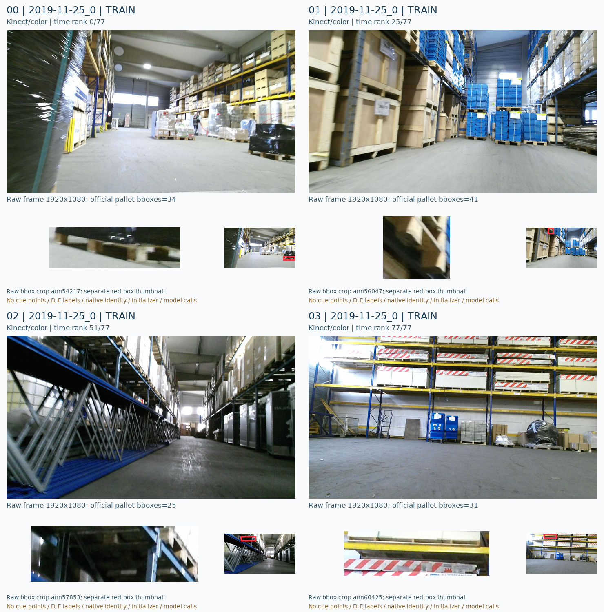
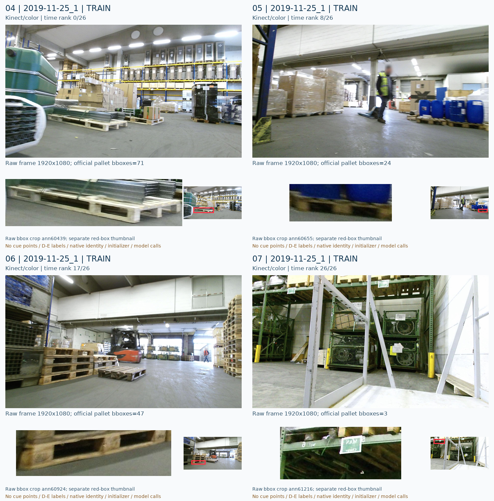
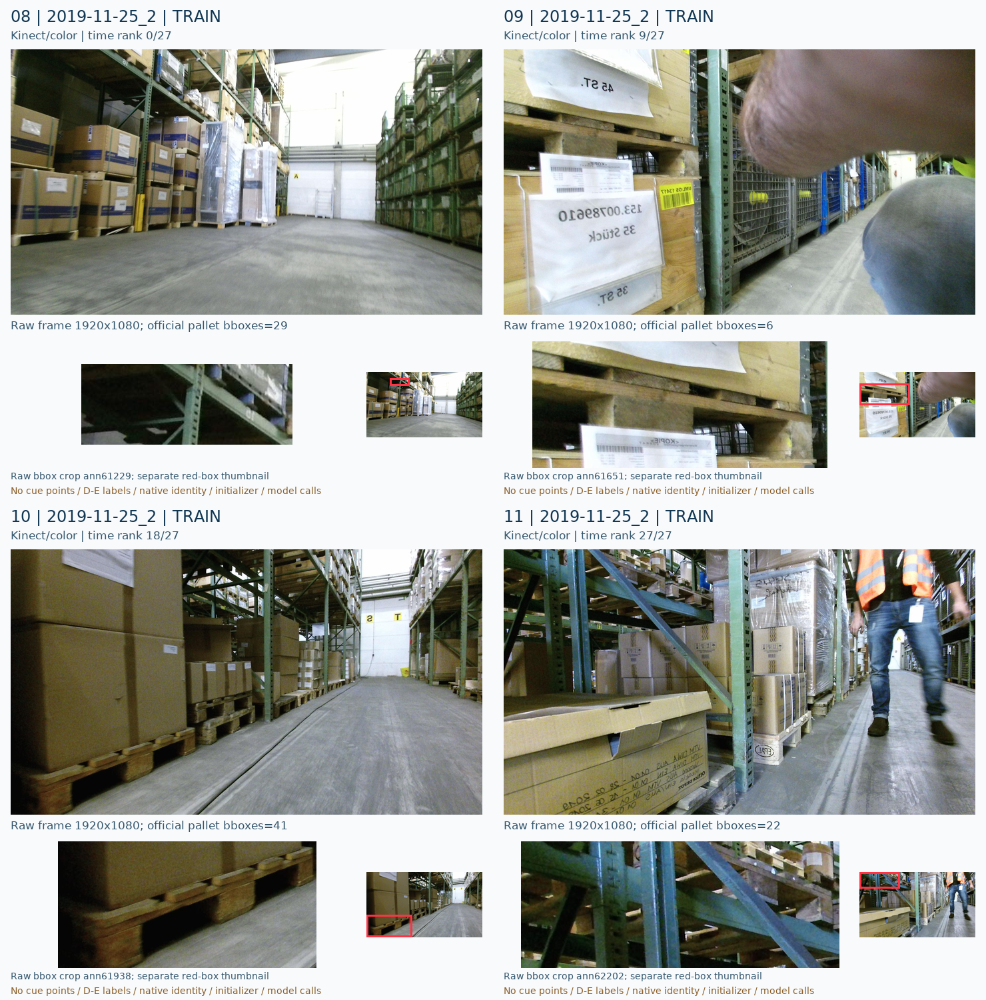
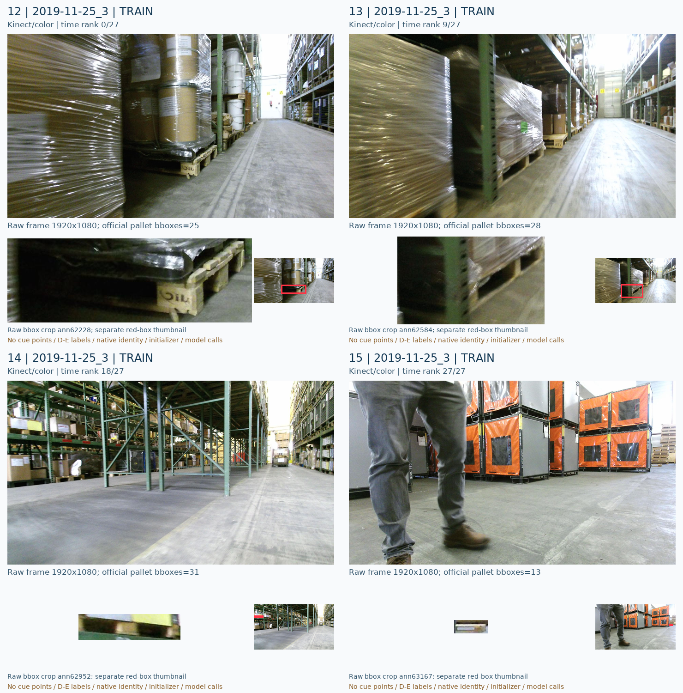
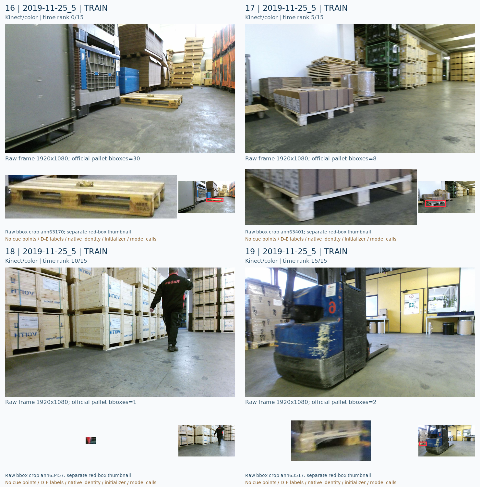
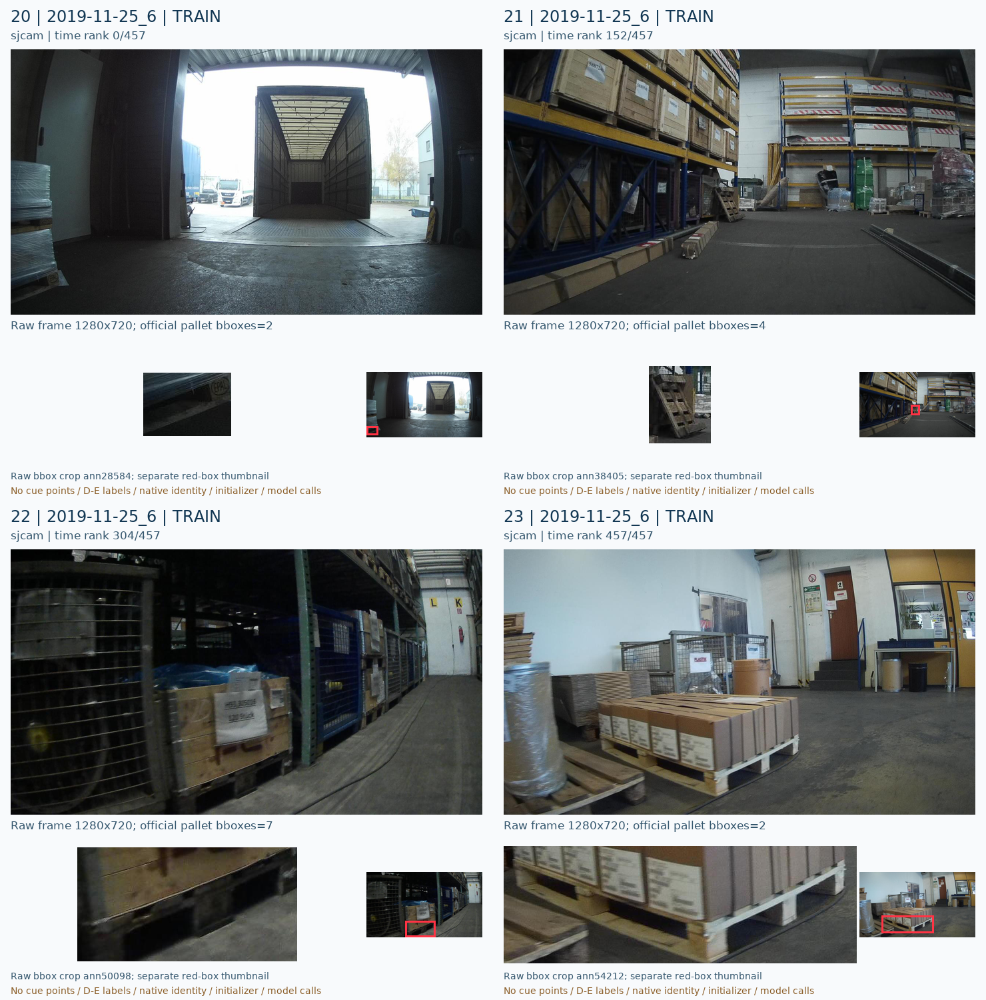

# PUBLIC LOCO TRAIN24 intake

원문: [query_visibility_spatial_stencil_control_20261023_v127/public_diversity_intake/GALLERY_KO.html](../../archive/task-2/pallet-keypoint-visibility/query_visibility_spatial_stencil_control_20261023_v127/public_diversity_intake/GALLERY_KO.html)

원 HTML SHA256: `2c825fbfdcaf18f09c45f8a078f8ffcfac603857fde5449f7c281e7255ceda4d`

원 img ordinal 1–6 / 6. 원 순서 유지; 이미지 pixel decode/모델/평가 재실행 없음.

## 원 이미지 1

원문 직전 heading

```text
2019-11-25_0
```



## 원 이미지 2

원문 직전 heading

```text
2019-11-25_1
```



## 원 이미지 3

원문 직전 heading

```text
2019-11-25_2
```



## 원 이미지 4

원문 직전 heading

```text
2019-11-25_3
```



## 원 이미지 5

원문 직전 heading

```text
2019-11-25_5
```



## 원 이미지 6

원문 직전 heading

```text
2019-11-25_6
```


