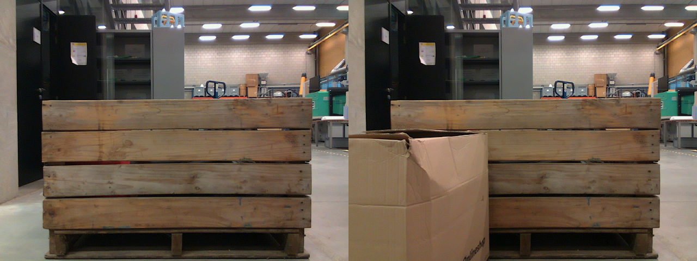
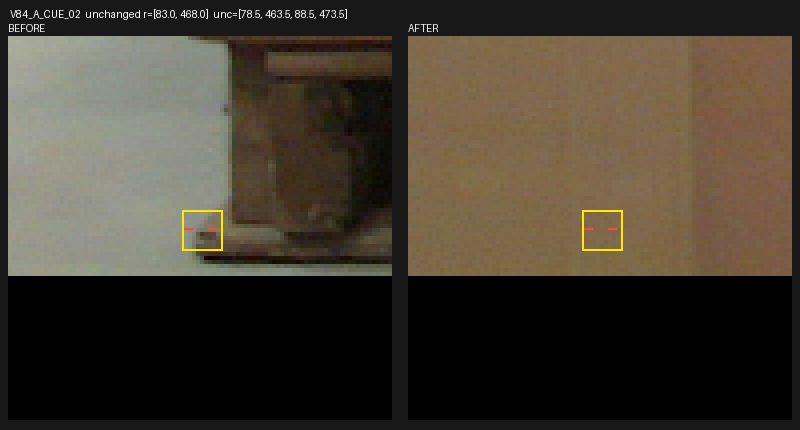
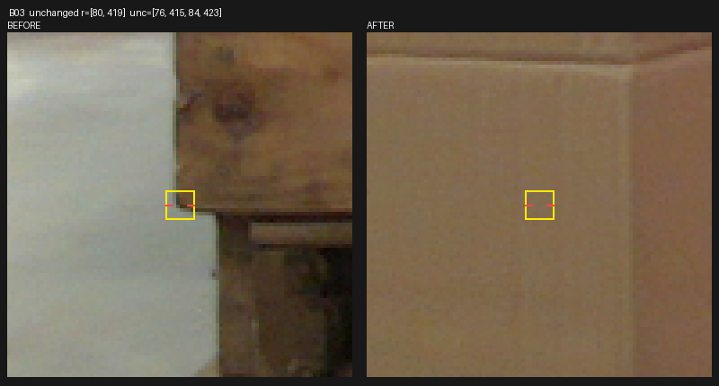

# 공개 실사 같은 코너의 전후 가림 V84

원문: [query_visibility_paired_cue_20261023_v84/ROOT_READOUT_KO.html](../../archive/task-2/pallet-keypoint-visibility/query_visibility_paired_cue_20261023_v84/ROOT_READOUT_KO.html)

원 HTML SHA256: `c767f3d12074655cae40e216f68c51eb2bd0ad9ec1b803fef963bf67c6c06a5f`

원 img ordinal 1–3 / 3. 원 순서 유지; 이미지 pixel decode/모델/평가 재실행 없음.

## 원 이미지 1

원문 직전 heading

```text
같은 코너가 실제로 가려지는 공개 실사: V84
```

원 alt

```text
정렬이나 좌표 수정 없는 공개 실사 전후
```



## 원 이미지 2

원문 직전 heading

```text
같은 코너가 실제로 가려지는 공개 실사: V84
```

원 alt

```text
왼쪽 base-runner 동일 위치: before 보임 after 판지 가림
```



## 원 이미지 3

원문 직전 heading

```text
같은 코너가 실제로 가려지는 공개 실사: V84
```

원 alt

```text
왼쪽 판재 끝 동일 위치: before 보임 after 판지 가림
```


