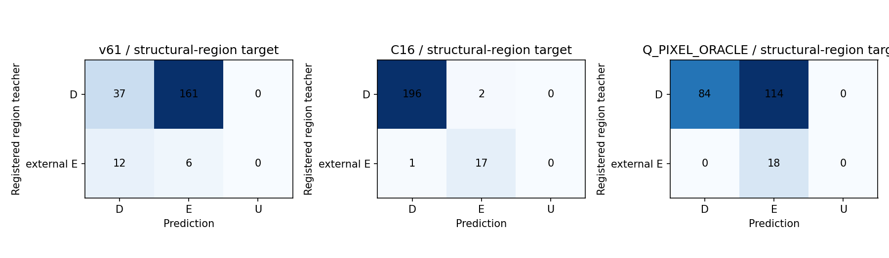

# V128 고정 합성 source 진단

원문: [query_visibility_registered_native_render_20261023_v128/saved_source_evaluation_v2/READOUT_KO.html](../../archive/task-2/pallet-keypoint-visibility/query_visibility_registered_native_render_20261023_v128/saved_source_evaluation_v2/READOUT_KO.html)

원 HTML SHA256: `6de1c548ccc4418dc64f00da097de6c3786e9a80726fa56ac0657c6792e64050`

원 img ordinal 1–4 / 4. 원 순서 유지; 이미지 pixel decode/모델/평가 재실행 없음.

## 원 이미지 1

원문 직전 heading

```text
고정 native1 D→E→D triplet 18개
```

원 HTML caption

```text
SEMANTIC_DE_CONFUSION
```



## 원 이미지 2

원문 직전 heading

```text
고정 native1 D→E→D triplet 18개
```

원 HTML caption

```text
ZERO_OFFSET_BEFORE_ALL16
```


## 원 이미지 3

원문 직전 heading

```text
고정 native1 D→E→D triplet 18개
```

원 HTML caption

```text
POLYMER_RIB_LEG_NATIVE1_ALL9_TRIPLETS
```


## 원 이미지 4

원문 직전 heading

```text
고정 native1 D→E→D triplet 18개
```

원 HTML caption

```text
WOOD_BOARD_BLOCK_NATIVE1_ALL9_TRIPLETS
```


