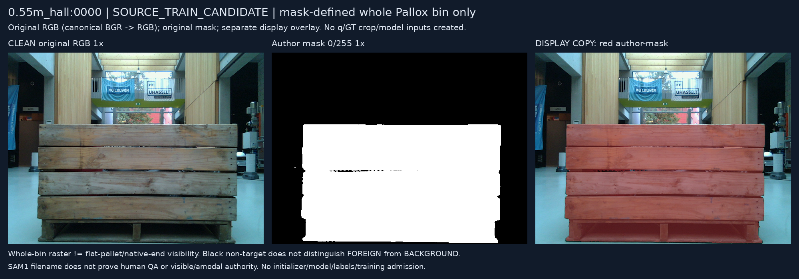
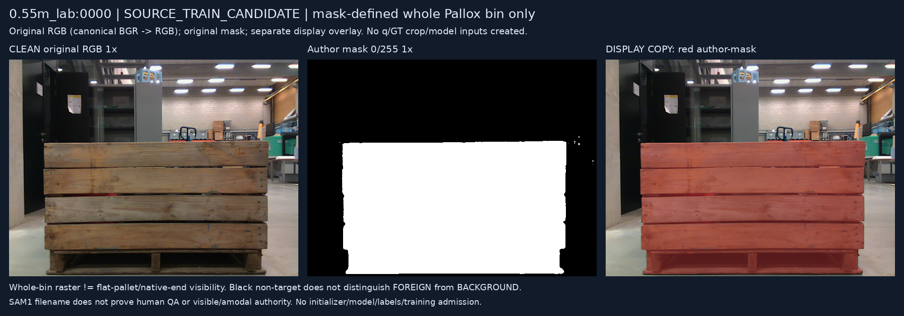
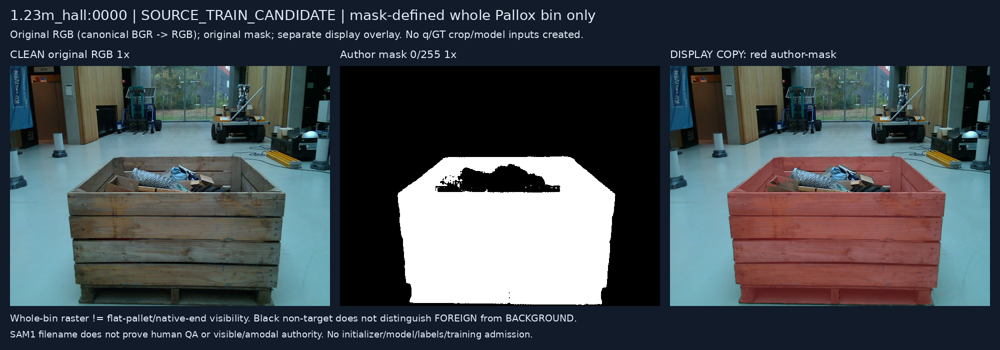
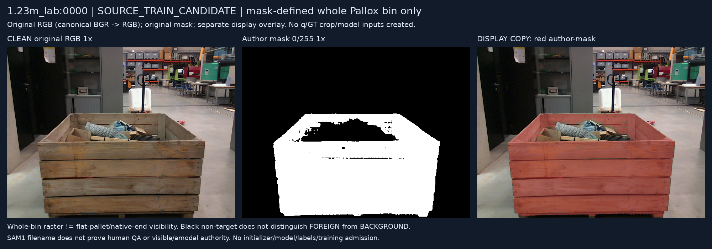
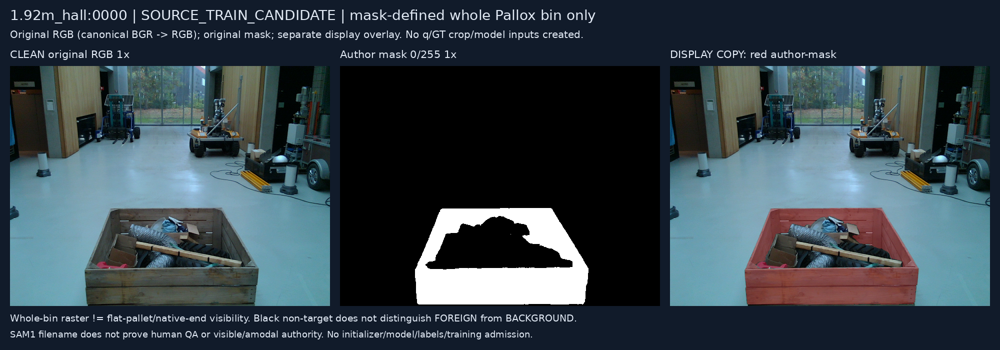
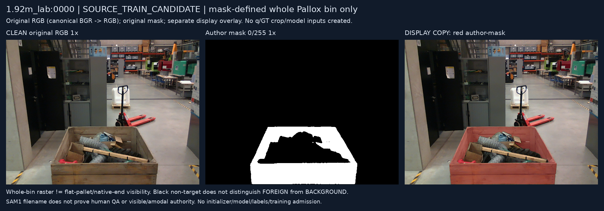
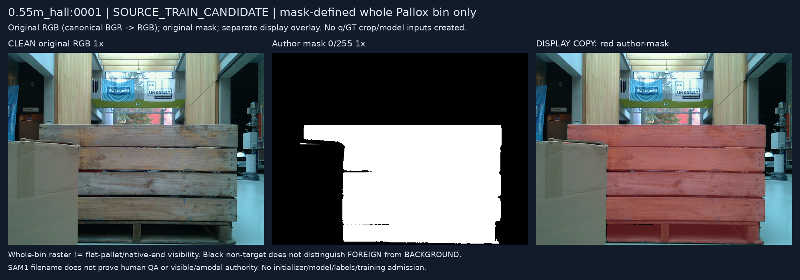
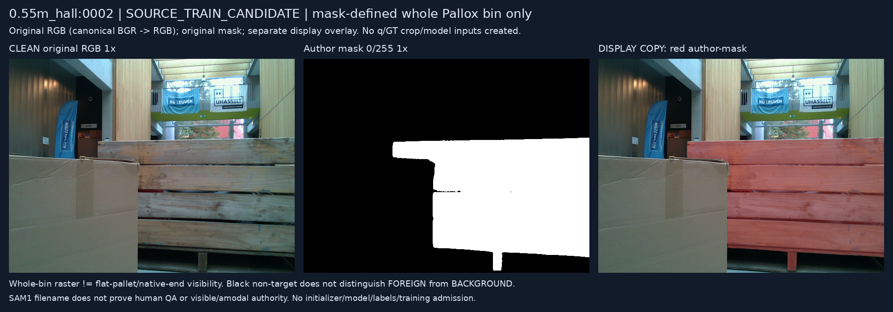

# Fixed Pallox8 RGB-mask intake

원문: [query_visibility_source_same_query_causal_diagnosis_20261024_v182/public_pallox_rgb_mask_pilot_v1/index.html](../../archive/task-2/pallet-keypoint-visibility/query_visibility_source_same_query_causal_diagnosis_20261024_v182/public_pallox_rgb_mask_pilot_v1/index.html)

원 HTML SHA256: `d6fc286825c5660a7873cc5210f2c6d069c5a18531018876d139b7c06a170d09`

원 img ordinal 1–8 / 8. 원 순서 유지; 이미지 pixel decode/모델/평가 재실행 없음.

## 원 이미지 1

원문 직전 heading

```text
0.55m_hall:0000
```



## 원 이미지 2

원문 직전 heading

```text
0.55m_lab:0000
```



## 원 이미지 3

원문 직전 heading

```text
1.23m_hall:0000
```



## 원 이미지 4

원문 직전 heading

```text
1.23m_lab:0000
```



## 원 이미지 5

원문 직전 heading

```text
1.92m_hall:0000
```



## 원 이미지 6

원문 직전 heading

```text
1.92m_lab:0000
```



## 원 이미지 7

원문 직전 heading

```text
0.55m_hall:0001
```



## 원 이미지 8

원문 직전 heading

```text
0.55m_hall:0002
```


