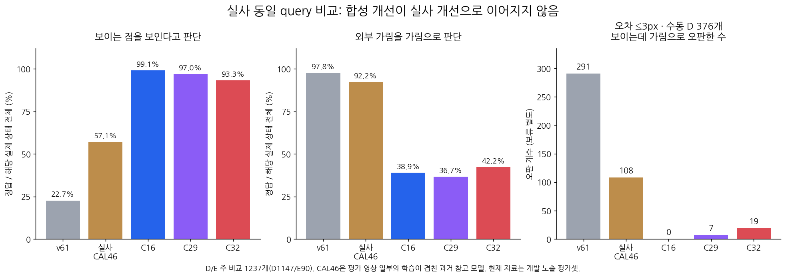

# V143 실사 전이 고정 비교

원문: [query_visibility_frozen_native_current_benchmark_20261024_v143/ROOT_READOUT_KO.html](../../archive/task-2/pallet-keypoint-visibility/query_visibility_frozen_native_current_benchmark_20261024_v143/ROOT_READOUT_KO.html)

원 HTML SHA256: `dccac687d99ef102ec7f765aa30c71ffd5ca8063924fbd7868477aa331ad8a84`

원 img ordinal 1–1 / 1. 원 순서 유지; 이미지 pixel decode/모델/평가 재실행 없음.

## 원 이미지 1

원문 직전 heading

```text
V143 · 최근 두 모델의 실사 전이 확인
```

원 alt

```text
실사 D/E recall 및 오차 3px 이하 D 오판 비교
```


