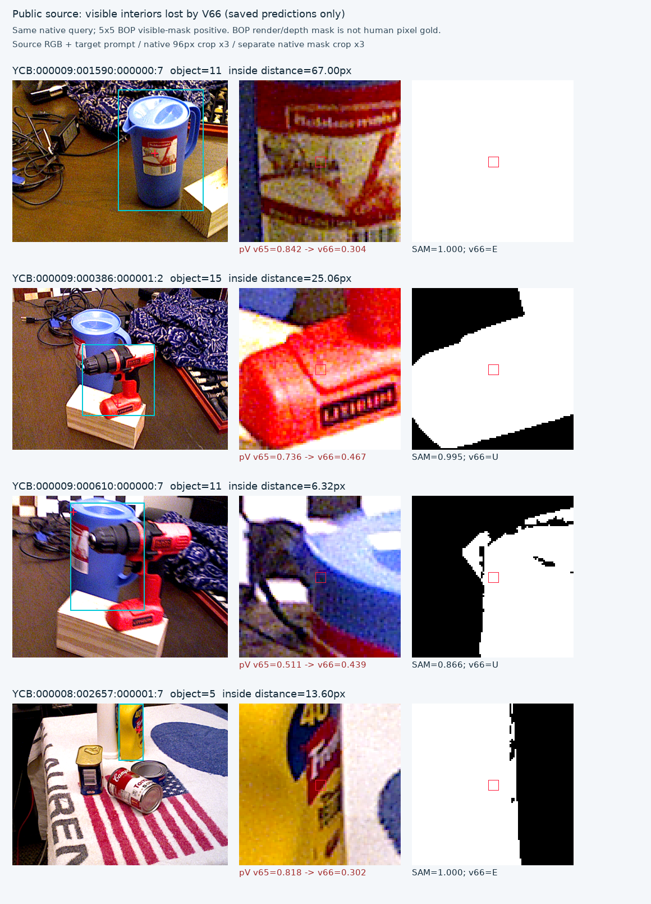

# v67 소스 대조 실험

원문: [query_visibility_visible_preservation_20261023_v67/RESULTS_KO.html](../../archive/task-2/pallet-keypoint-visibility/query_visibility_visible_preservation_20261023_v67/RESULTS_KO.html.parts.json)

원 HTML SHA256: `e4e6cdc8baf43601ec220179484c9049d472d9c25a940eafa6e8c9ca86d10ab2`

원 img ordinal 1–1 / 1. 원 순서 유지; 이미지 pixel decode/모델/평가 재실행 없음.

## 원 이미지 1

원문 직전 heading

```text
v67 학습 전에 고정한 실제 공개 crop
```

원 alt

```text
공개 물체의 보이는 내부 점을 head가 지운 실제 crop
```



원문 HTML이 큰 경우 링크는 원 SHA를 보존하는 무손실 gzip descriptor를 가리킵니다.
