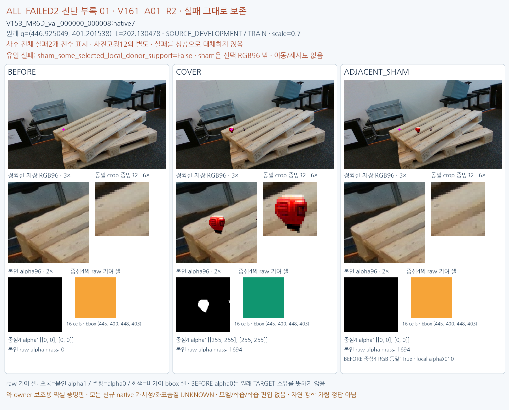
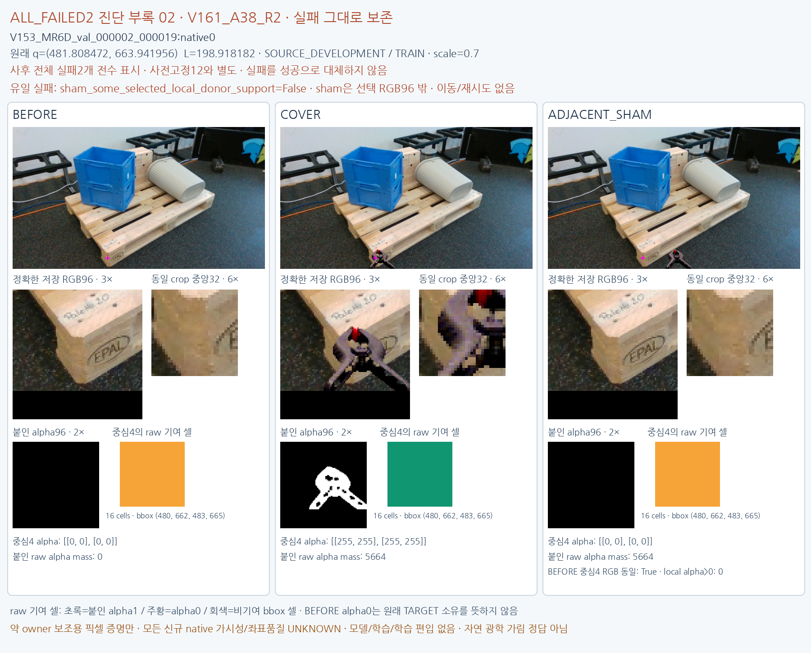

# ALL_FAILED2 diagnostic appendix

원문: [query_visibility_public_train_owner_counterfactual_20261024_v161/all_failed2_visual_appendix_v1/index.html](../../archive/task-2/pallet-keypoint-visibility/query_visibility_public_train_owner_counterfactual_20261024_v161/all_failed2_visual_appendix_v1/index.html)

원 HTML SHA256: `d1a1fbf0bbcdfb11a3969d54e65c911dfc82b8a49fd4fad0a2f3a0da7a94c059`

원 img ordinal 1–2 / 2. 원 순서 유지; 이미지 pixel decode/모델/평가 재실행 없음.

## 원 이미지 1

원문 직전 heading

```text
ALL_FAILED2 · 사후 전수 실패 진단 부록
```

원 alt

```text
all retained failure diagnostic
```



## 원 이미지 2

원문 직전 heading

```text
ALL_FAILED2 · 사후 전수 실패 진단 부록
```

원 alt

```text
all retained failure diagnostic
```


