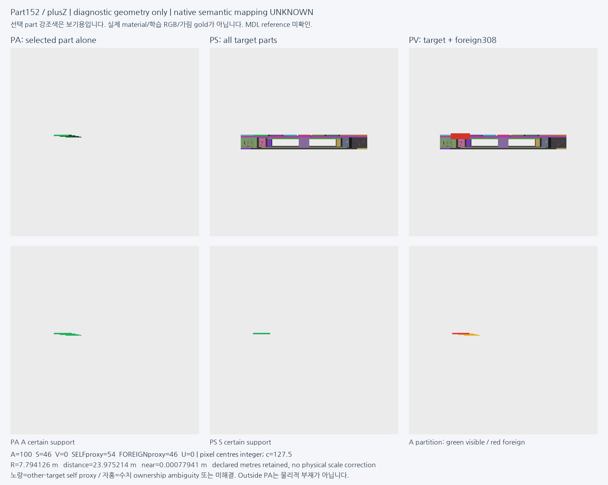
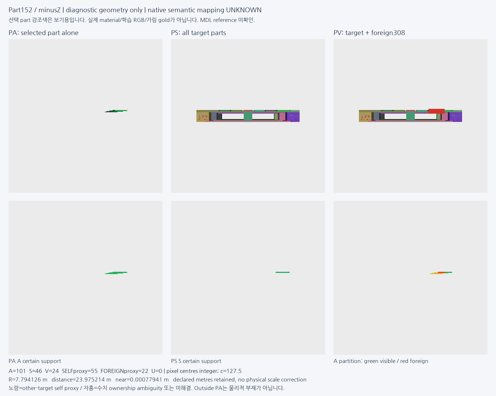
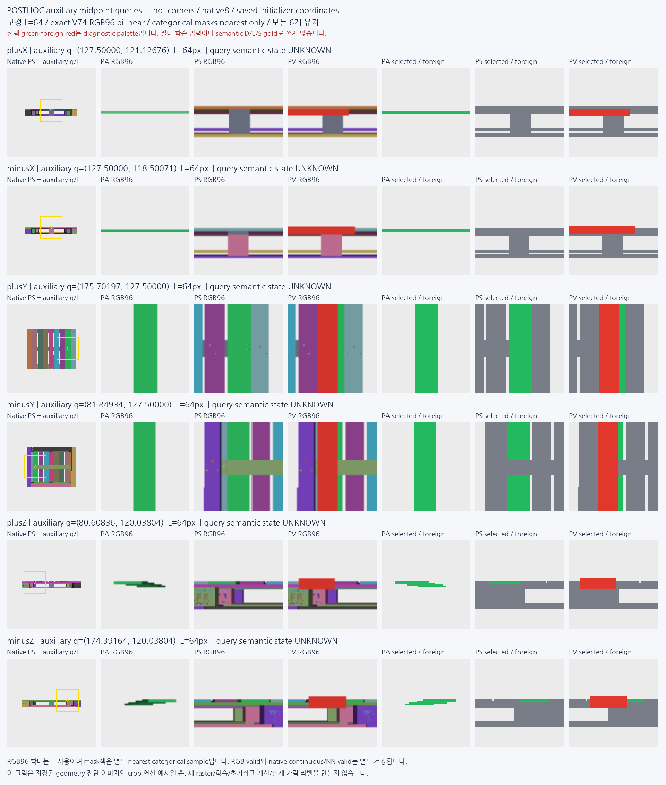

# V93 — 기대 부품 가림의 합성 감독 진단

원문: [query_visibility_synthetic_part_teacher_20261023_v93/ROOT_READOUT_KO.html](../../archive/task-2/pallet-keypoint-visibility/query_visibility_synthetic_part_teacher_20261023_v93/ROOT_READOUT_KO.html)

원 HTML SHA256: `d64af3011b25e69ef65fcda7aa436d40c10e22298b22161fec2abb1c0b70ff6f`

원 img ordinal 1–7 / 7. 원 순서 유지; 이미지 pixel decode/모델/평가 재실행 없음.

## 원 이미지 1

원문 직전 heading

```text
고정한 여섯 시점의 실제 렌더
```

원 alt

```text
plusX 고정 렌더와 owner 마스크
```


## 원 이미지 2

원문 직전 heading

```text
고정한 여섯 시점의 실제 렌더
```

원 alt

```text
minusX 고정 렌더와 owner 마스크
```


## 원 이미지 3

원문 직전 heading

```text
고정한 여섯 시점의 실제 렌더
```

원 alt

```text
plusY 고정 렌더와 owner 마스크
```


## 원 이미지 4

원문 직전 heading

```text
고정한 여섯 시점의 실제 렌더
```

원 alt

```text
minusY 고정 렌더와 owner 마스크
```


## 원 이미지 5

원문 직전 heading

```text
고정한 여섯 시점의 실제 렌더
```

원 alt

```text
plusZ 고정 렌더와 owner 마스크
```



## 원 이미지 6

원문 직전 heading

```text
고정한 여섯 시점의 실제 렌더
```

원 alt

```text
minusZ 고정 렌더와 owner 마스크
```



## 원 이미지 7

원문 직전 heading

```text
같은 위치·같은 크기의 crop
```

원 alt

```text
여섯 시점 auxiliary query 동일 위치 crop
```


