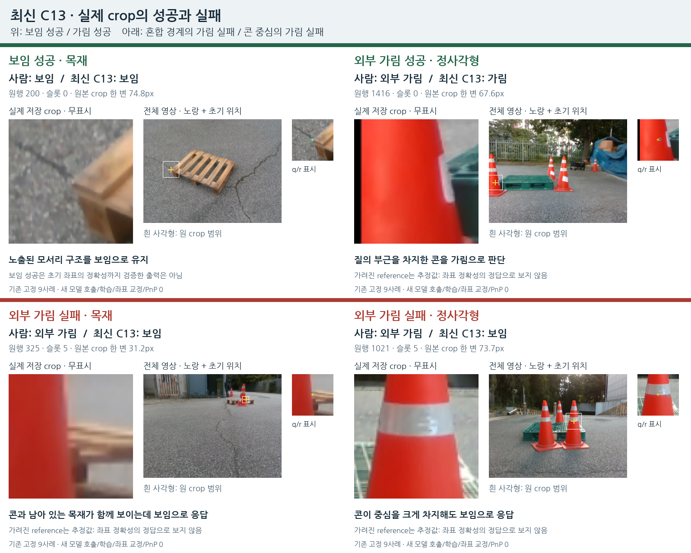
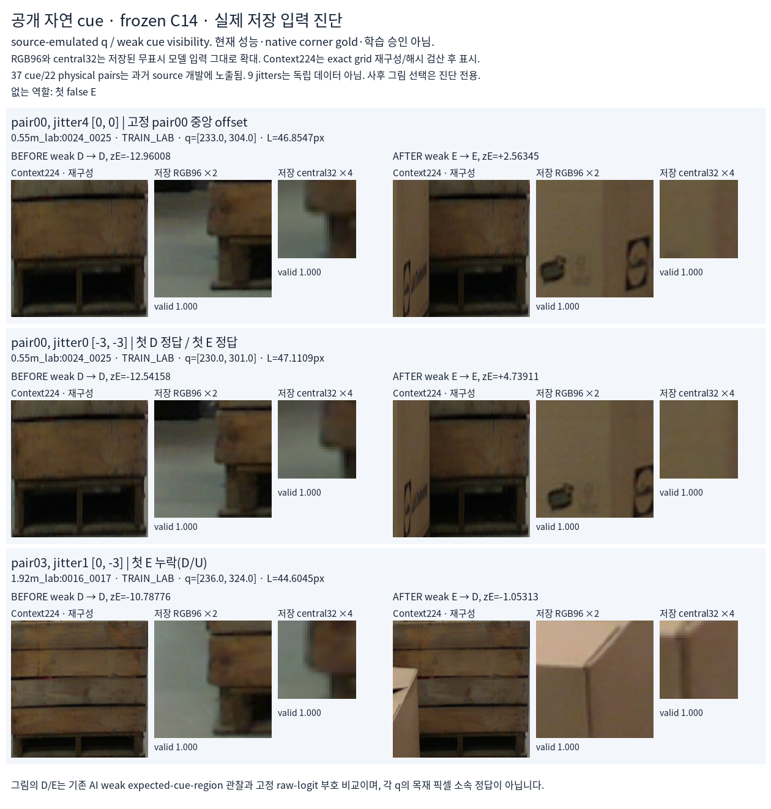
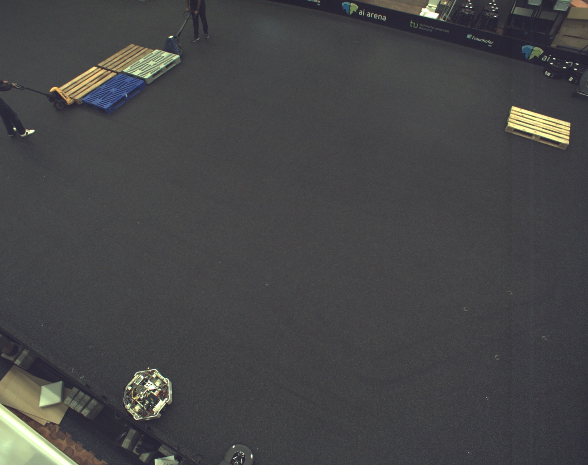

# 가림 판단의 성공·실패 — 현재 crop와 공개 실사의 차이

원문: [query_visibility_natural_cue_query_baseline_20261023_v121/ROOT_READOUT_KO.html](../../archive/task-2/pallet-keypoint-visibility/query_visibility_natural_cue_query_baseline_20261023_v121/ROOT_READOUT_KO.html)

원 HTML SHA256: `f373f78d7cb4cc6de22ca15feb353c8ef771f608be19cfdcbe093bf28be6a754`

원 img ordinal 1–3 / 3. 원 순서 유지; 이미지 pixel decode/모델/평가 재실행 없음.

## 원 이미지 1

원문 직전 heading

```text
1. 현재 영상에서 잘되는 것과 안 되는 것
```

원 alt

```text
실제 평가 영상의 성공2와 실패2. 최신 C14도 같은 네 판단.
```



## 원 이미지 2

원문 직전 heading

```text
2. 같은 모델이 공개 실사의 실제 상자 가림은 구별하는가
```

원 alt

```text
공개 자연 단서의 실제 저장 모델 입력. 고정pair00 성공과pair03 가림 누락.
```



## 원 이미지 3

원문 직전 heading

```text
4. 다음에 바꿀 부분
```

원 alt

```text
공개 TOMIE 원영상의 파란색 및 밝은색 flat pallets. 새 가림 라벨 아님.
```


