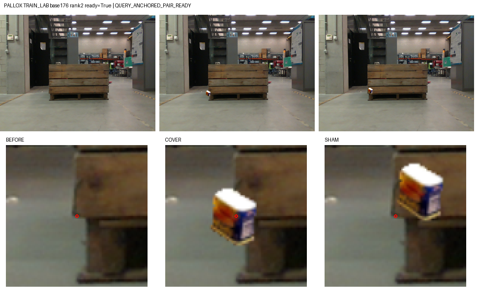
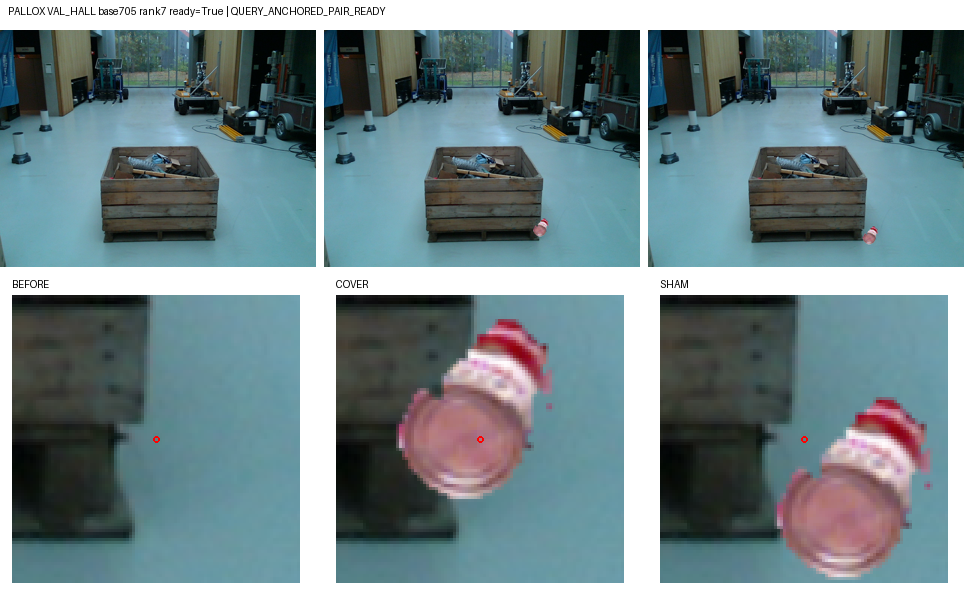
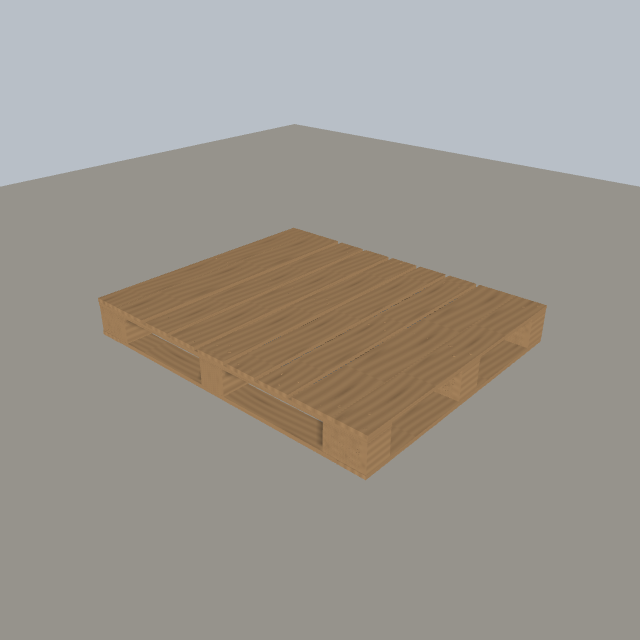

# V96 query 단서 연결 소스 실험

원문: [query_visibility_query_anchored_cue_20261023_v96/ROOT_READOUT_KO.html](../../archive/task-2/pallet-keypoint-visibility/query_visibility_query_anchored_cue_20261023_v96/ROOT_READOUT_KO.html)

원 HTML SHA256: `3842498849cecbb4e4687b849b7329b52230910fe2169ce4134dc09728c12608`

원 img ordinal 1–5 / 5. 원 순서 유지; 이미지 pixel decode/모델/평가 재실행 없음.

## 원 이미지 1

원문 직전 heading

```text
마지막 상태의 실제 저장 crop 실패 4개
```

원 alt

```text
고정 마지막2000의 실제 모델 입력 실패 비교
```


## 원 이미지 2

원문 직전 heading

```text
마지막 상태의 실제 저장 crop 실패 4개
```

원 alt

```text
고정 마지막2000의 실제 모델 입력 실패 비교
```


## 원 이미지 3

원문 직전 heading

```text
실제 고정 crop 미리보기
```

원 alt

```text
원본 가림 대조 고정사례4
```

원 HTML caption

```text
TRAIN 고정 사례 · base 176, donor rank 2 · 원래 q/L 유지. 표시는 보기 전용입니다.
```



## 원 이미지 4

원문 직전 heading

```text
실제 고정 crop 미리보기
```

원 alt

```text
원본 가림 대조 고정사례6
```

원 HTML caption

```text
VAL 고정 사례 · base 705, donor rank 7 · 원래 q/L 유지. 표시는 보기 전용입니다.
```



## 원 이미지 5

원문 직전 heading

```text
별도 절차적 목재 렌더: 이번 학습에서 제외
```

원 alt

```text
소스 학습에서 제외한 실제 procedural wood mesh 렌더
```


