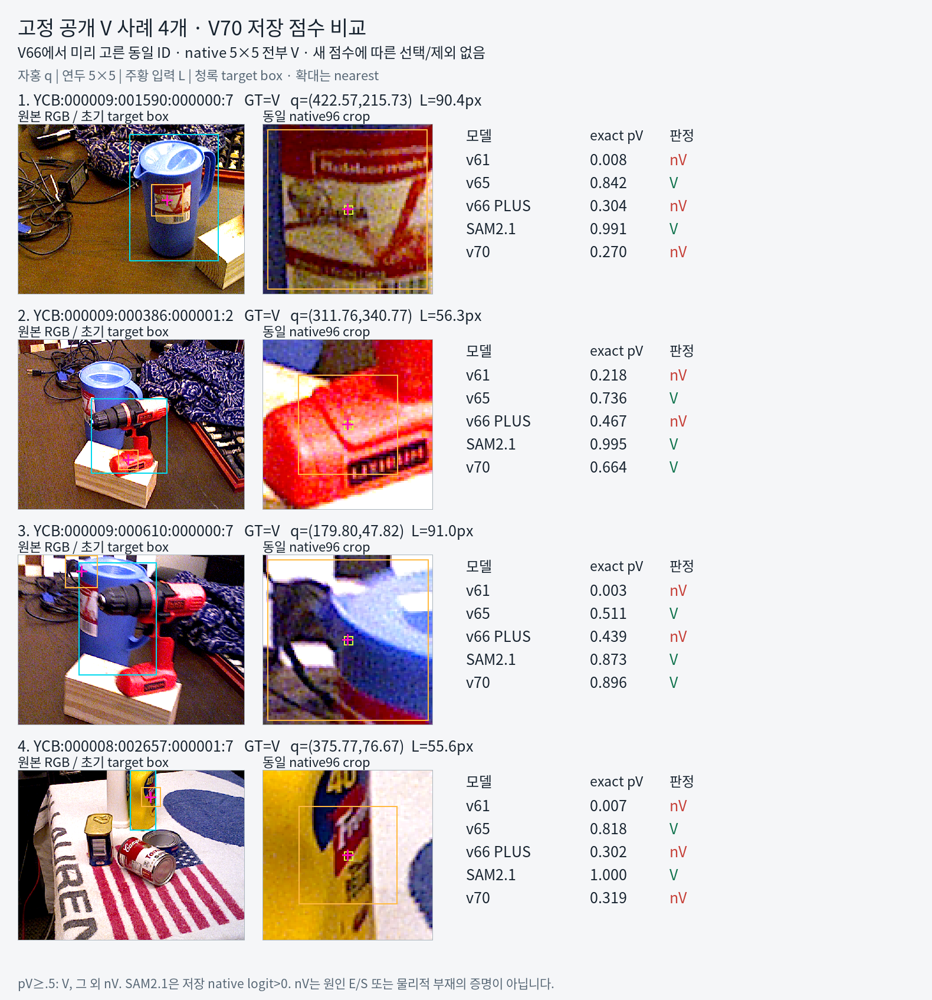
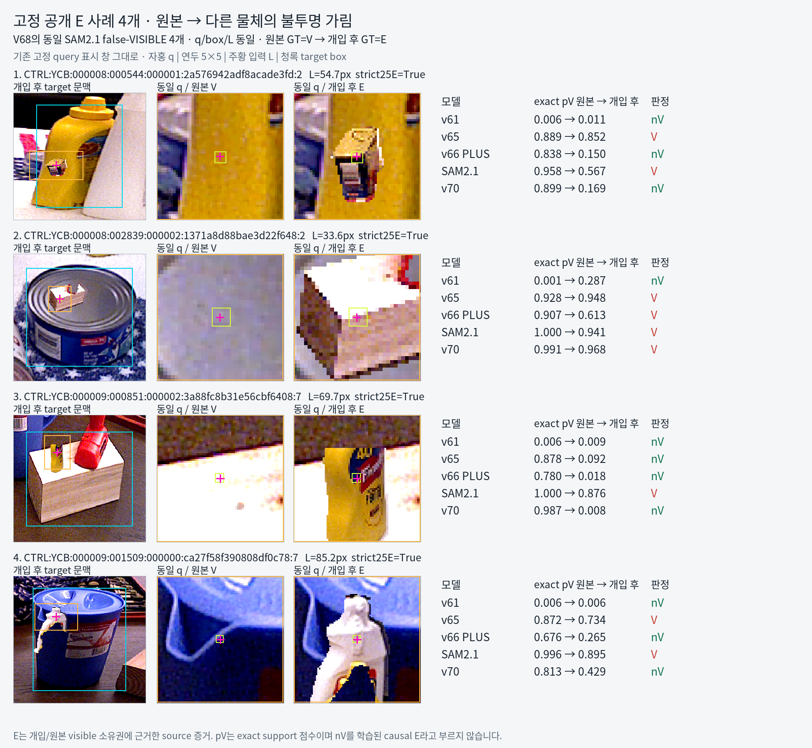
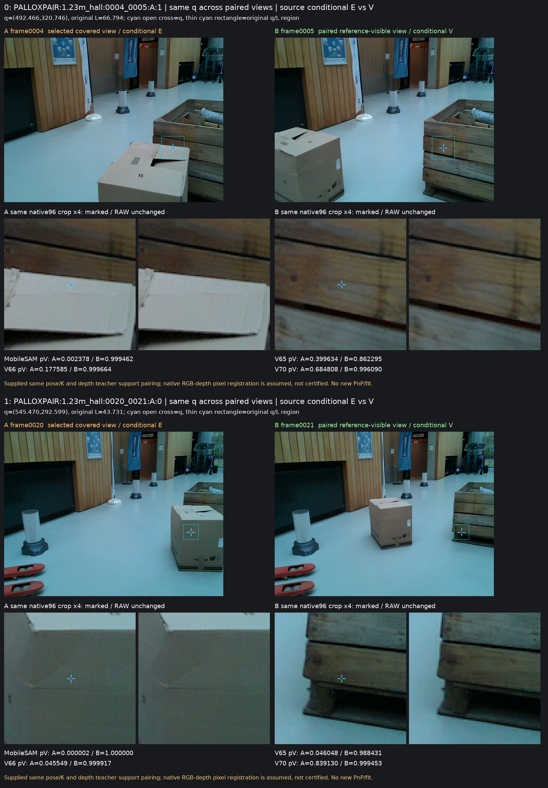

# v70 — 대상 소유권 head와 실제 가림 진단

원문: [query_visibility_target_ownership_20261023_v70/RESULTS_KO.html](../../archive/task-2/pallet-keypoint-visibility/query_visibility_target_ownership_20261023_v70/RESULTS_KO.html.parts.json)

원 HTML SHA256: `a180e9b634fae082e25fbbfd6d6cc32d48d50dc37789f79245874d4b7f7accb3`

원 img ordinal 1–3 / 3. 원 순서 유지; 이미지 pixel decode/모델/평가 재실행 없음.

## 원 이미지 1

원문 직전 heading

```text
3. 실제 crop: 좋아진 사례와 남은 실패
```

원 alt

```text
고정 V 4개: V70은 2개 보임, 2개 안 보임. 이 소집합은 전체 recall 추정용이 아니다.
```

원 HTML caption

```text
고정 V 4개: V70은 2개 보임, 2개 안 보임. 이 소집합은 전체 recall 추정용이 아니다.
```



## 원 이미지 2

원문 직전 heading

```text
3. 실제 crop: 좋아진 사례와 남은 실패
```

원 alt

```text
고정 E 4개: V70은 3개 안 보임, 1개 보임. 캔 뚜껑 위 cardboard는 여전히 pV 0.968이다.
```

원 HTML caption

```text
고정 E 4개: V70은 3개 안 보임, 1개 보임. 캔 뚜껑 위 cardboard는 여전히 pV 0.968이다.
```



## 원 이미지 3

원문 직전 heading

```text
공개 목재에서도 실제 가림을 보임으로 보는가
```

원 alt

```text
동일 query의 실제 공개 목재 RGB 쌍. 왼쪽은 앞 cardboard, 오른쪽은 대상 목재. 원본 crop과 표시 crop을 함께 보존했다.
```

원 HTML caption

```text
동일 query의 실제 공개 목재 RGB 쌍. 왼쪽은 앞 cardboard, 오른쪽은 대상 목재. 원본 crop과 표시 crop을 함께 보존했다.
```



원문 HTML이 큰 경우 링크는 원 SHA를 보존하는 무손실 gzip descriptor를 가리킵니다.
