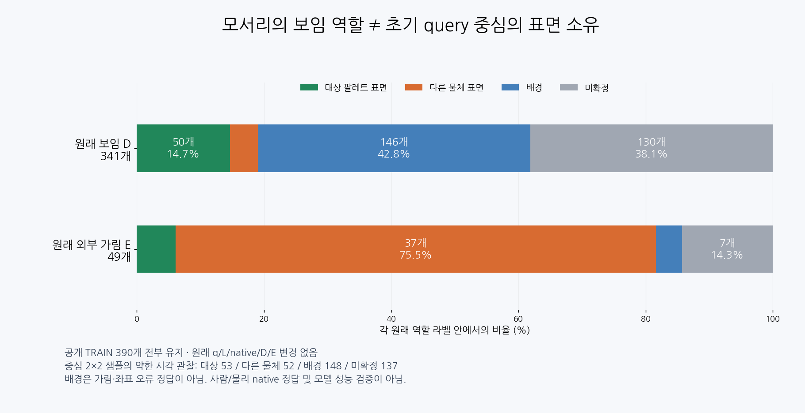
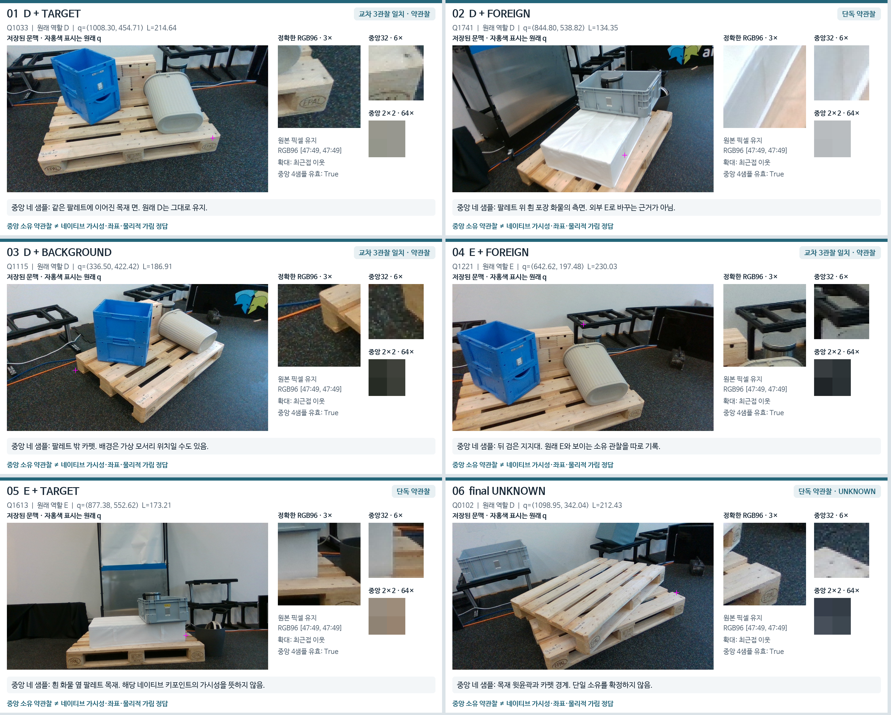

# 공개 TRAIN crop 중심 감사 · V158

원문: [query_visibility_train_query_owner_witness_20261024_v158/ROOT_READOUT_KO.html](../../archive/task-2/pallet-keypoint-visibility/query_visibility_train_query_owner_witness_20261024_v158/ROOT_READOUT_KO.html)

원 HTML SHA256: `06293a27f25d9957c932f640473973a9a4fd2c9cb290327072d704ba98d0f9be`

원 img ordinal 1–2 / 2. 원 순서 유지; 이미지 pixel decode/모델/평가 재실행 없음.

## 원 이미지 1

원문 직전 heading

```text
원래 역할 라벨과 실제 중심 관찰
```

원 alt

```text
D341 E49 안의 중심 소유 관찰 분포
```



## 원 이미지 2

원문 직전 heading

```text
실제 crop에서 확인할 차이
```

원 alt

```text
공개자료의 실제 crop 6개
```


