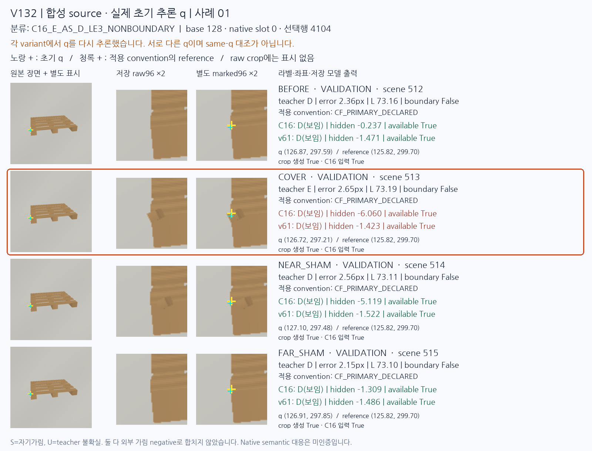
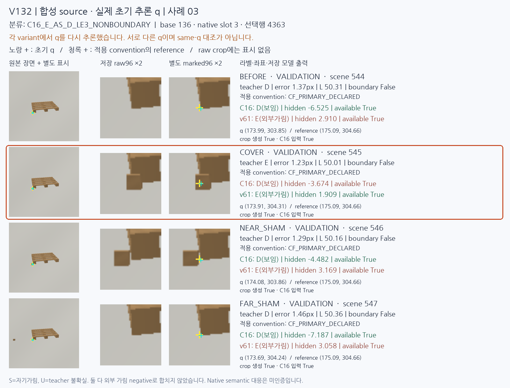
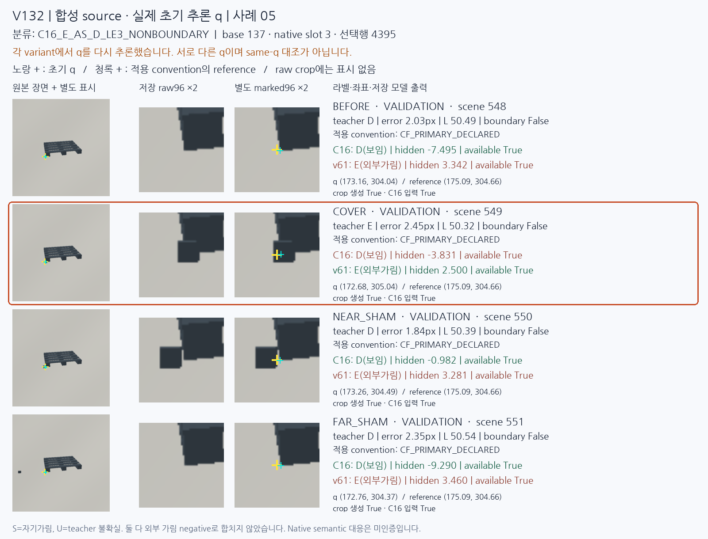
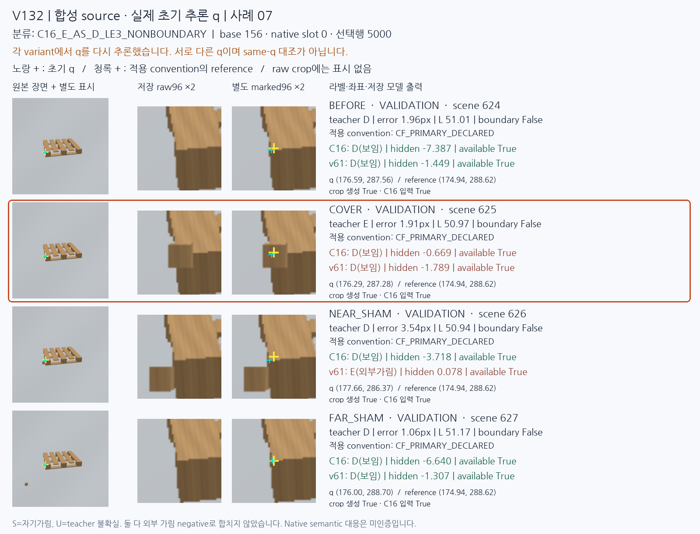

# V132 실제 초기 좌표에서 실패 재현

원문: [query_visibility_actual_initializer_source_20261024_v132/ROOT_READOUT_KO.html](../../archive/task-2/pallet-keypoint-visibility/query_visibility_actual_initializer_source_20261024_v132/ROOT_READOUT_KO.html)

원 HTML SHA256: `d871cccf6ed0980e2aa186cabbde676e643807b1aef007c0054535e20d5e532b`

원 img ordinal 1–4 / 4. 원 순서 유지; 이미지 pixel decode/모델/평가 재실행 없음.

## 원 이미지 1

원문 직전 heading

```text
실제 초기 좌표에서도 외부 가림 누락을 재현했다
```

원 alt

```text
합성 base 128: 저장 raw crop과 네 변형의 출력
```



## 원 이미지 2

원문 직전 heading

```text
실제 초기 좌표에서도 외부 가림 누락을 재현했다
```

원 alt

```text
합성 base 136: 저장 raw crop과 네 변형의 출력
```



## 원 이미지 3

원문 직전 heading

```text
실제 초기 좌표에서도 외부 가림 누락을 재현했다
```

원 alt

```text
합성 base 137: 저장 raw crop과 네 변형의 출력
```



## 원 이미지 4

원문 직전 heading

```text
실제 초기 좌표에서도 외부 가림 누락을 재현했다
```

원 alt

```text
합성 base 156: 저장 raw crop과 네 변형의 출력
```


