# V186 source registration probe

원문: [query_visibility_public_source_registration_probe_20261024_v186/fixed_source_registration_probe_v1/index.html](../../archive/task-2/pallet-keypoint-visibility/query_visibility_public_source_registration_probe_20261024_v186/fixed_source_registration_probe_v1/index.html)

원 HTML SHA256: `955d6dd5952f08ded905a71dc921f1189c105e147cbff0341c0f55b09c8a87f3`

원 img ordinal 1–14 / 14. 원 순서 유지; 이미지 pixel decode/모델/평가 재실행 없음.

## 원 이미지 1

원문 직전 heading

```text
val/000000:0
```

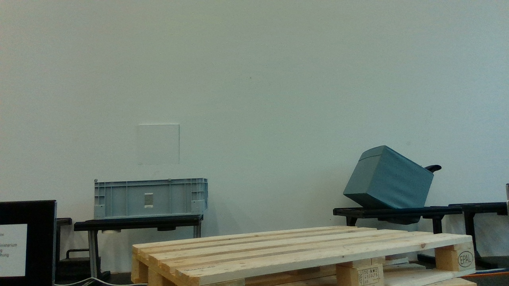

## 원 이미지 2

원문 직전 heading

```text
val/000002:0
```


## 원 이미지 3

원문 직전 heading

```text
val/000005:0
```

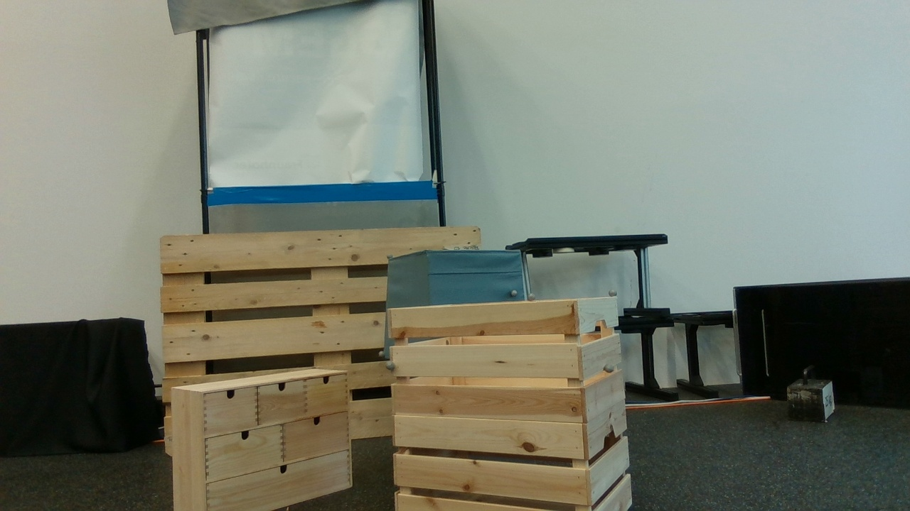

## 원 이미지 4

원문 직전 heading

```text
val/000006:0
```

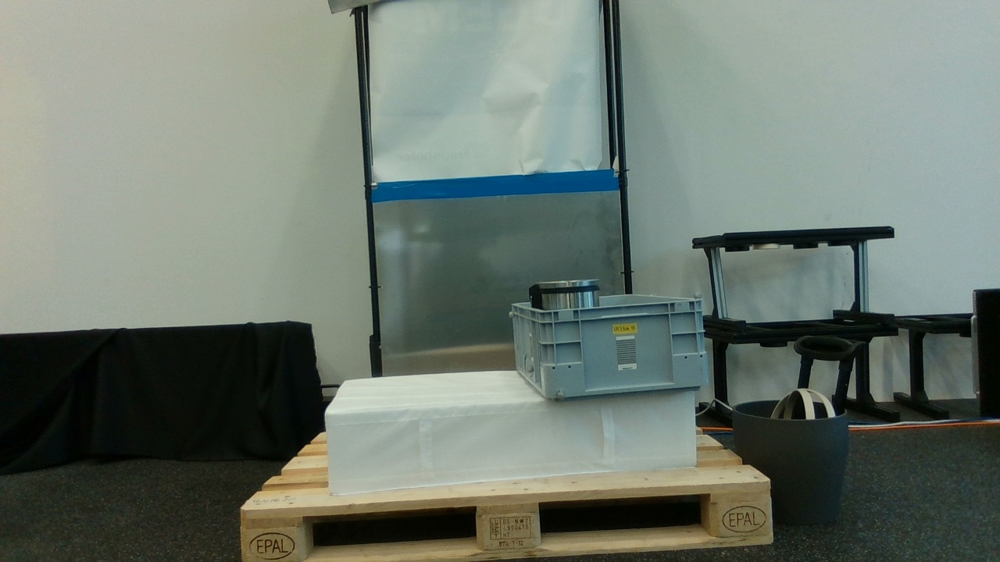

## 원 이미지 5

원문 직전 heading

```text
frame0 GTinstance0
```

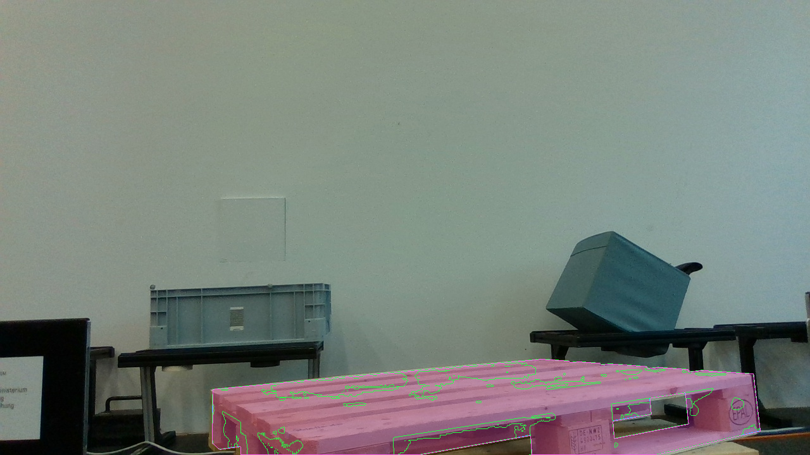

## 원 이미지 6

원문 직전 heading

```text
frame0 GTinstance0
```

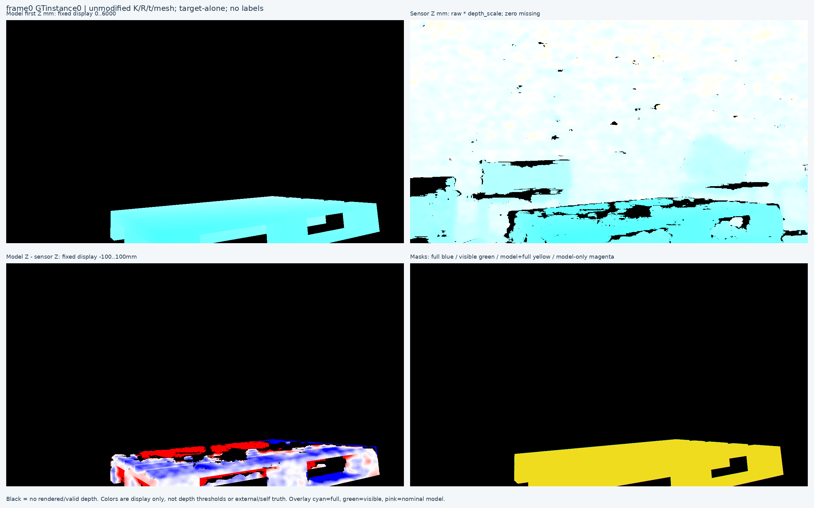

## 원 이미지 7

원문 직전 heading

```text
frame0 GTinstance1
```

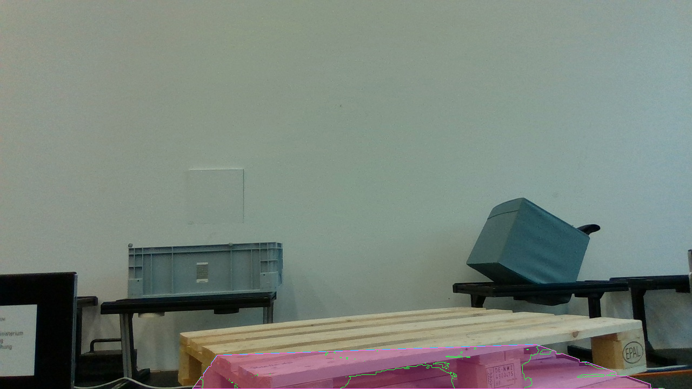

## 원 이미지 8

원문 직전 heading

```text
frame0 GTinstance1
```

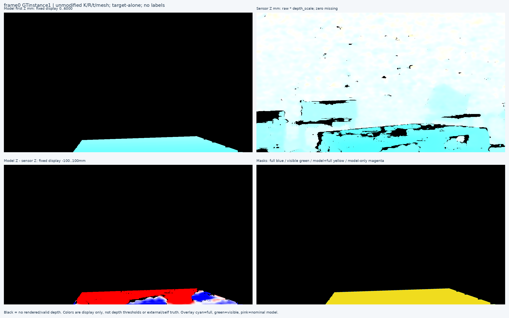

## 원 이미지 9

원문 직전 heading

```text
frame118 GTinstance0
```

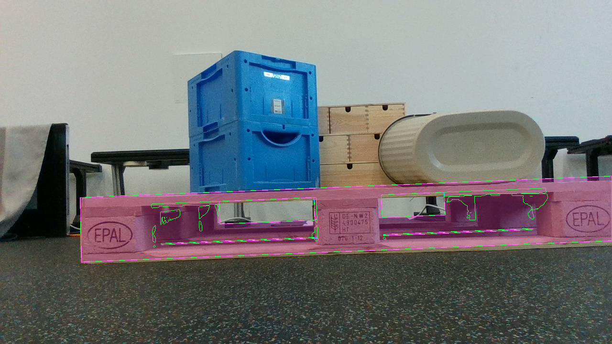

## 원 이미지 10

원문 직전 heading

```text
frame118 GTinstance0
```

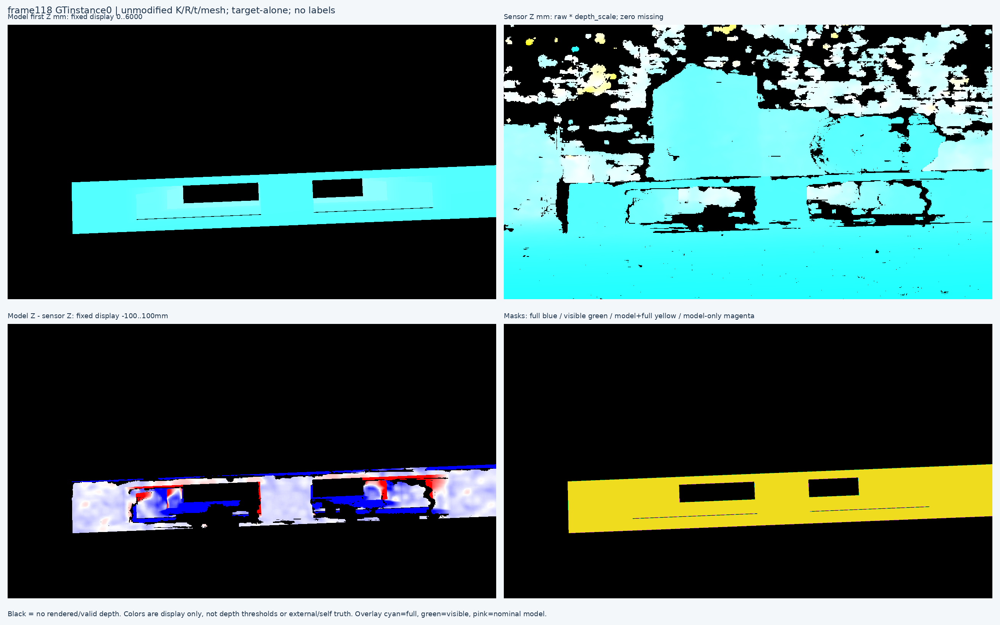

## 원 이미지 11

원문 직전 heading

```text
frame166 GTinstance3
```

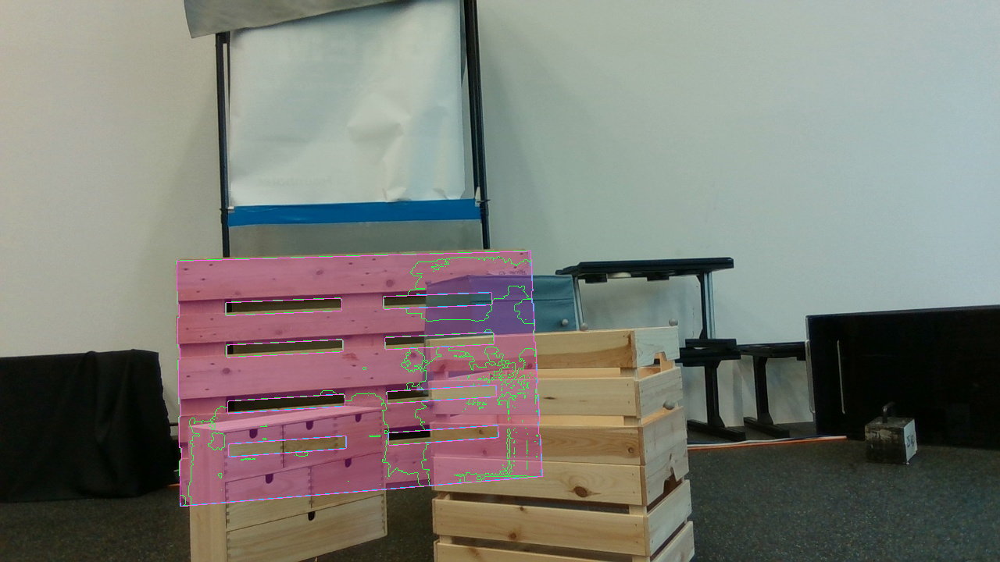

## 원 이미지 12

원문 직전 heading

```text
frame166 GTinstance3
```

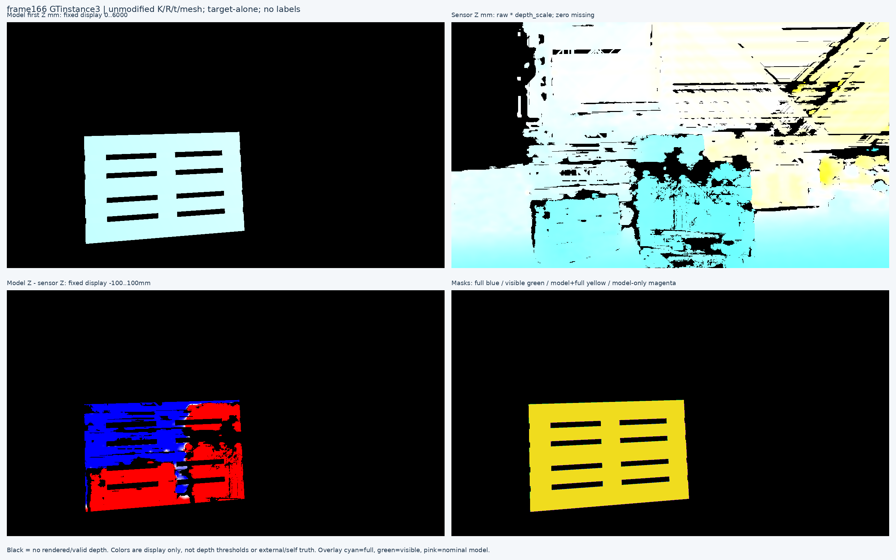

## 원 이미지 13

원문 직전 heading

```text
frame199 GTinstance0
```

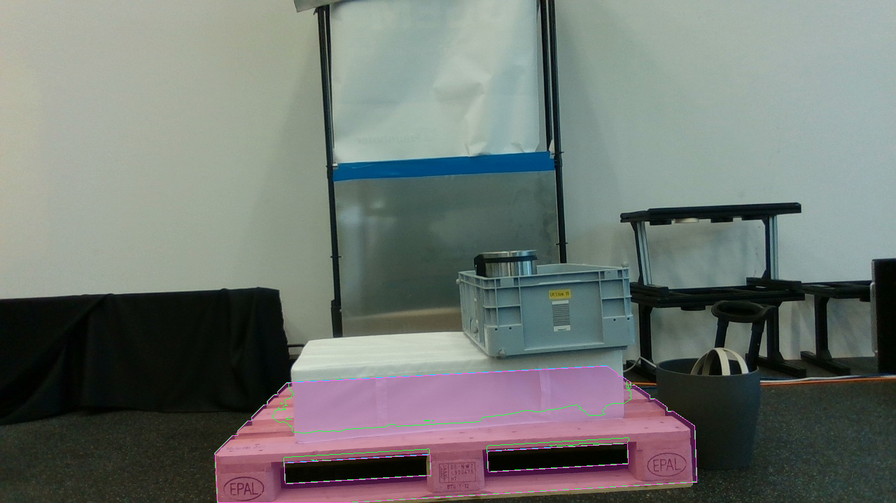

## 원 이미지 14

원문 직전 heading

```text
frame199 GTinstance0
```

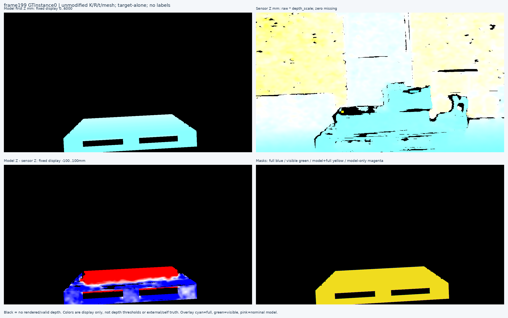
