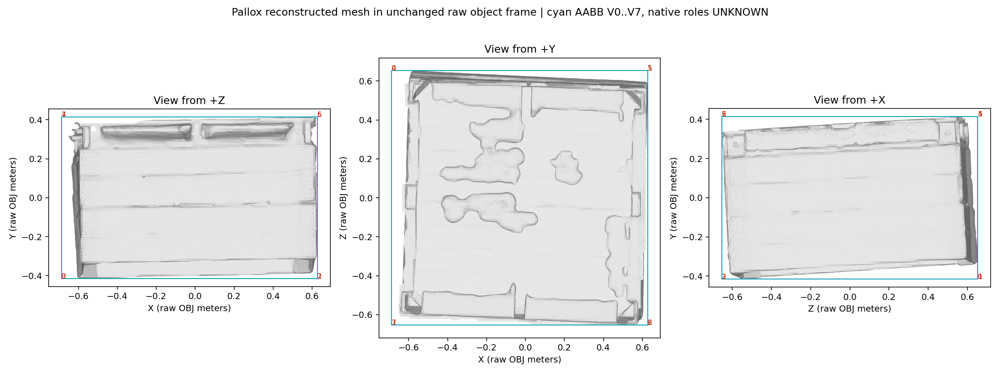
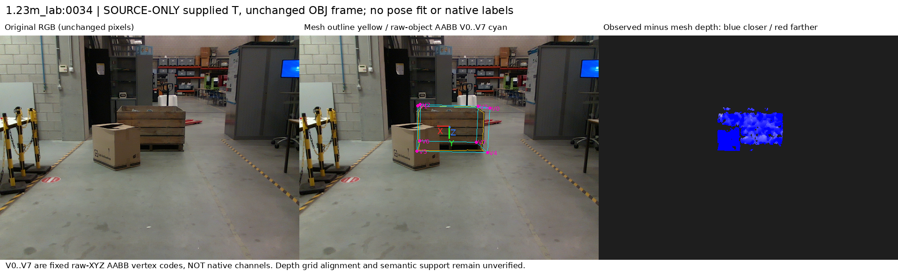
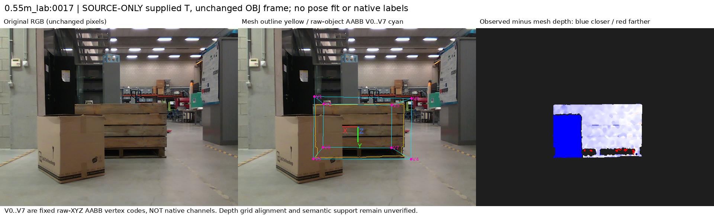
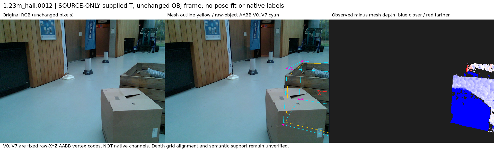
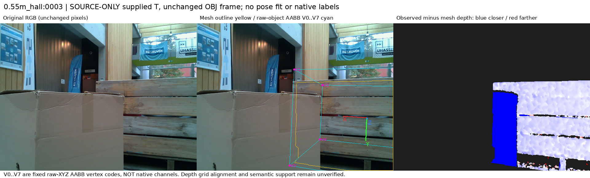

# Pallox fixed source reference feasibility

원문: [query_visibility_public_native_reference_feasibility_20261024_v140/pallox_reference_diagnostics_v1/INDEX.html](../../archive/task-2/pallet-keypoint-visibility/query_visibility_public_native_reference_feasibility_20261024_v140/pallox_reference_diagnostics_v1/INDEX.html)

원 HTML SHA256: `30894ccbaa503327335f103c7287e454c85ac717f9914a36009622b178183930`

원 img ordinal 1–5 / 5. 원 순서 유지; 이미지 pixel decode/모델/평가 재실행 없음.

## 원 이미지 1

원문 직전 heading

```text
Pallox fixed source geometry
```



## 원 이미지 2

원문 직전 heading

```text
1.23m_lab:0034
```



## 원 이미지 3

원문 직전 heading

```text
0.55m_lab:0017
```



## 원 이미지 4

원문 직전 heading

```text
1.23m_hall:0012
```



## 원 이미지 5

원문 직전 heading

```text
0.55m_hall:0003
```


