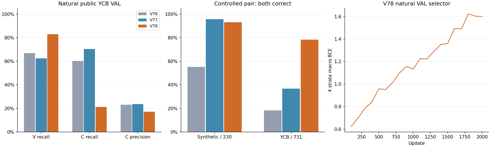
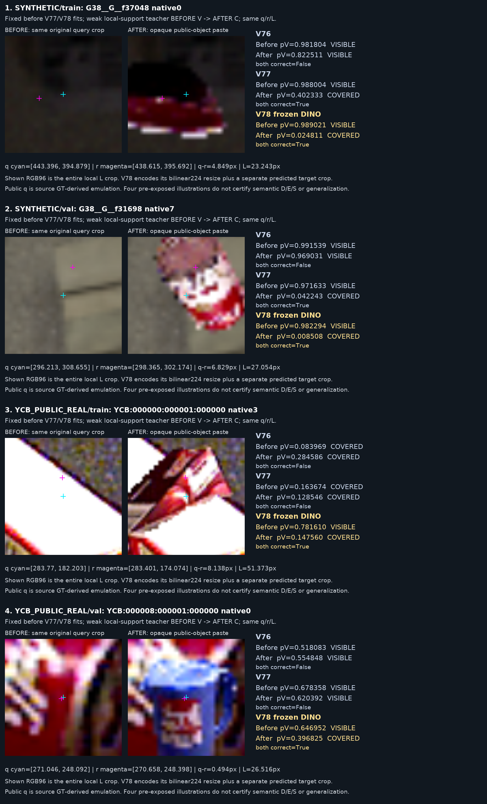

# V78 DINO source 비교

원문: [query_visibility_dino_query_support_20261023_v78/RESULTS_KO.html](../../archive/task-2/pallet-keypoint-visibility/query_visibility_dino_query_support_20261023_v78/RESULTS_KO.html)

원 HTML SHA256: `7c5cc8079fee9b69adb2a83fc12d034b18842b2f2198741a611edf3abc7e7e12`

원 img ordinal 1–2 / 2. 원 순서 유지; 이미지 pixel decode/모델/평가 재실행 없음.

## 원 이미지 1

원문 직전 heading

```text
가린 후 전체 known query VAL
```

원 alt

```text
V76 V77 V78 공개 source 검증 비교
```



## 원 이미지 2

원문 직전 heading

```text
미리 고정한 실제 crop 4쌍
```

원 alt

```text
고정 source RGB crop과 V76 V77 V78 저장 점수
```


