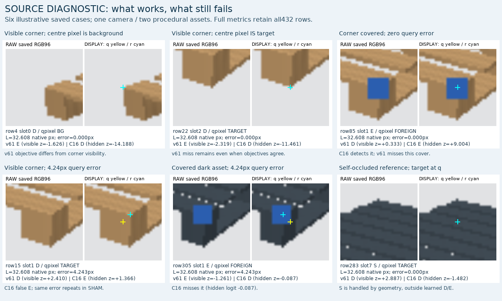

# V128 고정 합성 source 진단

원문: [query_visibility_registered_native_render_20261023_v128/ROOT_READOUT_KO.html](../../archive/task-2/pallet-keypoint-visibility/query_visibility_registered_native_render_20261023_v128/ROOT_READOUT_KO.html)

원 HTML SHA256: `d6c26a02faec69beda967611fe86b5ee70a778b5828977eba2e0a3cefbdf4f19`

원 img ordinal 1–5 / 5. 원 순서 유지; 이미지 pixel decode/모델/평가 재실행 없음.

## 원 이미지 1

원문 직전 heading

```text
고정 native1 D→E→D triplet 18개
```

원 HTML caption

```text
SEMANTIC_DE_CONFUSION
```


## 원 이미지 2

원문 직전 heading

```text
고정 native1 D→E→D triplet 18개
```

원 HTML caption

```text
ZERO_OFFSET_BEFORE_ALL16
```


## 원 이미지 3

원문 직전 heading

```text
고정 native1 D→E→D triplet 18개
```

원 HTML caption

```text
POLYMER_RIB_LEG_NATIVE1_ALL9_TRIPLETS
```


## 원 이미지 4

원문 직전 heading

```text
고정 native1 D→E→D triplet 18개
```

원 HTML caption

```text
WOOD_BOARD_BLOCK_NATIVE1_ALL9_TRIPLETS
```


## 원 이미지 5

원문 직전 heading

```text
실제 crop에서 확인한 성공·실패
```


