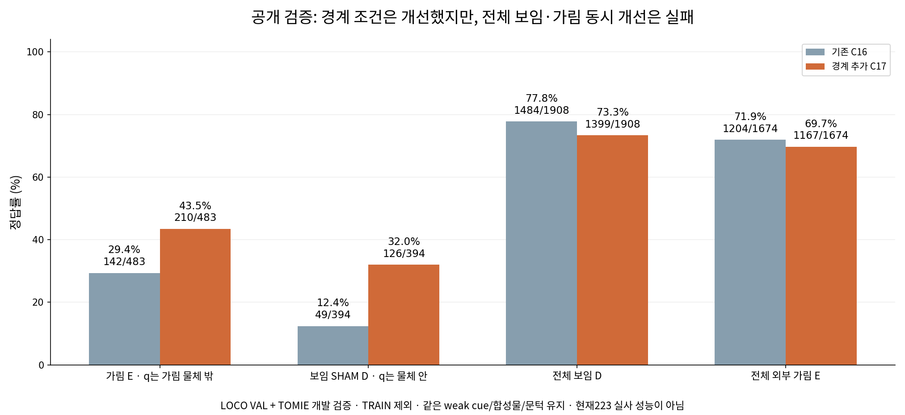
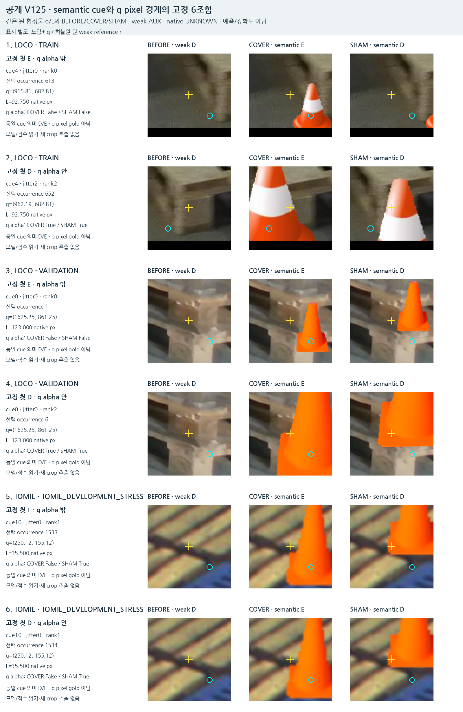
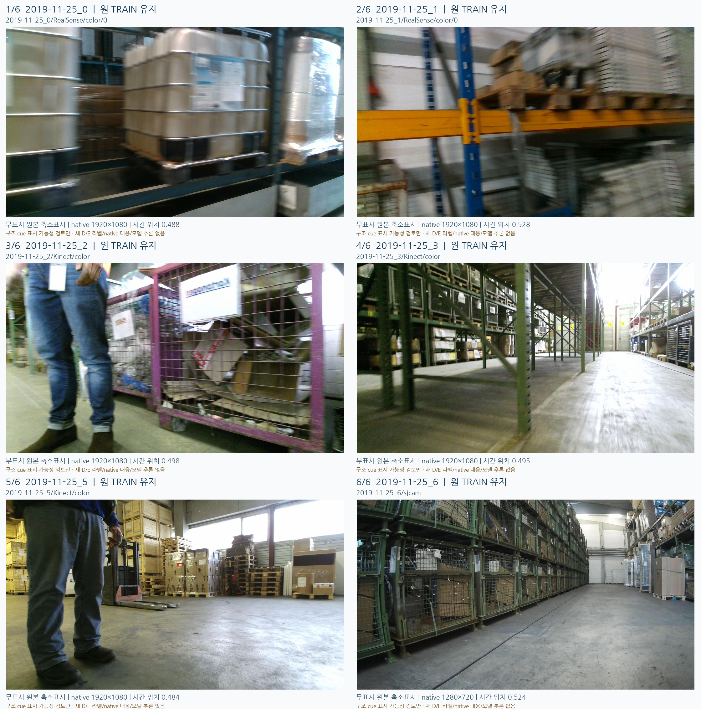

# C17 공개 경계 실험

원문: [query_visibility_boundary_query_source_20261023_v125/ROOT_READOUT_KO.html](../../archive/task-2/pallet-keypoint-visibility/query_visibility_boundary_query_source_20261023_v125/ROOT_READOUT_KO.html)

원 HTML SHA256: `a4dba816a1fec67e476bab99665b6ea4a0894dd77956dc3095dc8e0d9d549ba5`

원 img ordinal 1–3 / 3. 원 순서 유지; 이미지 pixel decode/모델/평가 재실행 없음.

## 원 이미지 1

원문 직전 heading

```text
공개 검증 결과 · TRAIN 제외
```

원 alt

```text
LOCO VAL + 한 TOMIE 개발 episode의 상관 파생 사례. 현재 실사 성능이 아니다.
```

원 HTML caption

```text
LOCO VAL + 한 TOMIE 개발 episode의 상관 파생 사례. 현재 실사 성능이 아니다.
```



## 원 이미지 2

원문 직전 heading

```text
어떤 반례를 추가했는가
```

원 alt

```text
고정6개 조건·5개서로다른triplet. 같은TOMIEtriplet이두조건에해당하므로중복을유지했다.
```

원 HTML caption

```text
고정6개 조건·5개서로다른triplet. 같은TOMIEtriplet이두조건에해당하므로중복을유지했다.
```



## 원 이미지 3

원문 직전 heading

```text
별도로 확인한 공개 원본 후보
```

원 alt

```text
LOCO 공식TRAIN의6take에서모델점수없이메타데이터로고른6장. 이번C17학습에는사용하지않았다.
```

원 HTML caption

```text
LOCO 공식TRAIN의6take에서모델점수없이메타데이터로고른6장. 이번C17학습에는사용하지않았다.
```


