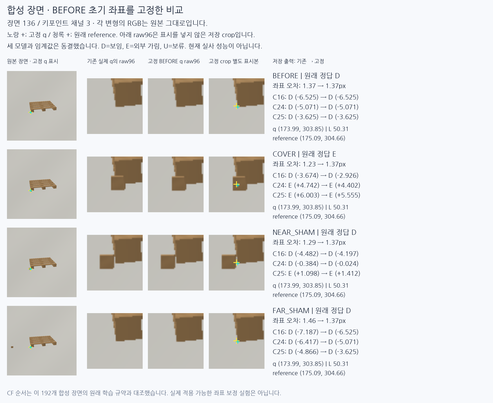
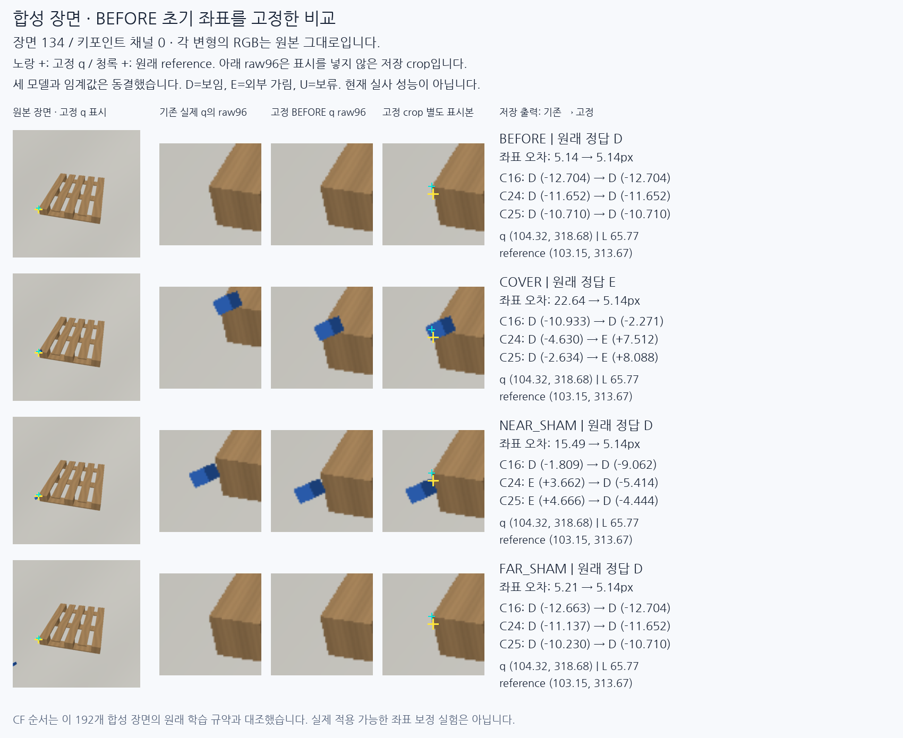

# 팔레트 가림 판단: 원인 분리와 짝 학습 대조

원문: [query_visibility_native_pair_supervision_control_20261024_v135/ROOT_READOUT_KO.html](../../archive/task-2/pallet-keypoint-visibility/query_visibility_native_pair_supervision_control_20261024_v135/ROOT_READOUT_KO.html)

원 HTML SHA256: `085b12eb075a32be73f76eb55069ff1fd43c322467ba3ff934e8d4947b7242b0`

원 img ordinal 1–2 / 2. 원 순서 유지; 이미지 pixel decode/모델/평가 재실행 없음.

## 원 이미지 1

원문 직전 heading

```text
보이는 모서리 옆의 물체를 가림으로 오인
```

원 alt

```text
같은 좌표를 고정한 목재 모서리의 가림과 근접 비가림 비교
```



## 원 이미지 2

원문 직전 heading

```text
초기 좌표 이동 때문에 판단이 달라진 사례
```

원 alt

```text
파란 물체와 좌표 이동의 영향을 분리한 비교
```


