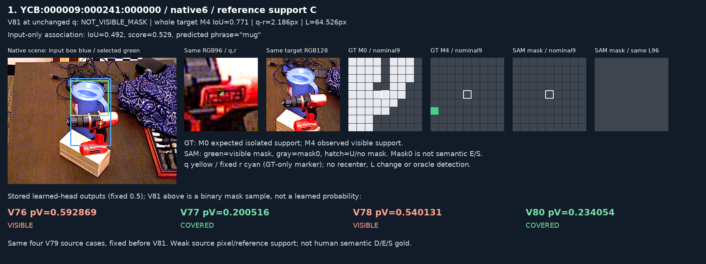
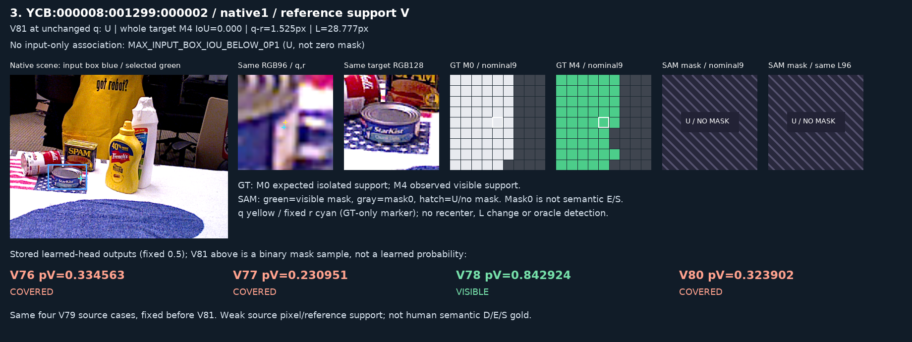
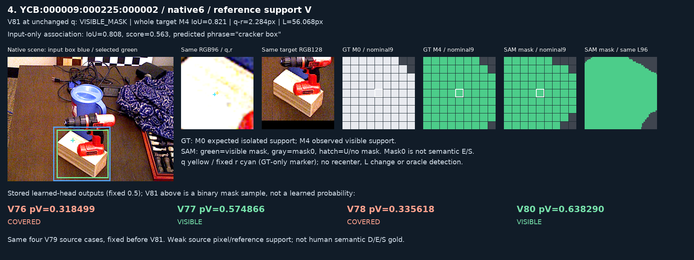

# V81 고정 텍스트·대상 mask source 평가

원문: [query_visibility_grounded_target_20261023_v81/RESULTS_KO.html](../../archive/task-2/pallet-keypoint-visibility/query_visibility_grounded_target_20261023_v81/RESULTS_KO.html)

원 HTML SHA256: `bf1bd3d062339f43eefe8d2ccc7c6fe50ee61b154de1ca13395e0341a03d10bb`

원 img ordinal 1–4 / 4. 원 순서 유지; 이미지 pixel decode/모델/평가 재실행 없음.

## 원 이미지 1

원문 직전 heading

```text
V79에 고정된 실제 네 사례
```

원 alt

```text
고정 source 사례 YCB:000009:000241:000000
```

원 HTML caption

```text
YCB:000009:000241:000000 / native 6: GT support C, V81 NOT_VISIBLE_MASK. 입력·사례 선택은 V81 결과로 바꾸지 않았습니다.
```



## 원 이미지 2

원문 직전 heading

```text
V79에 고정된 실제 네 사례
```

원 alt

```text
고정 source 사례 YCB:000008:001872:000004
```

원 HTML caption

```text
YCB:000008:001872:000004 / native 6: GT support C, V81 VISIBLE_MASK. 입력·사례 선택은 V81 결과로 바꾸지 않았습니다.
```


## 원 이미지 3

원문 직전 heading

```text
V79에 고정된 실제 네 사례
```

원 alt

```text
고정 source 사례 YCB:000008:001299:000002
```

원 HTML caption

```text
YCB:000008:001299:000002 / native 1: GT support V, V81 U. 입력·사례 선택은 V81 결과로 바꾸지 않았습니다.
```



## 원 이미지 4

원문 직전 heading

```text
V79에 고정된 실제 네 사례
```

원 alt

```text
고정 source 사례 YCB:000009:000225:000002
```

원 HTML caption

```text
YCB:000009:000225:000002 / native 6: GT support V, V81 VISIBLE_MASK. 입력·사례 선택은 V81 결과로 바꾸지 않았습니다.
```


