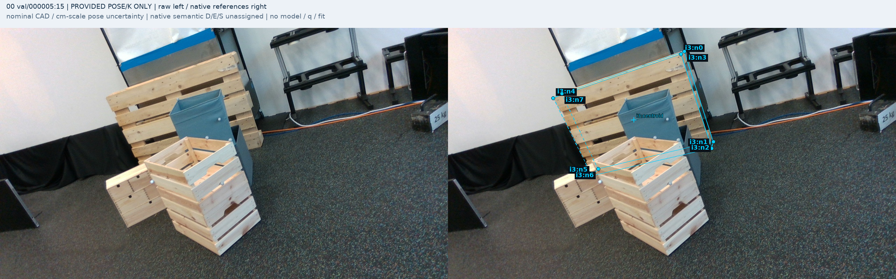
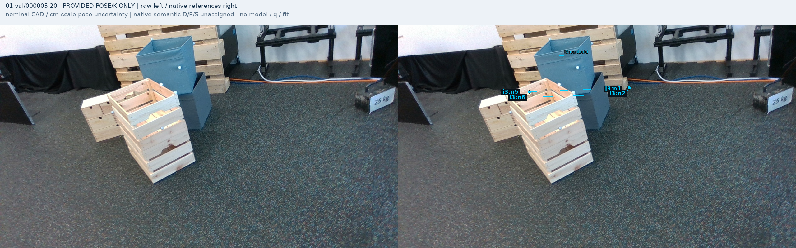
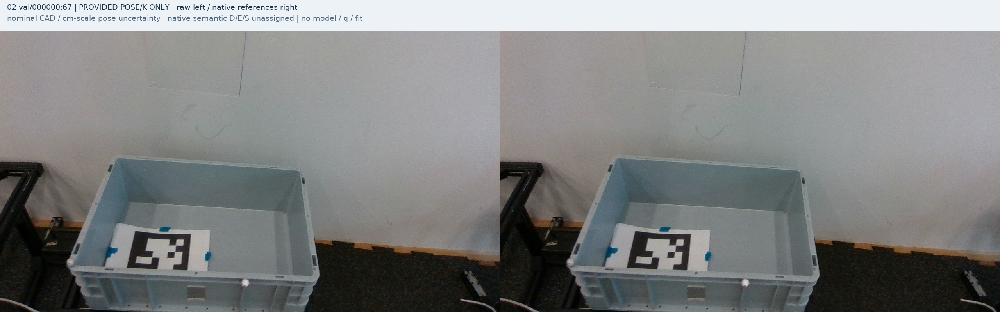
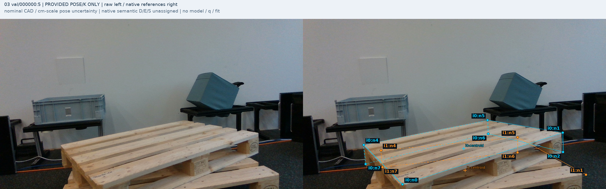
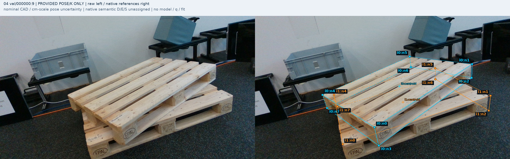
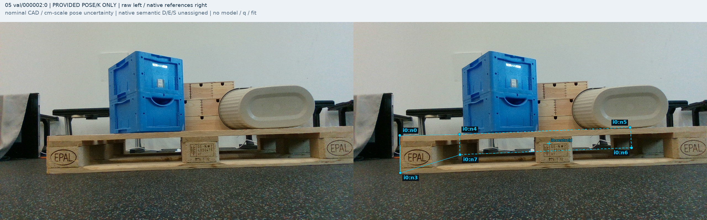
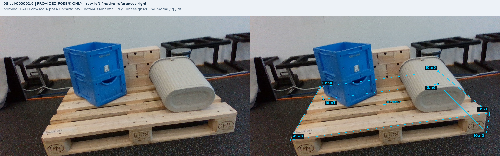
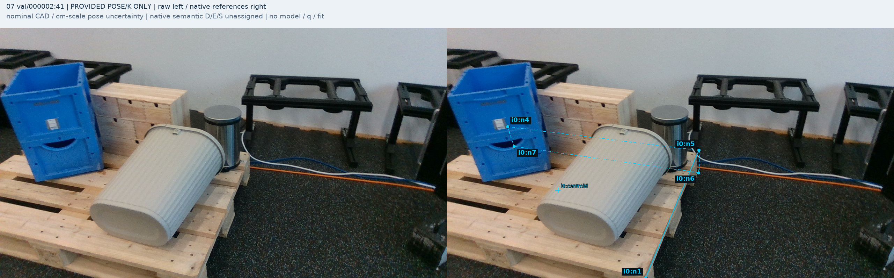
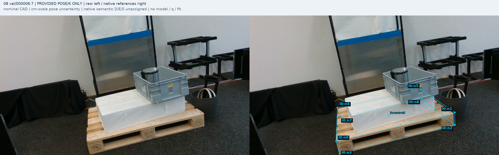
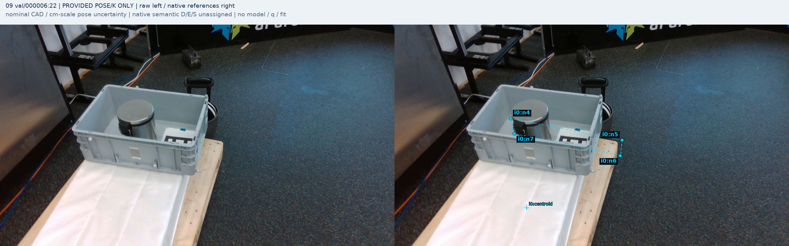

# MR6D 원 native 참조·source 역할 제안

원문: [query_visibility_mr6d_actual_query_bridge_20261024_v152/native_reference_audit/INDEX.html](../../archive/task-2/pallet-keypoint-visibility/query_visibility_mr6d_actual_query_bridge_20261024_v152/native_reference_audit/INDEX.html)

원 HTML SHA256: `0486d4326707668ae21a0a98dfeb5140ada6d0b71d5b48c374f4a80e3990fb8e`

원 img ordinal 1–10 / 10. 원 순서 유지; 이미지 pixel decode/모델/평가 재실행 없음.

## 원 이미지 1

원문 직전 heading

```text
00 val/000005:15
```

원 alt

```text
원 RGB와 모든 instance의 원 native 참조
```



## 원 이미지 2

원문 직전 heading

```text
01 val/000005:20
```

원 alt

```text
원 RGB와 모든 instance의 원 native 참조
```



## 원 이미지 3

원문 직전 heading

```text
02 val/000000:67
```

원 alt

```text
원 RGB와 모든 instance의 원 native 참조
```



## 원 이미지 4

원문 직전 heading

```text
03 val/000000:5
```

원 alt

```text
원 RGB와 모든 instance의 원 native 참조
```



## 원 이미지 5

원문 직전 heading

```text
04 val/000000:9
```

원 alt

```text
원 RGB와 모든 instance의 원 native 참조
```



## 원 이미지 6

원문 직전 heading

```text
05 val/000002:0
```

원 alt

```text
원 RGB와 모든 instance의 원 native 참조
```



## 원 이미지 7

원문 직전 heading

```text
06 val/000002:9
```

원 alt

```text
원 RGB와 모든 instance의 원 native 참조
```



## 원 이미지 8

원문 직전 heading

```text
07 val/000002:41
```

원 alt

```text
원 RGB와 모든 instance의 원 native 참조
```



## 원 이미지 9

원문 직전 heading

```text
08 val/000006:7
```

원 alt

```text
원 RGB와 모든 instance의 원 native 참조
```



## 원 이미지 10

원문 직전 heading

```text
09 val/000006:22
```

원 alt

```text
원 RGB와 모든 instance의 원 native 참조
```


