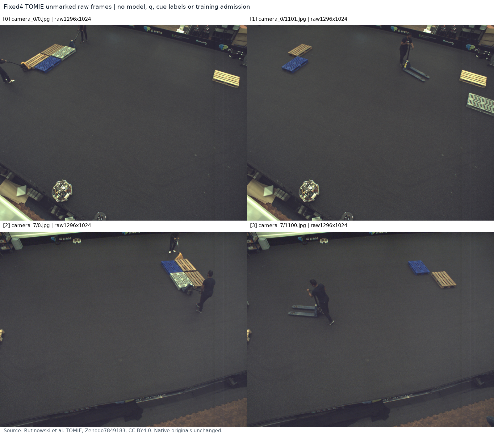
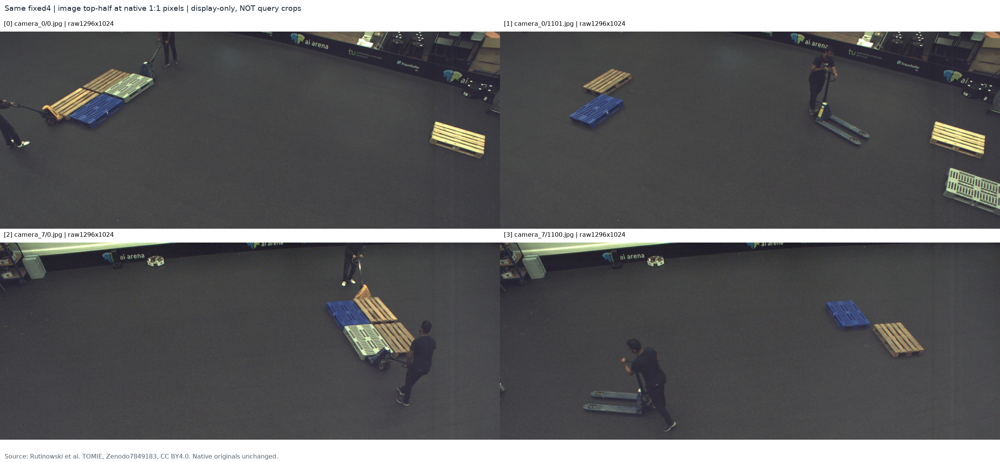

# TOMIE 실제 원본 RGB 소규모 확인

원문: [query_visibility_public_flat_pallet_pilot_20261023_v103/RAW_PILOT_READOUT_KO.html](../../archive/task-2/pallet-keypoint-visibility/query_visibility_public_flat_pallet_pilot_20261023_v103/RAW_PILOT_READOUT_KO.html)

원 HTML SHA256: `36f6c01470f8de85502f63bff6086e70452f1aceaf68fd4462314fa3ca4d84de`

원 img ordinal 1–2 / 2. 원 순서 유지; 이미지 pixel decode/모델/평가 재실행 없음.

## 원 이미지 1

원문 직전 heading

```text
실제 원본 4장
```

원 alt

```text
고정4 원본 전체 보기
```



## 원 이미지 2

원문 직전 heading

```text
실제 원본 4장
```

원 alt

```text
고정4 상단절반 native 상세
```


