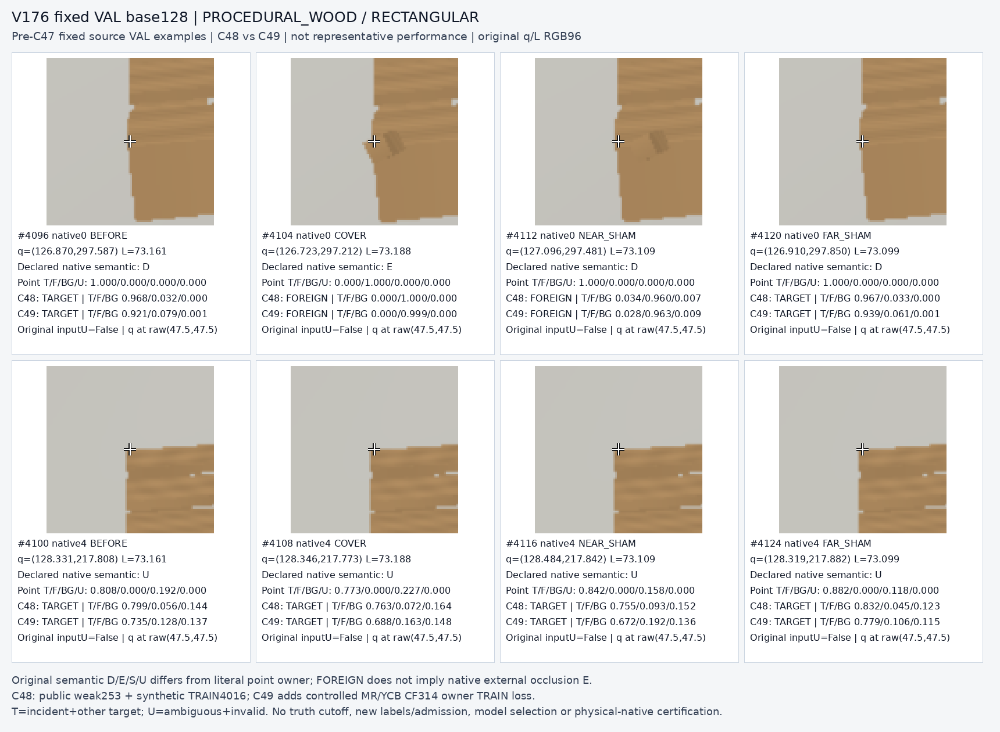
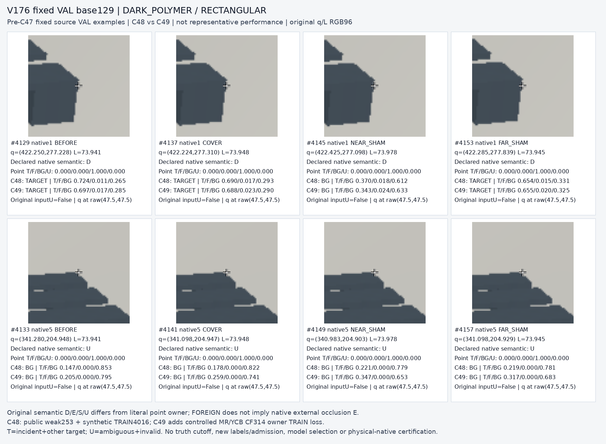
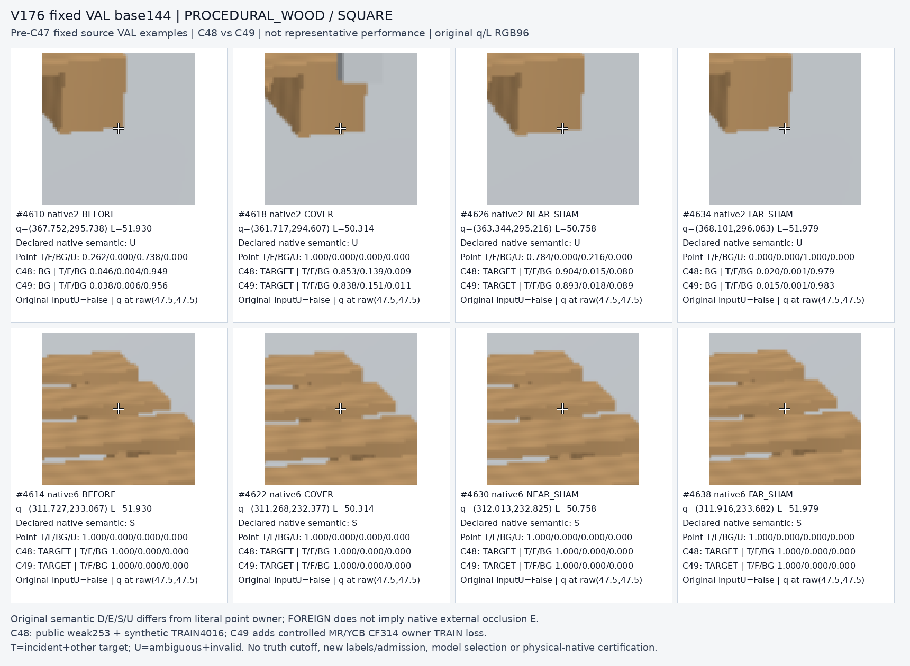
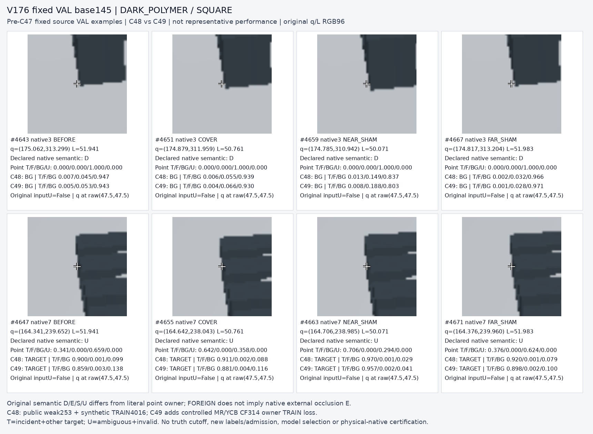

# V176 C48 vs C49 fixed32

원문: [query_visibility_direct_owner_public_ycb_control_20261024_v176/fixed32_source_crop_review_v1/index.html](../../archive/task-2/pallet-keypoint-visibility/query_visibility_direct_owner_public_ycb_control_20261024_v176/fixed32_source_crop_review_v1/index.html)

원 HTML SHA256: `b128532332a461d82f30a8c8bb57481630c7d01d490cc47a28337c2143b65bfe`

원 img ordinal 1–4 / 4. 원 순서 유지; 이미지 pixel decode/모델/평가 재실행 없음.

## 원 이미지 1

원문 직전 heading

```text
base 128
```

원 alt

```text
fixed8 base128
```



## 원 이미지 2

원문 직전 heading

```text
base 129
```

원 alt

```text
fixed8 base129
```



## 원 이미지 3

원문 직전 heading

```text
base 144
```

원 alt

```text
fixed8 base144
```



## 원 이미지 4

원문 직전 heading

```text
base 145
```

원 alt

```text
fixed8 base145
```


