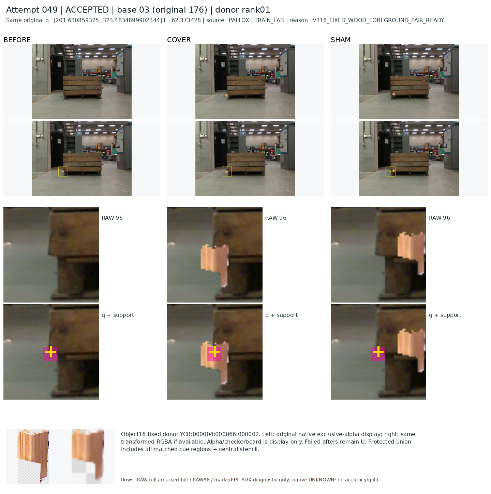

# 보임·외부가림: 성공, 실패와 해결 방향

원문: [query_visibility_success_failure_visual_review_20261023_v117/ROOT_INTERPRETATION_KO.html](../../archive/task-2/pallet-keypoint-visibility/query_visibility_success_failure_visual_review_20261023_v117/ROOT_INTERPRETATION_KO.html)

원 HTML SHA256: `b6be6fe2a9f8e43000e84fc31585291319ea3f0966b4c4b7e8d725f0abf3087e`

원 img ordinal 1–3 / 3. 원 순서 유지; 이미지 pixel decode/모델/평가 재실행 없음.

## 원 이미지 1

원문 직전 heading

```text
왼쪽 위: 보임 성공 / 오른쪽 위: 외부가림 성공왼쪽 아래: 외부가림 실패 / 오른쪽 아래: 야간 보임 개선
```

원 alt

```text
실제 저장 crop의 성공과 실패 네 사례
```


## 원 이미지 2

원문 직전 heading

```text
콘이 충분히 보이는데도 놓친 사례
```

원 alt

```text
콘 중심의 가림을 C11은 숨김, C12는 보임으로 응답한 실제 사례1021
```


## 원 이미지 3

원문 직전 heading

```text
이미 공개 데이터에서 확인한 보완점
```

원 alt

```text
공개 source의 같은 q에서 목재 단서를 가린 cover와 보존한 sham
```


