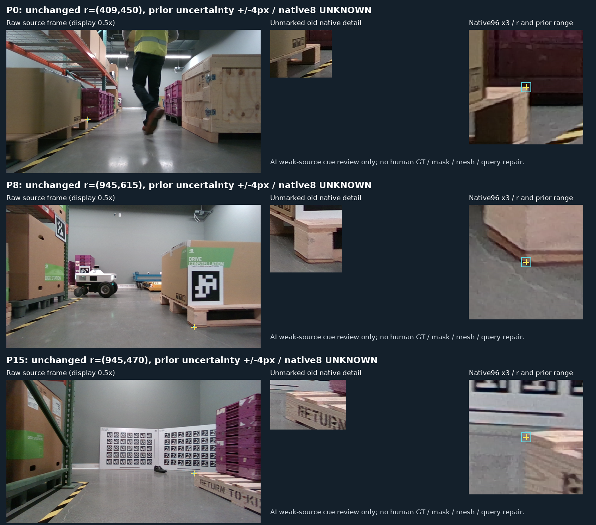

# 공개 팔레트 cue 검토 V83

원문: [query_visibility_public_cue_audit_20261023_v83/ROOT_READOUT_KO.html](../../archive/task-2/pallet-keypoint-visibility/query_visibility_public_cue_audit_20261023_v83/ROOT_READOUT_KO.html)

원 HTML SHA256: `0b92cd46ad39aa21d1193b421c95b98dab51fea0e37f44bea878f6d1eab3dcb1`

원 img ordinal 1–1 / 1. 원 순서 유지; 이미지 pixel decode/모델/평가 재실행 없음.

## 원 이미지 1

원문 직전 heading

```text
공개 실사 cue와 초기 query 대응: V83
```

원 alt

```text
고정 공개 source 세 장과 실제 코너 crop
```


