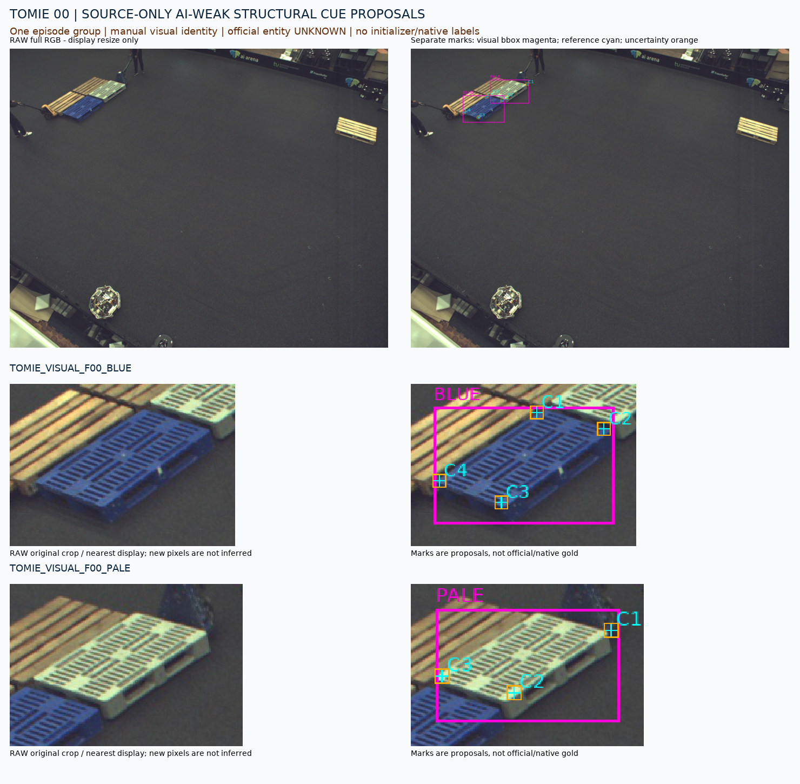
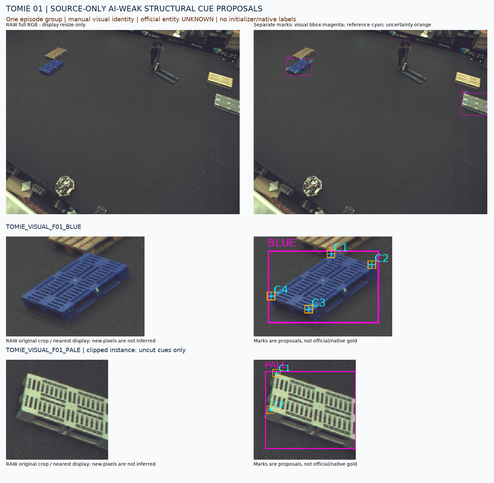
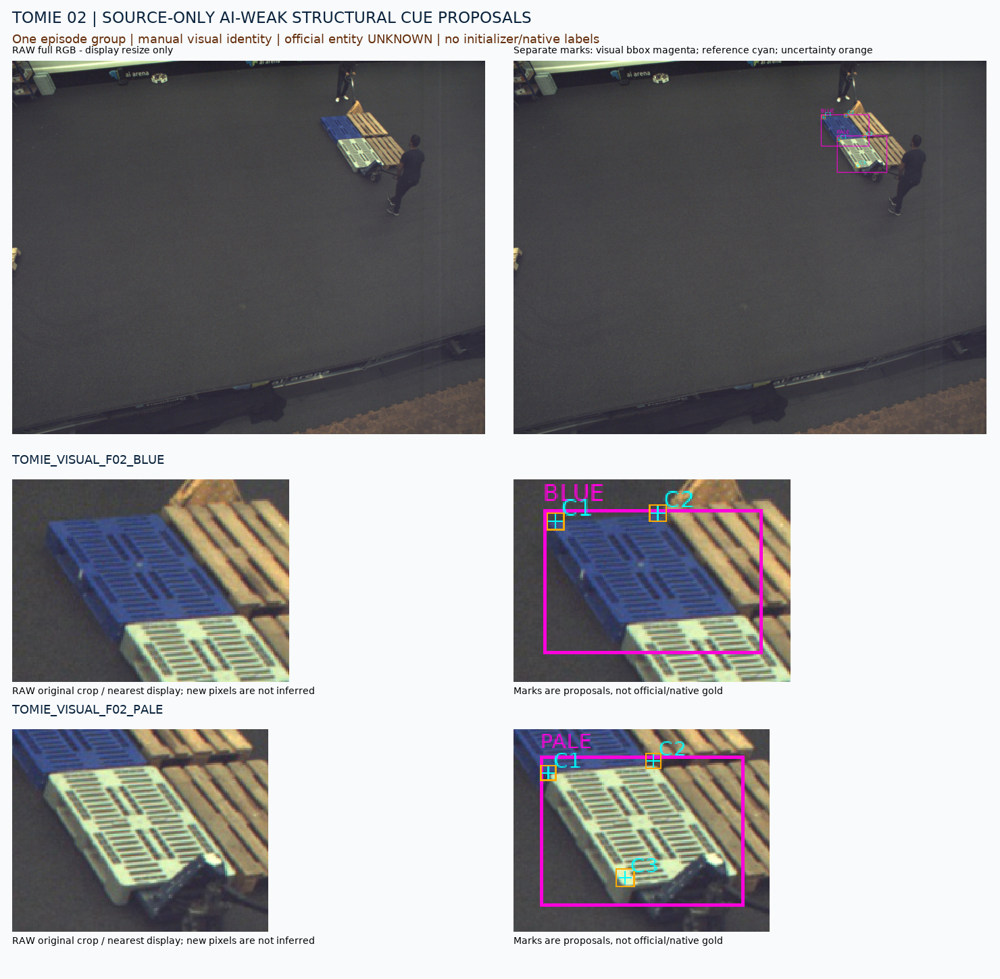
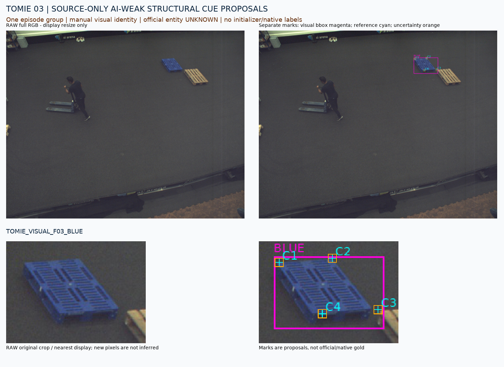
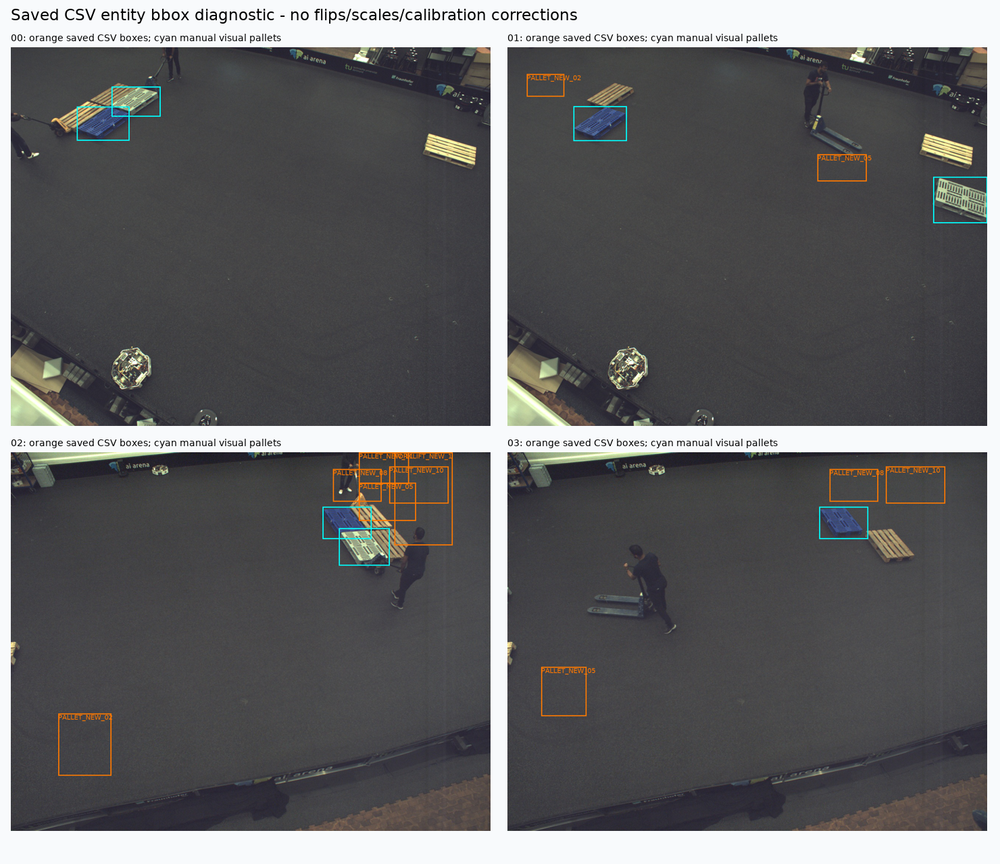

# TOMIE fixed4 구조 cue 제안

원문: [query_visibility_flat_pallet_cue_source_20261023_v122/tomie_cue_preparation/provenance/PRE_OVERLAY_QA_V1/GALLERY_KO.html](../../archive/task-2/pallet-keypoint-visibility/query_visibility_flat_pallet_cue_source_20261023_v122/tomie_cue_preparation/provenance/PRE_OVERLAY_QA_V1/GALLERY_KO.html)

원 HTML SHA256: `082da874b4ba9228e0ab3a7bd7a6d62c8d0f80dc4339049a921c6263149884cc`

원 img ordinal 1–5 / 5. 원 순서 유지; 이미지 pixel decode/모델/평가 재실행 없음.

## 원 이미지 1

원문 직전 heading

```text
공개 TOMIE flat-pallet 구조 cue 제안
```



## 원 이미지 2

원문 직전 heading

```text
공개 TOMIE flat-pallet 구조 cue 제안
```



## 원 이미지 3

원문 직전 heading

```text
공개 TOMIE flat-pallet 구조 cue 제안
```



## 원 이미지 4

원문 직전 heading

```text
공개 TOMIE flat-pallet 구조 cue 제안
```



## 원 이미지 5

원문 직전 heading

```text
공개 TOMIE flat-pallet 구조 cue 제안
```


