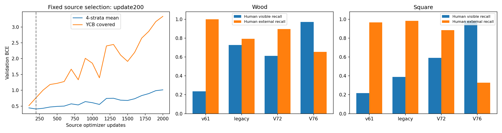
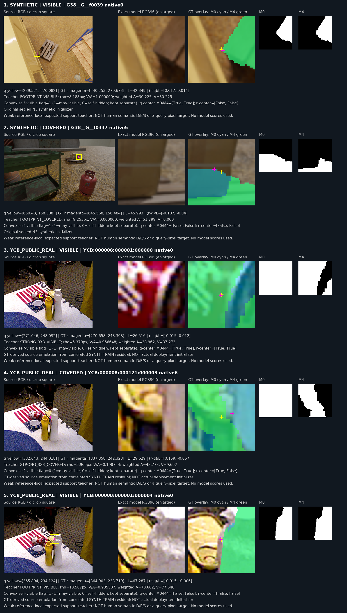
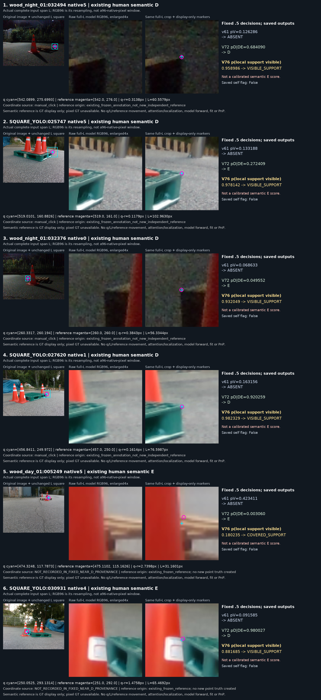

# V76 혼합 head 평가

원문: [query_visibility_reference_local_support_20261023_v76/RESULTS_KO.html](../../archive/task-2/pallet-keypoint-visibility/query_visibility_reference_local_support_20261023_v76/RESULTS_KO.html)

원 HTML SHA256: `2cb205e582e05113c3ff1d7349af76040d65f857000c18a6d079fbe20420476e`

원 img ordinal 1–3 / 3. 원 순서 유지; 이미지 pixel decode/모델/평가 재실행 없음.

## 원 이미지 1

원문 직전 heading

```text
합성·공개 실사에서 실제 학습한 것
```

원 alt

```text
source curve and current recall
```



## 원 이미지 2

원문 직전 heading

```text
실제 crop과 라벨 정의
```

원 alt

```text
Actual source crops and masks
```



## 원 이미지 3

원문 직전 heading

```text
실제 crop과 라벨 정의
```

원 alt

```text
Fixed actual current input crops
```


