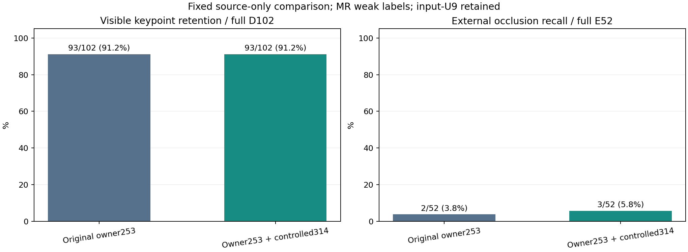

# 고정 query 대조 데이터 추가 결과 — V162

원문: [query_visibility_counterfactual_frozen_features_20261024_v162/provenance/BEFORE_REPORT_CLARITY/ROOT_READOUT_KO.html](../../archive/task-2/pallet-keypoint-visibility/query_visibility_counterfactual_frozen_features_20261024_v162/provenance/BEFORE_REPORT_CLARITY/ROOT_READOUT_KO.html)

원 HTML SHA256: `1b79abdf66acb13ccd22d0578fbdfa2508e7d0888c81f678b1cc023caec85ff0`

원 img ordinal 1–1 / 1. 원 순서 유지; 이미지 pixel decode/모델/평가 재실행 없음.

## 원 이미지 1

원문 직전 heading

```text
같은 위치를 덮는 대조 데이터가 주 가림 판단을 개선했는가
```

원 alt

```text
고정 공개 검증의 보임 보존과 외부 가림 검출 비교
```


