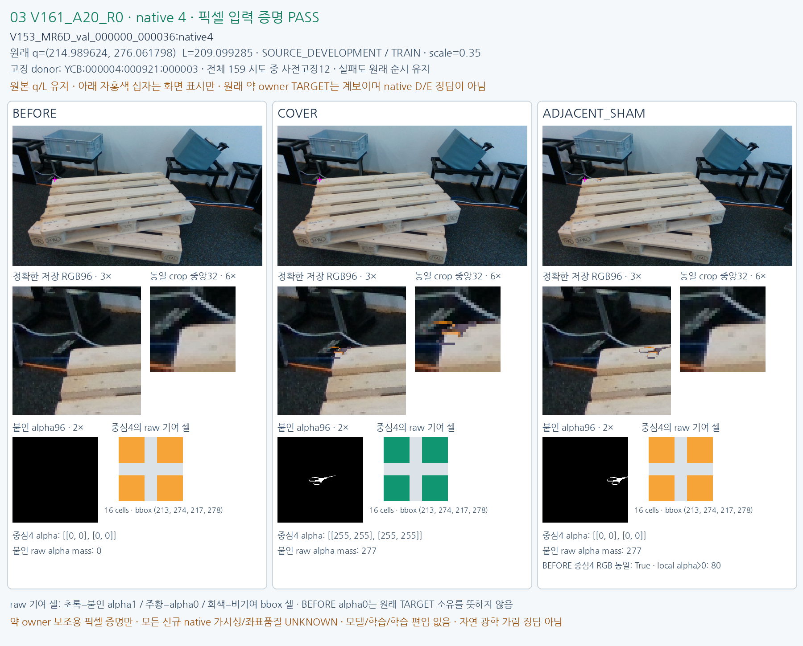

# FIXED12 V161_A20_R0

원문: [query_visibility_public_train_owner_counterfactual_20261024_v161/fixed12_visual_v1/CASE_03_V161_A20_R0.html](../../archive/task-2/pallet-keypoint-visibility/query_visibility_public_train_owner_counterfactual_20261024_v161/fixed12_visual_v1/CASE_03_V161_A20_R0.html)

원 HTML SHA256: `f3929b605b28adac7de55bf63f25361975e181ea32f0be72815b96c13b8082de`

원 img ordinal 1–1 / 1. 원 순서 유지; 이미지 pixel decode/모델/평가 재실행 없음.

## 원 이미지 1

원문 직전 heading

```text
FIXED12 V161_A20_R0
```

원 alt

```text
BEFORE COVER ADJACENT SHAM same-q source pixels
```


