# v66 데이터 준비와 검산 | 팔레트 query 가림

원문: [query_visibility_controlled_real_20261022_v66/source_audit/DATA_PREPARATION_REPORT/CROPS_QA.html](../../archive/task-2/pallet-keypoint-visibility/query_visibility_controlled_real_20261022_v66/source_audit/DATA_PREPARATION_REPORT/CROPS_QA.html.parts.json)

원 HTML SHA256: `a8347084e394ca6ce33db8da3ccefc60489ed3958a06d88e0e0b04ff4c04bac4`

원 img ordinal 1–13 / 13. 원 순서 유지; 이미지 pixel decode/모델/평가 재실행 없음.

## 원 이미지 1

원문 직전 heading

```text
0.55m_hall
```

원 alt

```text
0.55m_hall viewA 실제 slot0 native96 crop
```

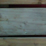

## 원 이미지 2

원문 직전 heading

```text
0.55m_hall
```

원 alt

```text
0.55m_hall viewB 실제 slot0 native96 crop
```

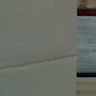

## 원 이미지 3

원문 직전 heading

```text
0.55m_lab
```

원 alt

```text
0.55m_lab viewA 실제 slot0 native96 crop
```

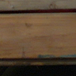

## 원 이미지 4

원문 직전 heading

```text
0.55m_lab
```

원 alt

```text
0.55m_lab viewB 실제 slot0 native96 crop
```

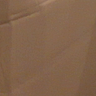

## 원 이미지 5

원문 직전 heading

```text
1.23m_hall
```

원 alt

```text
1.23m_hall viewA 실제 slot0 native96 crop
```

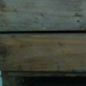

## 원 이미지 6

원문 직전 heading

```text
1.23m_hall
```

원 alt

```text
1.23m_hall viewB 실제 slot0 native96 crop
```

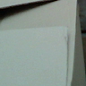

## 원 이미지 7

원문 직전 heading

```text
1.23m_lab
```

원 alt

```text
1.23m_lab viewA 실제 slot0 native96 crop
```

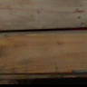

## 원 이미지 8

원문 직전 heading

```text
1.23m_lab
```

원 alt

```text
1.23m_lab viewB 실제 slot0 native96 crop
```

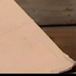

## 원 이미지 9

원문 직전 heading

```text
1.92m_hall
```

원 alt

```text
1.92m_hall viewA 실제 slot0 native96 crop
```

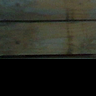

## 원 이미지 10

원문 직전 heading

```text
1.92m_hall
```

원 alt

```text
1.92m_hall viewB 실제 slot0 native96 crop
```

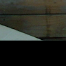

## 원 이미지 11

원문 직전 heading

```text
1.92m_lab
```

원 alt

```text
1.92m_lab viewA 실제 slot0 native96 crop
```

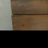

## 원 이미지 12

원문 직전 heading

```text
1.92m_lab
```

원 alt

```text
1.92m_lab viewB 실제 slot0 native96 crop
```

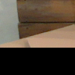

## 원 이미지 13

원문 직전 heading

```text
1.92m_lab
```

원 alt

```text
고정6쌍 fullframe과실제query crop 및teacher overlay
```

원 HTML caption

```text
녹색 V teacher / 주황 E teacher / 나머지 미확정. 1.92m HALL처럼 exact가 U여도 radius2 근거가 다를 수 있습니다. 반대로 근거가 부족하면 가림처럼 보여도 단정하지 않습니다.
```

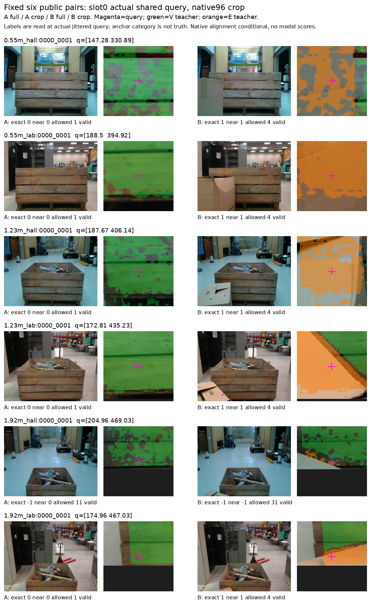

원문 HTML이 큰 경우 링크는 원 SHA를 보존하는 무손실 gzip descriptor를 가리킵니다.
