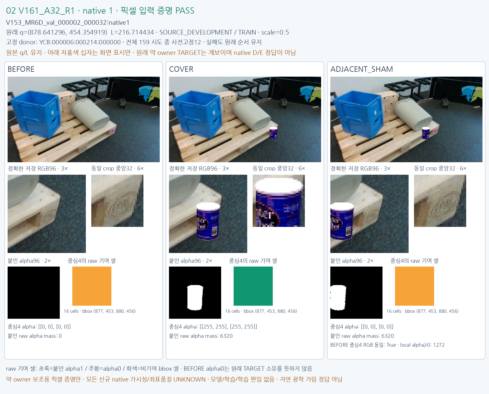

# FIXED12 V161_A32_R1

원문: [query_visibility_public_train_owner_counterfactual_20261024_v161/fixed12_visual_v1/CASE_02_V161_A32_R1.html](../../archive/task-2/pallet-keypoint-visibility/query_visibility_public_train_owner_counterfactual_20261024_v161/fixed12_visual_v1/CASE_02_V161_A32_R1.html)

원 HTML SHA256: `adf045d40736ddad78c2c4d3987d49fdca50a6887bc9f8fdbf8ff63f4fe94132`

원 img ordinal 1–1 / 1. 원 순서 유지; 이미지 pixel decode/모델/평가 재실행 없음.

## 원 이미지 1

원문 직전 heading

```text
FIXED12 V161_A32_R1
```

원 alt

```text
BEFORE COVER ADJACENT SHAM same-q source pixels
```


