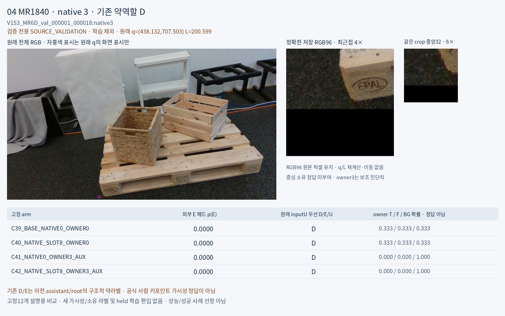
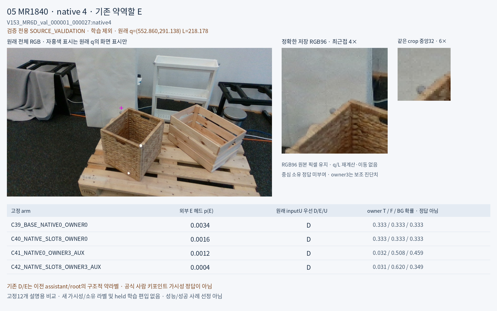
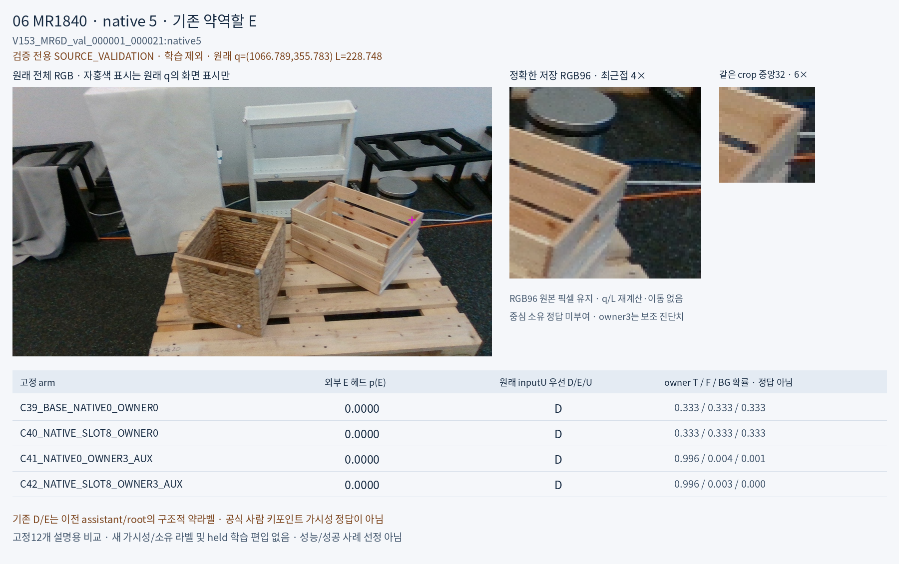
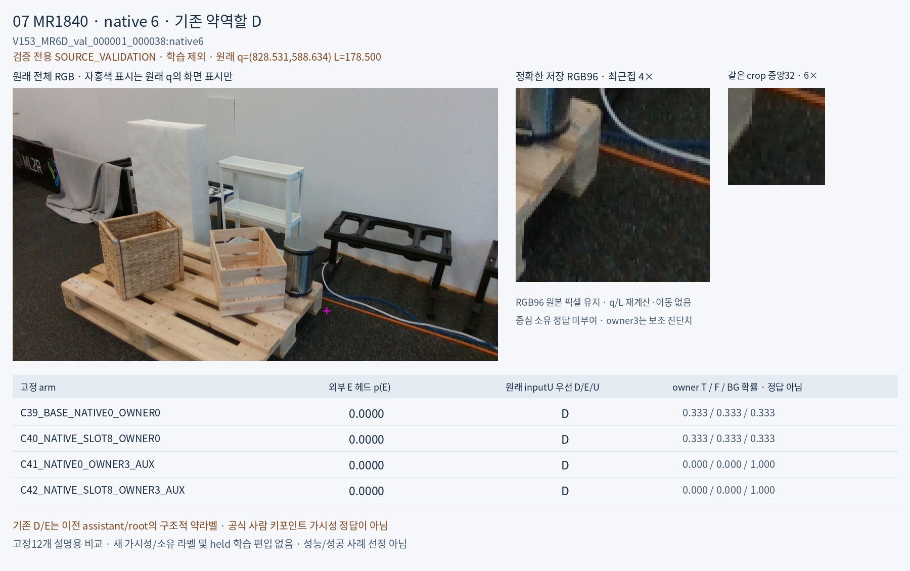
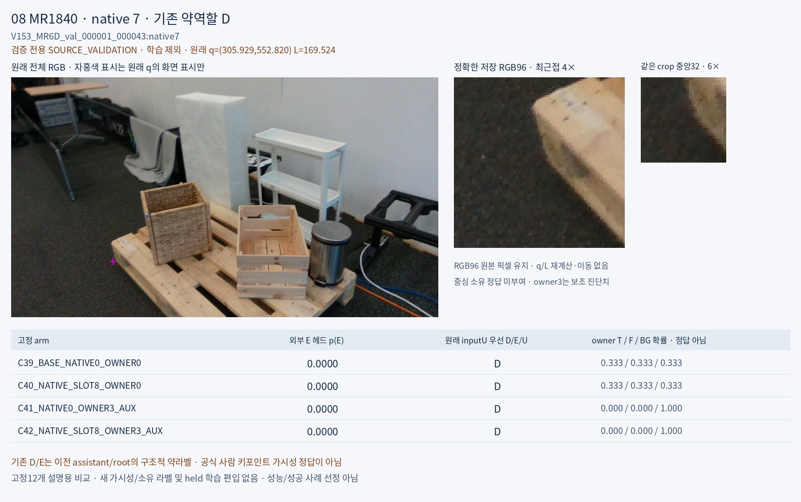
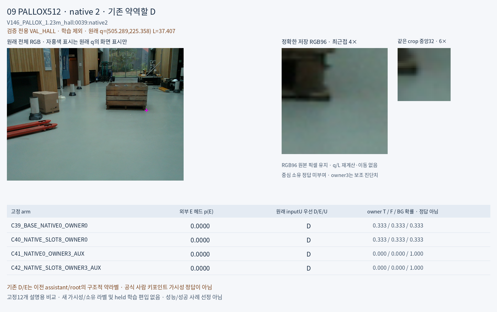
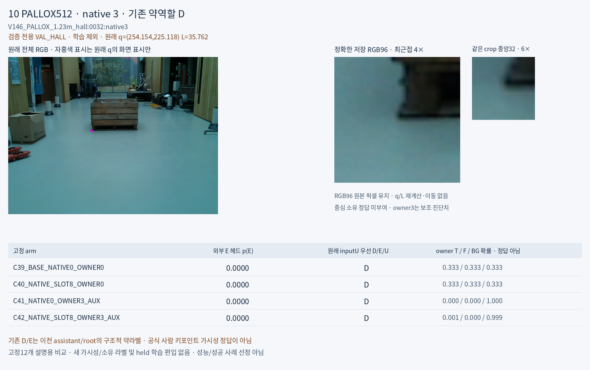
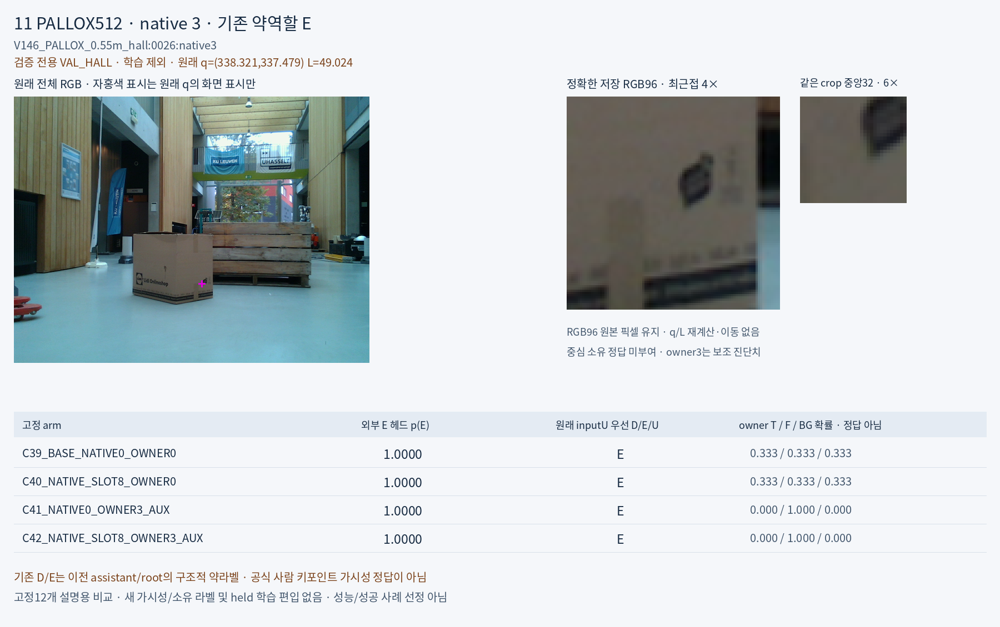
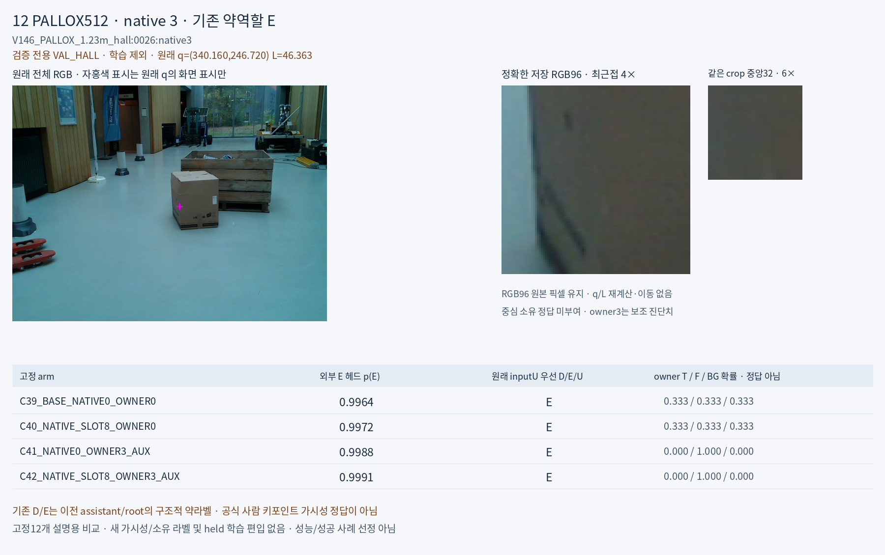

# V160 가림 대조실험 결과

원문: [query_visibility_native_slot_owner_factorial_20261024_v160/ROOT_READOUT_KO.html](../../archive/task-2/pallet-keypoint-visibility/query_visibility_native_slot_owner_factorial_20261024_v160/ROOT_READOUT_KO.html)

원 HTML SHA256: `df491242fb6de349b861253456333d1e71d92adcb6f12ebe1915f784d59feeae`

원 img ordinal 1–13 / 13. 원 순서 유지; 이미지 pixel decode/모델/평가 재실행 없음.

## 원 이미지 1

원문 직전 heading

```text
가림 판단 대조실험 V160
```

원 alt

```text
학습 자료 적합과 분리 장면 일반화, 원래 source 조건 통과 수 비교
```


## 원 이미지 2

원문 직전 heading

```text
고정한 실제 crop 12개
```

원 alt

```text
01 · MR1840 · native0 · 기존 약라벨 D
```


## 원 이미지 3

원문 직전 heading

```text
고정한 실제 crop 12개
```

원 alt

```text
02 · MR1840 · native1 · 기존 약라벨 D
```


## 원 이미지 4

원문 직전 heading

```text
고정한 실제 crop 12개
```

원 alt

```text
03 · MR1840 · native2 · 기존 약라벨 D
```


## 원 이미지 5

원문 직전 heading

```text
고정한 실제 crop 12개
```

원 alt

```text
04 · MR1840 · native3 · 기존 약라벨 D
```



## 원 이미지 6

원문 직전 heading

```text
고정한 실제 crop 12개
```

원 alt

```text
05 · MR1840 · native4 · 기존 약라벨 E
```



## 원 이미지 7

원문 직전 heading

```text
고정한 실제 crop 12개
```

원 alt

```text
06 · MR1840 · native5 · 기존 약라벨 E
```



## 원 이미지 8

원문 직전 heading

```text
고정한 실제 crop 12개
```

원 alt

```text
07 · MR1840 · native6 · 기존 약라벨 D
```



## 원 이미지 9

원문 직전 heading

```text
고정한 실제 crop 12개
```

원 alt

```text
08 · MR1840 · native7 · 기존 약라벨 D
```



## 원 이미지 10

원문 직전 heading

```text
고정한 실제 crop 12개
```

원 alt

```text
09 · PALLOX512 · native2 · 기존 약라벨 D
```



## 원 이미지 11

원문 직전 heading

```text
고정한 실제 crop 12개
```

원 alt

```text
10 · PALLOX512 · native3 · 기존 약라벨 D
```



## 원 이미지 12

원문 직전 heading

```text
고정한 실제 crop 12개
```

원 alt

```text
11 · PALLOX512 · native3 · 기존 약라벨 E
```



## 원 이미지 13

원문 직전 heading

```text
고정한 실제 crop 12개
```

원 alt

```text
12 · PALLOX512 · native3 · 기존 약라벨 E
```


