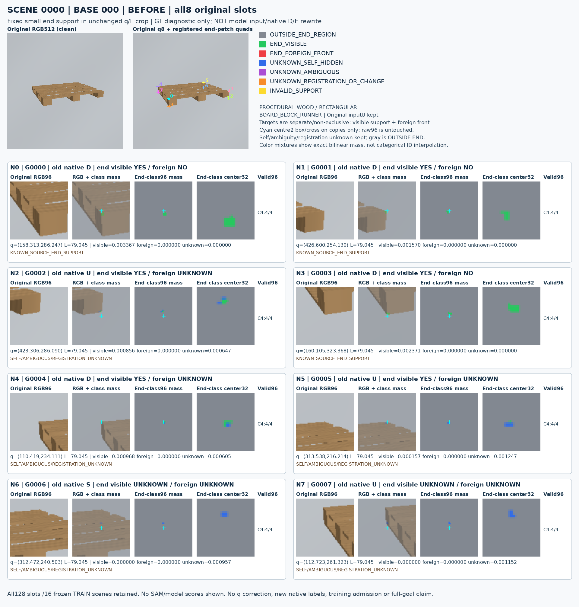
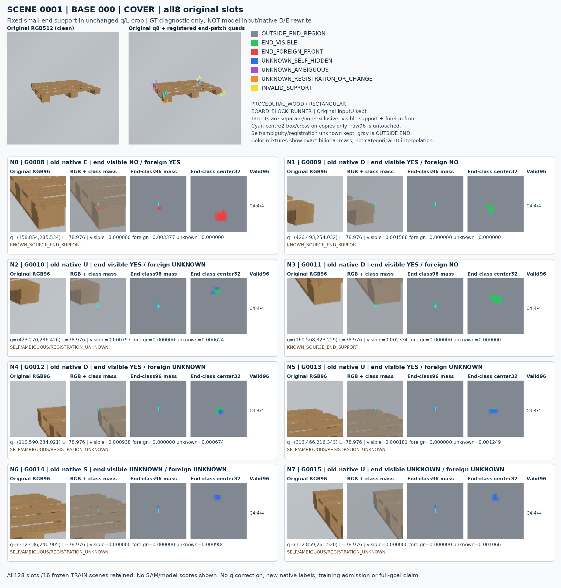
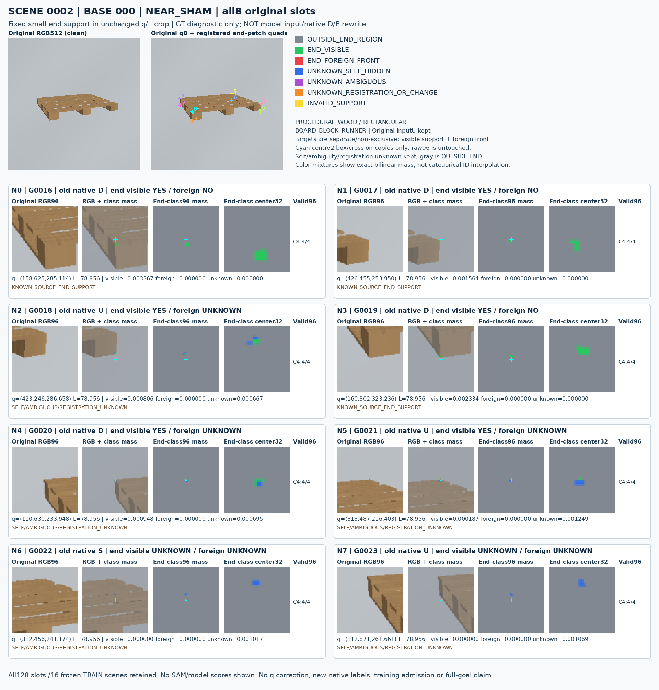
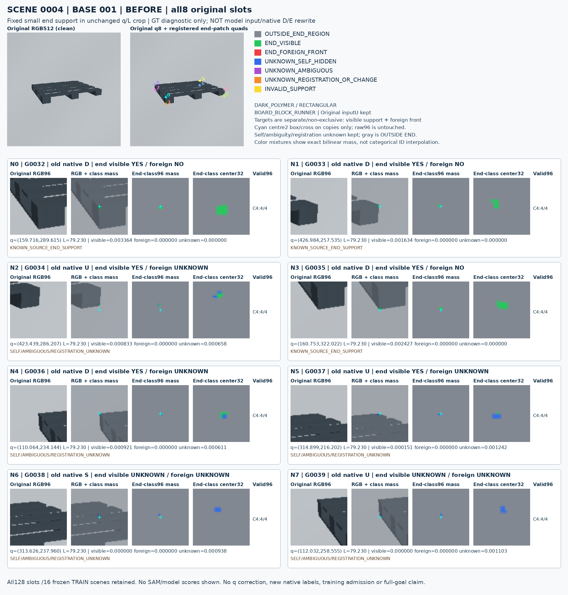
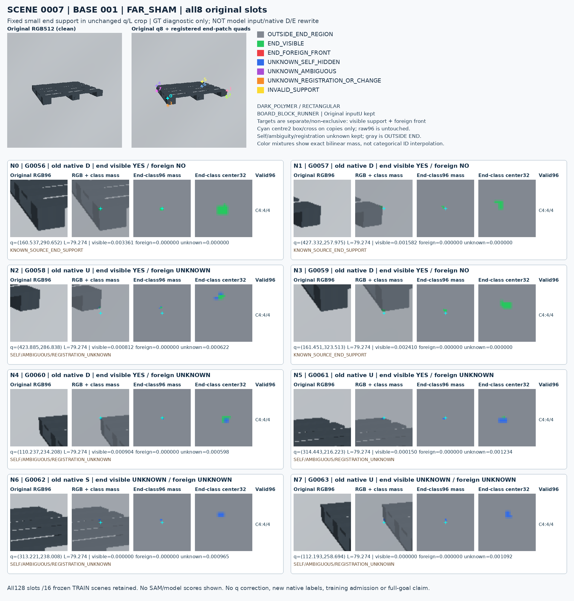
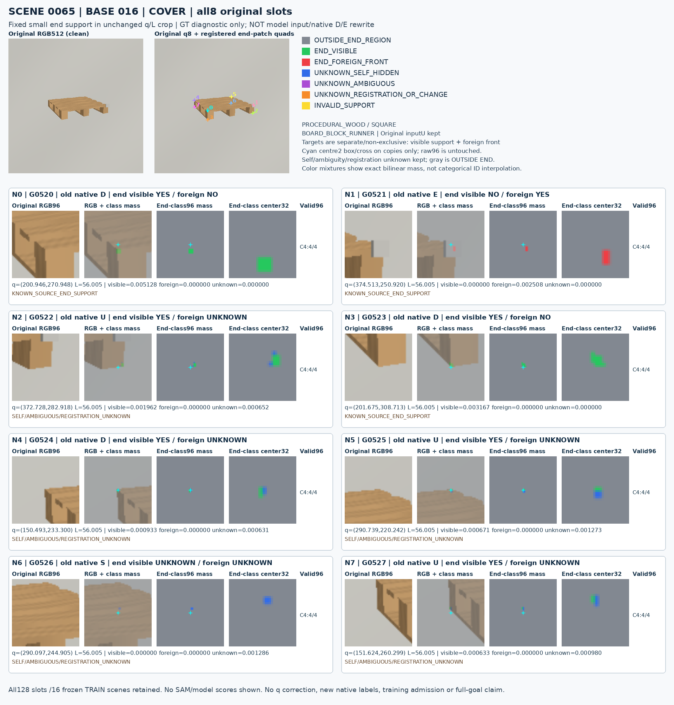
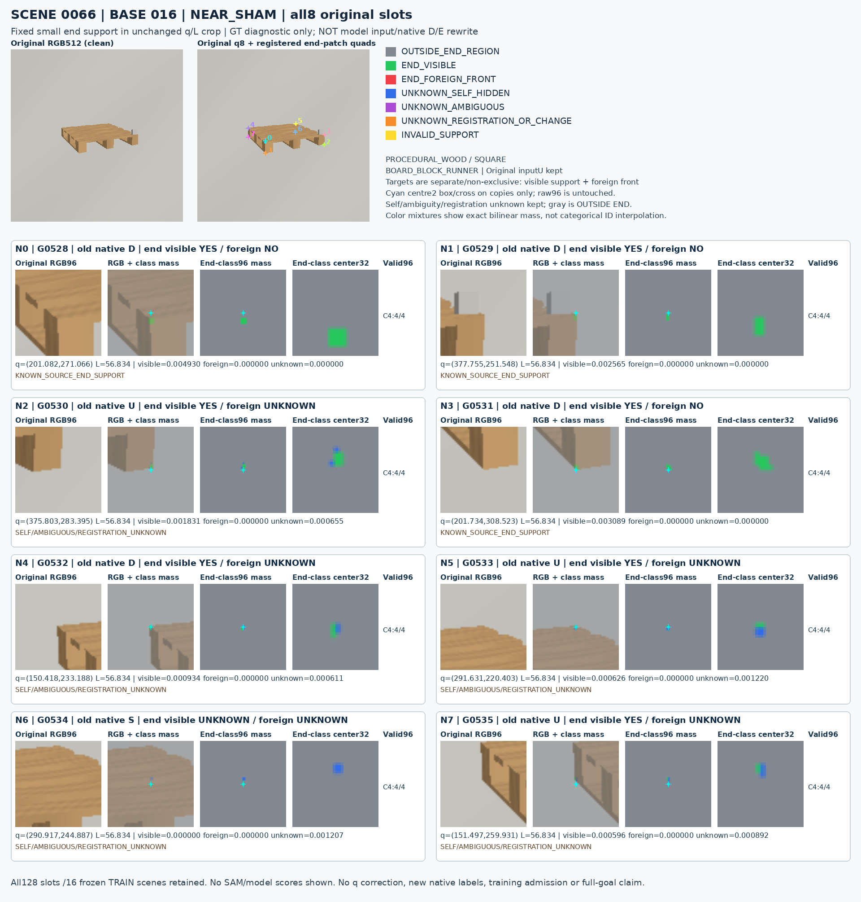
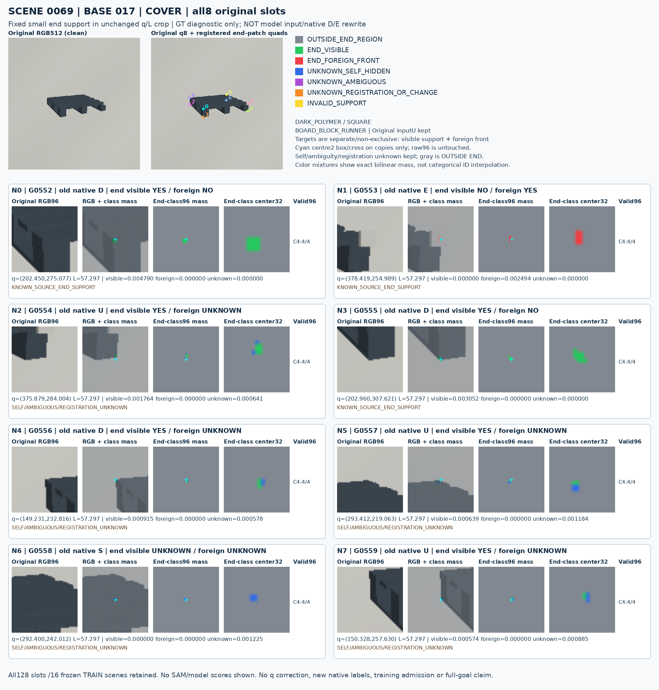
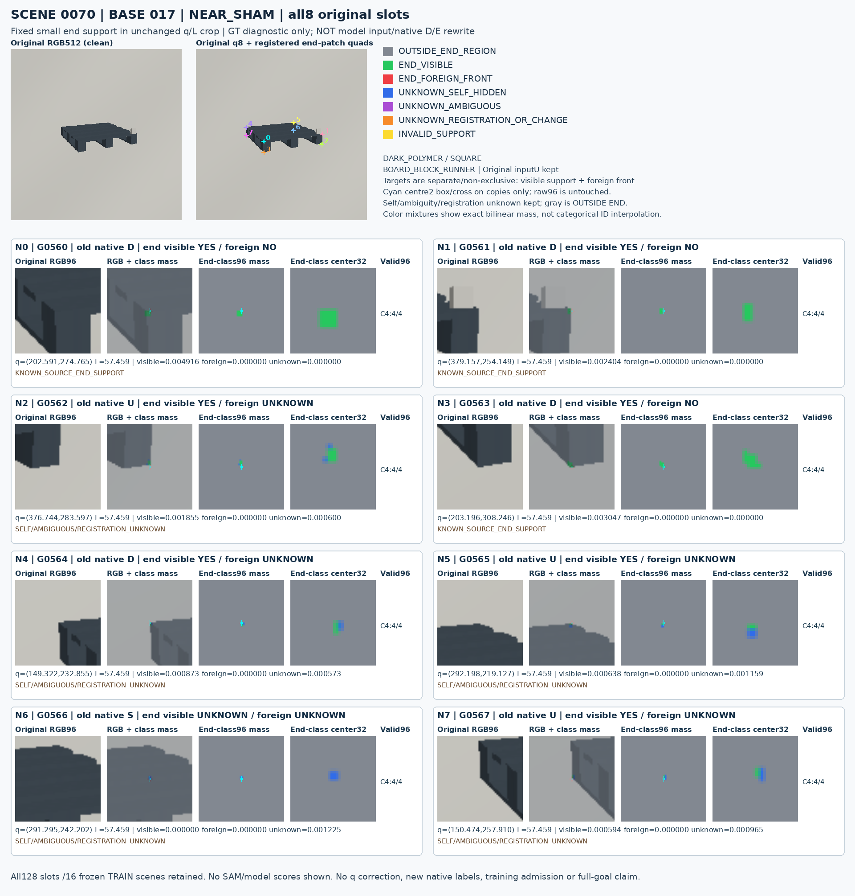
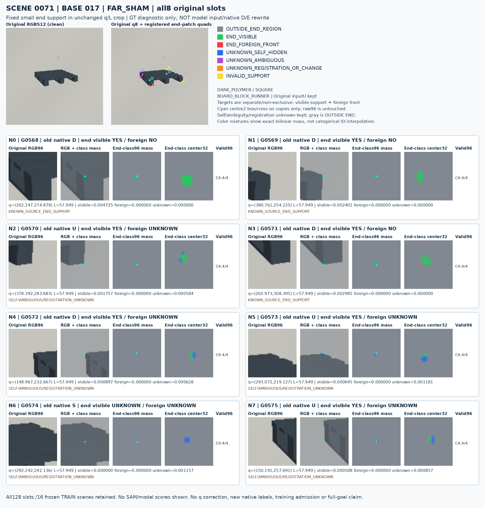

# Fixed128 source end support

원문: [query_visibility_frozen_sam_source_baseline_20261024_v180/source_end_spatial_visual128_v1/index.html](../../archive/task-2/pallet-keypoint-visibility/query_visibility_frozen_sam_source_baseline_20261024_v180/source_end_spatial_visual128_v1/index.html)

원 HTML SHA256: `15f3a4fc2497bceebc35946e75342b027bc7a1923bdda79cabc10be022838927`

원 img ordinal 1–16 / 16. 원 순서 유지; 이미지 pixel decode/모델/평가 재실행 없음.

## 원 이미지 1

원문 직전 heading

```text
Scene 0
```



## 원 이미지 2

원문 직전 heading

```text
Scene 1
```



## 원 이미지 3

원문 직전 heading

```text
Scene 2
```



## 원 이미지 4

원문 직전 heading

```text
Scene 3
```


## 원 이미지 5

원문 직전 heading

```text
Scene 4
```



## 원 이미지 6

원문 직전 heading

```text
Scene 5
```


## 원 이미지 7

원문 직전 heading

```text
Scene 6
```


## 원 이미지 8

원문 직전 heading

```text
Scene 7
```



## 원 이미지 9

원문 직전 heading

```text
Scene 64
```


## 원 이미지 10

원문 직전 heading

```text
Scene 65
```



## 원 이미지 11

원문 직전 heading

```text
Scene 66
```



## 원 이미지 12

원문 직전 heading

```text
Scene 67
```


## 원 이미지 13

원문 직전 heading

```text
Scene 68
```


## 원 이미지 14

원문 직전 heading

```text
Scene 69
```



## 원 이미지 15

원문 직전 heading

```text
Scene 70
```



## 원 이미지 16

원문 직전 heading

```text
Scene 71
```


