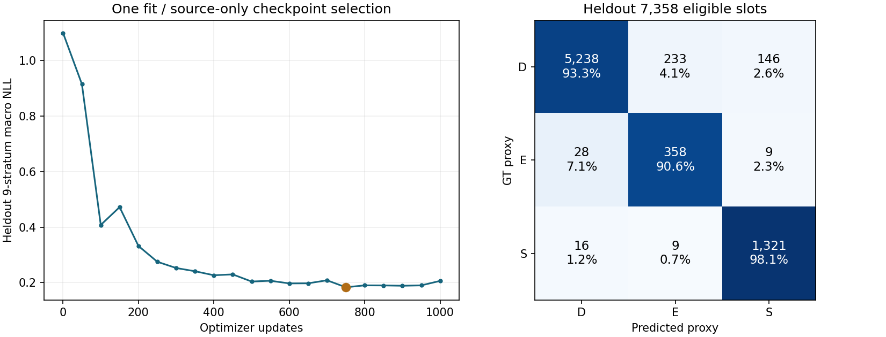

# V75 참조점 사전학습

원문: [query_visibility_native_context_pretrain_20261023_v75/RESULTS_KO.html](../../archive/task-2/pallet-keypoint-visibility/query_visibility_native_context_pretrain_20261023_v75/RESULTS_KO.html)

원 HTML SHA256: `864f738fb7b716035917aa39e5401c60a0a2b6ffa2c331fae1b9c5f93329033d`

원 img ordinal 1–2 / 2. 원 순서 유지; 이미지 pixel decode/모델/평가 재실행 없음.

## 원 이미지 1

원문 직전 heading

```text
같은 순서와 참조점을 사용하는 합성 분류
```



## 원 이미지 2

원문 직전 heading

```text
공개 실사 감독을 연결하기 전 확인한 목표 차이
```


