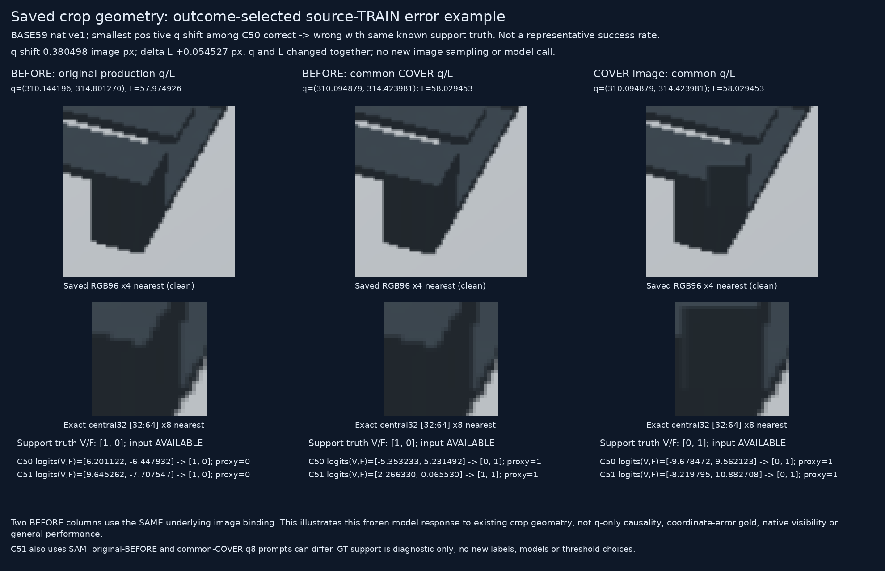

# Outcome-selected saved crop geometry

원문: [query_visibility_source_same_query_causal_diagnosis_20261024_v182/crop_geometry_visual_v1/index.html](../../archive/task-2/pallet-keypoint-visibility/query_visibility_source_same_query_causal_diagnosis_20261024_v182/crop_geometry_visual_v1/index.html)

원 HTML SHA256: `41ac83c5b062217389b509f29f0cc83f125aa6d036842af722ebad220a83073f`

원 img ordinal 1–2 / 2. 원 순서 유지; 이미지 pixel decode/모델/평가 재실행 없음.

## 원 이미지 1

원문 직전 heading

```text
결과를 보고 선택한 source 오류 설명 사례
```



## 원 이미지 2

원문 직전 heading

```text
표시용 차이
```


