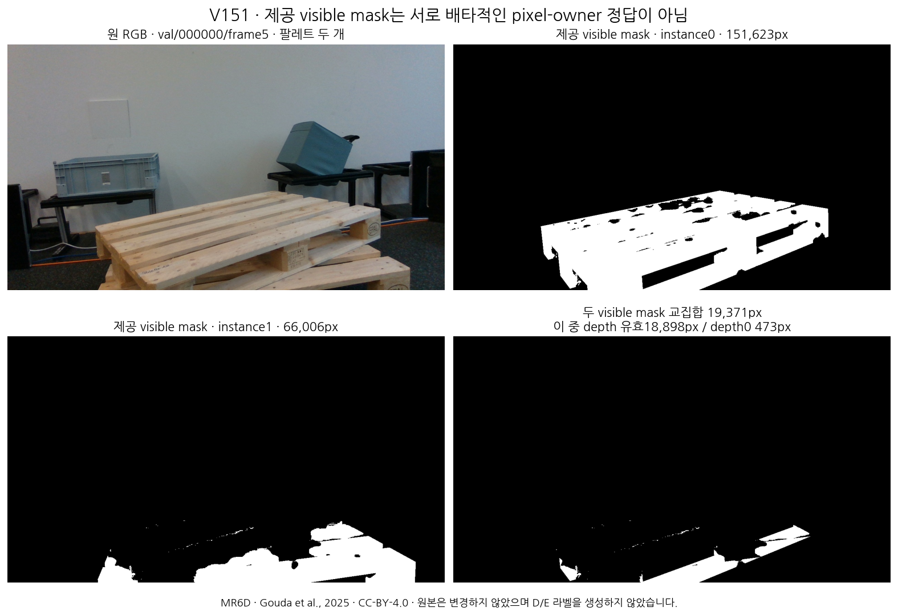

# V151 실제 Euro 팔레트 공개 source 확보

원문: [query_visibility_mr6d_public_native_intake_20261024_v151/ROOT_READOUT_KO.html](../../archive/task-2/pallet-keypoint-visibility/query_visibility_mr6d_public_native_intake_20261024_v151/ROOT_READOUT_KO.html)

원 HTML SHA256: `3d77daeec1cc724e3f65e9d0f1ca8ef63db214659b303d1cc6f6781dd696952f`

원 img ordinal 1–5 / 5. 원 순서 유지; 이미지 pixel decode/모델/평가 재실행 없음.

## 원 이미지 1

원문 직전 heading

```text
실제 RGB에서 확인한 형상과 가림
```

원 alt

```text
원 MR6D 공개 RGB 고정 표본
```


## 원 이미지 2

원문 직전 heading

```text
실제 RGB에서 확인한 형상과 가림
```

원 alt

```text
원 MR6D 공개 RGB 고정 표본
```


## 원 이미지 3

원문 직전 heading

```text
실제 RGB에서 확인한 형상과 가림
```

원 alt

```text
원 MR6D 공개 RGB 고정 표본
```


## 원 이미지 4

원문 직전 heading

```text
새 CAD에서 확인한 역할 참조의 기초
```

원 alt

```text
제공 CAD의 상판과 하부 runner 및 canonical corners
```


## 원 이미지 5

원문 직전 heading

```text
제공 mask를 곧바로 키포인트 정답으로 쓸 수 없는 사례
```

원 alt

```text
두 pallet visible mask 교집합 비교
```


