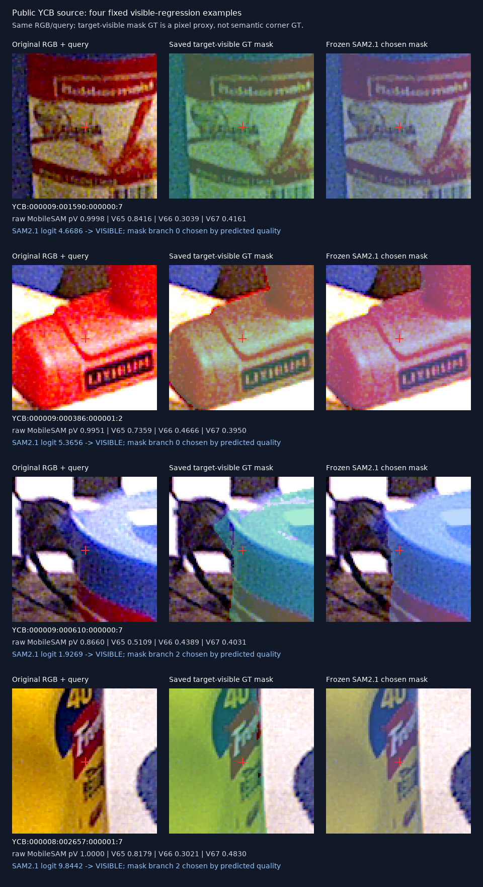
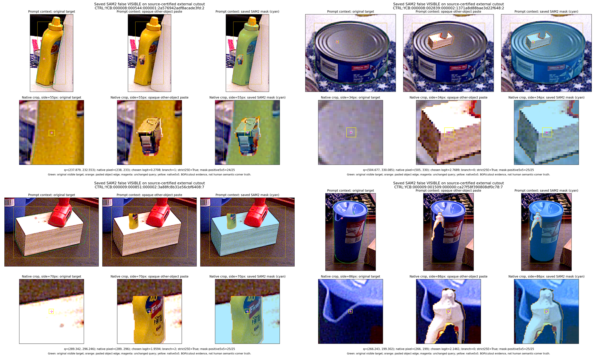

# V68 SAM2.1 공개·합성 동일 대상 비교

원문: [query_visibility_sam21_frozen_20261023_v68/RESULTS_KO.html](../../archive/task-2/pallet-keypoint-visibility/query_visibility_sam21_frozen_20261023_v68/RESULTS_KO.html.parts.json)

원 HTML SHA256: `b0ab54b0a6bbce4e105e086ee9f26daf3c7b2fe793fe06fd7f2b495e941bcab0`

원 img ordinal 1–2 / 2. 원 순서 유지; 이미지 pixel decode/모델/평가 재실행 없음.

## 원 이미지 1

원문 직전 heading

```text
미리 고른 실제 공개 실사 4개 crop
```

원 HTML caption

```text
동일 RGB/query: 원본 → 저장된 visible-mask GT → SAM2.1 선택 마스크. 빨간 십자는 query. 확대는 nearest pixel입니다.
```



## 원 이미지 2

원문 직전 heading

```text
실제로 다른 물체가 가렸는데 보인다고 하는 사례
```

원 HTML caption

```text
공개 소스의 고정 외부 가림 오류 crop. 상세 선택·라벨·픽셀 검산은 같은 폴더의 JSON에 보존했습니다.
```



원문 HTML이 큰 경우 링크는 원 SHA를 보존하는 무손실 gzip descriptor를 가리킵니다.
