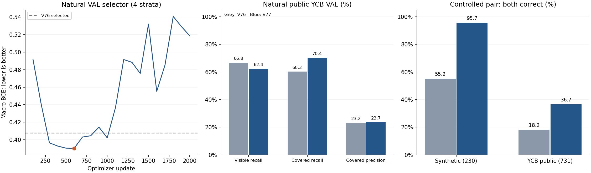
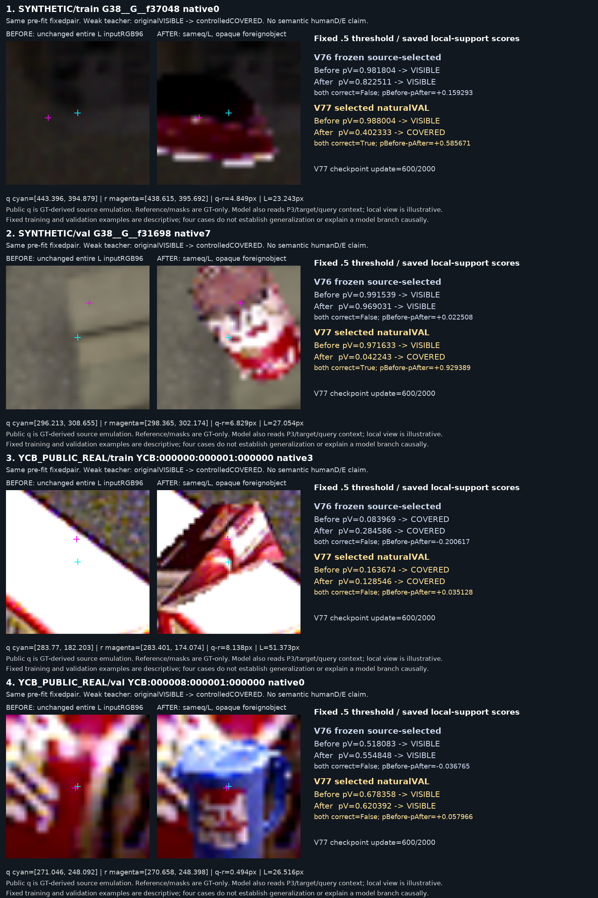

# V77 source 가림 전후 비교

원문: [query_visibility_controlled_pairs_20261023_v77/RESULTS_KO.html](../../archive/task-2/pallet-keypoint-visibility/query_visibility_controlled_pairs_20261023_v77/RESULTS_KO.html)

원 HTML SHA256: `5bc9b32bd49f780b5d4f4c2572df8c53a1e5ddcff10e31069a0f2e975a4ec148`

원 img ordinal 1–2 / 2. 원 순서 유지; 이미지 pixel decode/모델/평가 재실행 없음.

## 원 이미지 1

원문 직전 heading

```text
가린 후 전체 known query 성능
```

원 alt

```text
자연 VAL 학습 곡선, 공개 자연 recall·precision, controlled 전후 정답률
```



## 원 이미지 2

원문 직전 heading

```text
점수와 무관하게 미리 고른 실제 RGB 4쌍
```

원 alt

```text
미리 고정한 실제 source crop 전후와 V76·V77 저장 확률
```


