# V91 공개 실사 학습과 현재 팔레트 고정 비교

원문: [query_visibility_physical_cue_aux_20261023_v91/ROOT_READOUT_KO.html](../../archive/task-2/pallet-keypoint-visibility/query_visibility_physical_cue_aux_20261023_v91/ROOT_READOUT_KO.html)

원 HTML SHA256: `6d80b997c1a062dfd168dccbd13377fb91b1e3bf6f6310f059dfb39ef9dc7847`

원 img ordinal 1–11 / 11. 원 순서 유지; 이미지 pixel decode/모델/평가 재실행 없음.

## 원 이미지 1

원문 직전 heading

```text
수동 클릭 기준 오차 ≤3px인데도 놓치는 점
```

원 alt

```text
목재: 수동 D, q–r 1.002px. q/r의 저장 zE=+19.012/+19.522로 모두 비보임.
```

원 HTML caption

```text
목재: 수동 D, q–r 1.002px. q/r의 저장 zE=+19.012/+19.522로 모두 비보임.
```

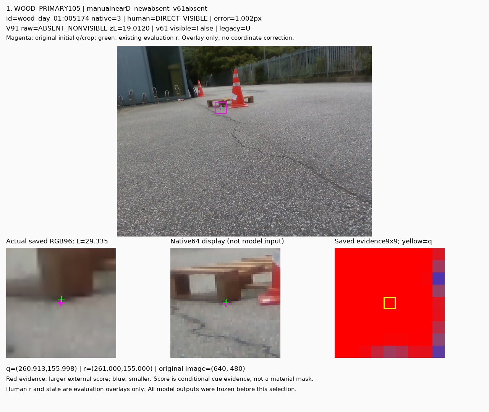

## 원 이미지 2

원문 직전 heading

```text
수동 클릭 기준 오차 ≤3px인데도 놓치는 점
```

원 alt

```text
정사각형: 수동 D, q–r 1.745px. q/r의 저장 zE=+2.055/+5.685로 모두 비보임.
```

원 HTML caption

```text
정사각형: 수동 D, q–r 1.745px. q/r의 저장 zE=+2.055/+5.685로 모두 비보임.
```

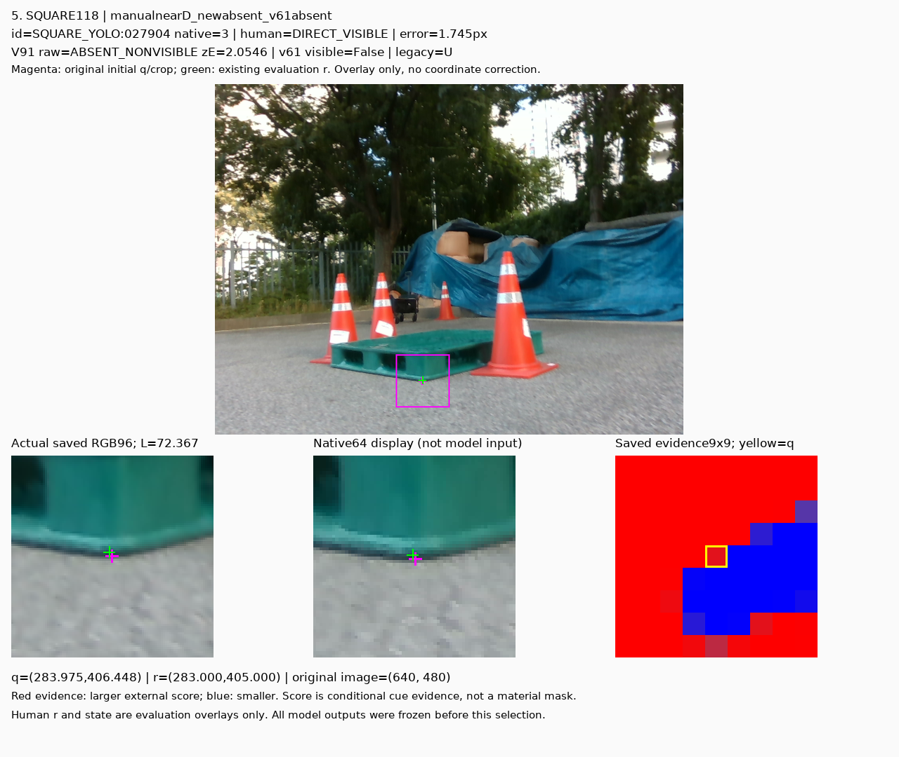

## 원 이미지 3

원문 직전 heading

```text
위치 오류가 기여하는 실패와, 위치만으로 설명되지 않는 실패
```

원 alt

```text
정사각형 E 오류: q zE=-25.432(D), r 조회 +6.630(E). cone 경계/표면의 위치 차이가 응답을 바꿉니다.
```

원 HTML caption

```text
정사각형 E 오류: q zE=-25.432(D), r 조회 +6.630(E). cone 경계/표면의 위치 차이가 응답을 바꿉니다.
```

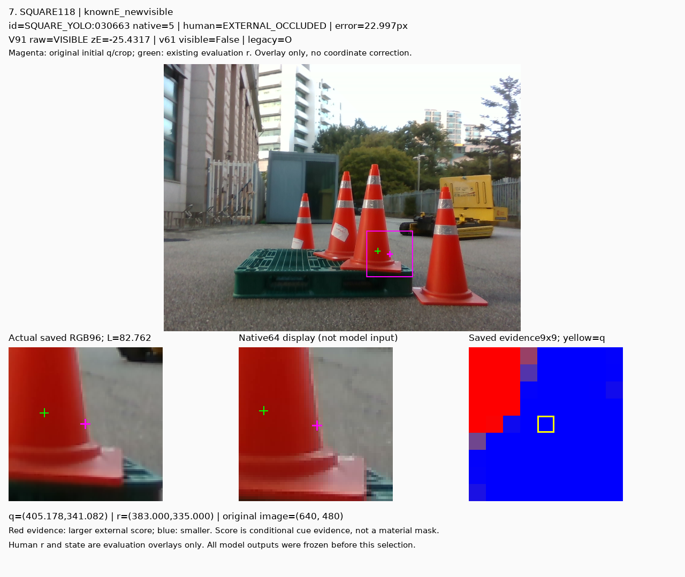

## 원 이미지 4

원문 직전 heading

```text
위치 오류가 기여하는 실패와, 위치만으로 설명되지 않는 실패
```

원 alt

```text
목재 E 오류: q zE=-28.644(D), r 조회 -5.970(D). cone가 가리는 실제 crop에서도 외부 가림을 놓칩니다.
```

원 HTML caption

```text
목재 E 오류: q zE=-28.644(D), r 조회 -5.970(D). cone가 가리는 실제 crop에서도 외부 가림을 놓칩니다.
```

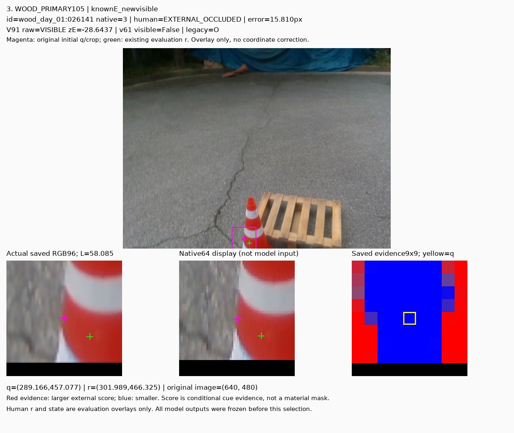

## 원 이미지 5

원문 직전 heading

```text
위치 오류가 기여하는 실패와, 위치만으로 설명되지 않는 실패
```

원 alt

```text
manualnearD_newvisible_v61absent · wood_night_01:029428
```

원 HTML caption

```text
manualnearD_newvisible_v61absent · wood_night_01:029428
```

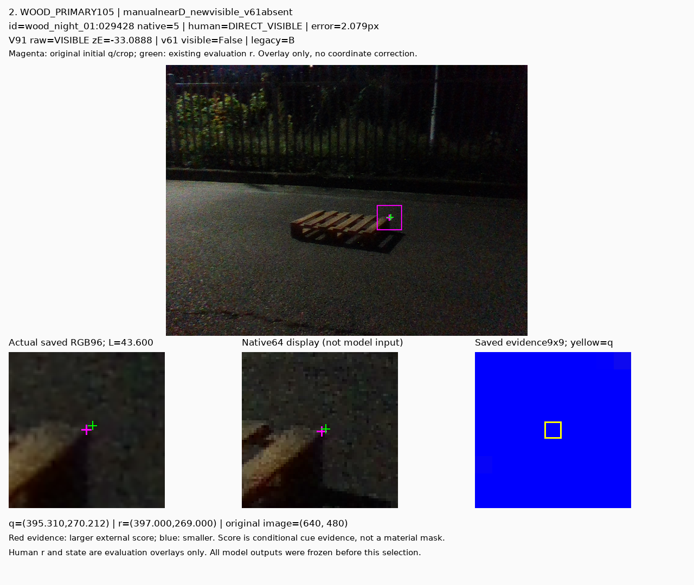

## 원 이미지 6

원문 직전 heading

```text
위치 오류가 기여하는 실패와, 위치만으로 설명되지 않는 실패
```

원 alt

```text
knownE_newabsent · wood_night_01:033297
```

원 HTML caption

```text
knownE_newabsent · wood_night_01:033297
```

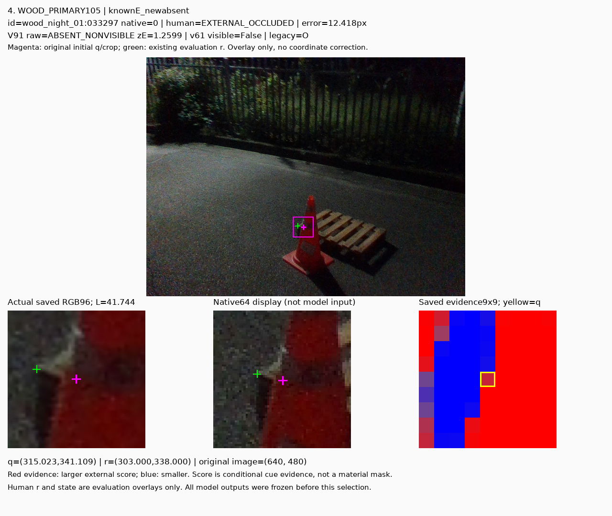

## 원 이미지 7

원문 직전 heading

```text
위치 오류가 기여하는 실패와, 위치만으로 설명되지 않는 실패
```

원 alt

```text
manualnearD_newvisible_v61absent · SQUARE_YOLO:029727
```

원 HTML caption

```text
manualnearD_newvisible_v61absent · SQUARE_YOLO:029727
```

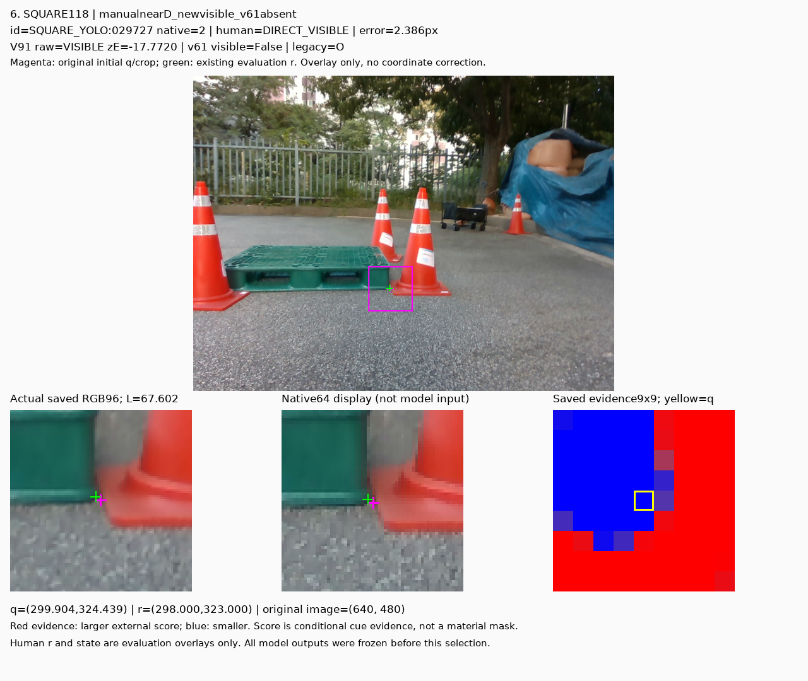

## 원 이미지 8

원문 직전 heading

```text
위치 오류가 기여하는 실패와, 위치만으로 설명되지 않는 실패
```

원 alt

```text
knownE_newabsent · SQUARE_YOLO:030295
```

원 HTML caption

```text
knownE_newabsent · SQUARE_YOLO:030295
```

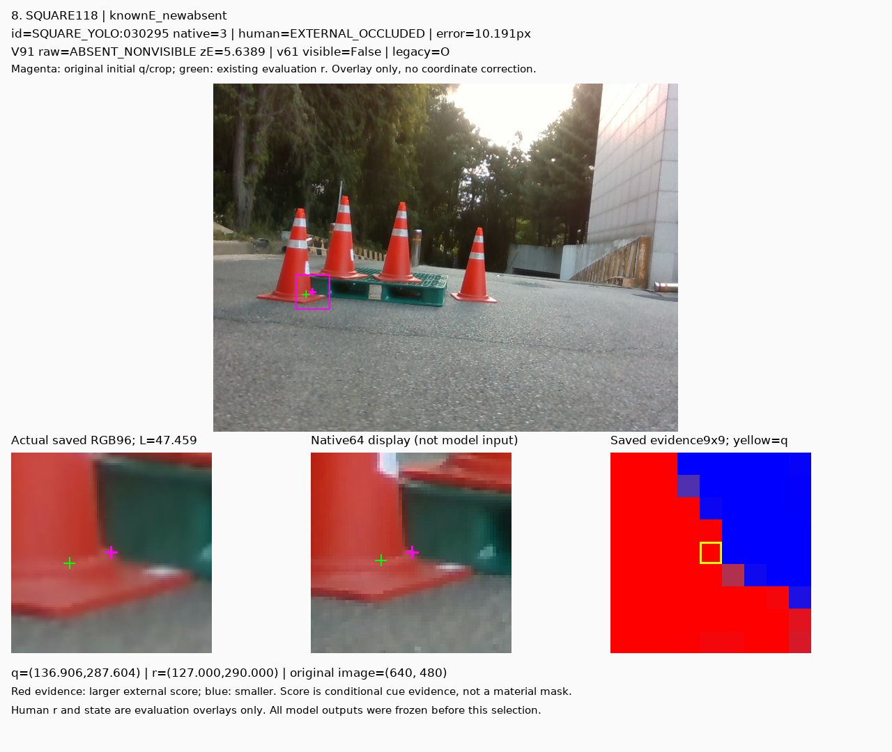

## 원 이미지 9

원문 직전 heading

```text
이번에 실제로 학습한 것
```

원 alt

```text
true0_pred0 · V85:1.23m_hall:0024_0025:LOWEST_WIDE_WALL_RIGHT
```

원 HTML caption

```text
true0_pred0 · V85:1.23m_hall:0024_0025:LOWEST_WIDE_WALL_RIGHT
```

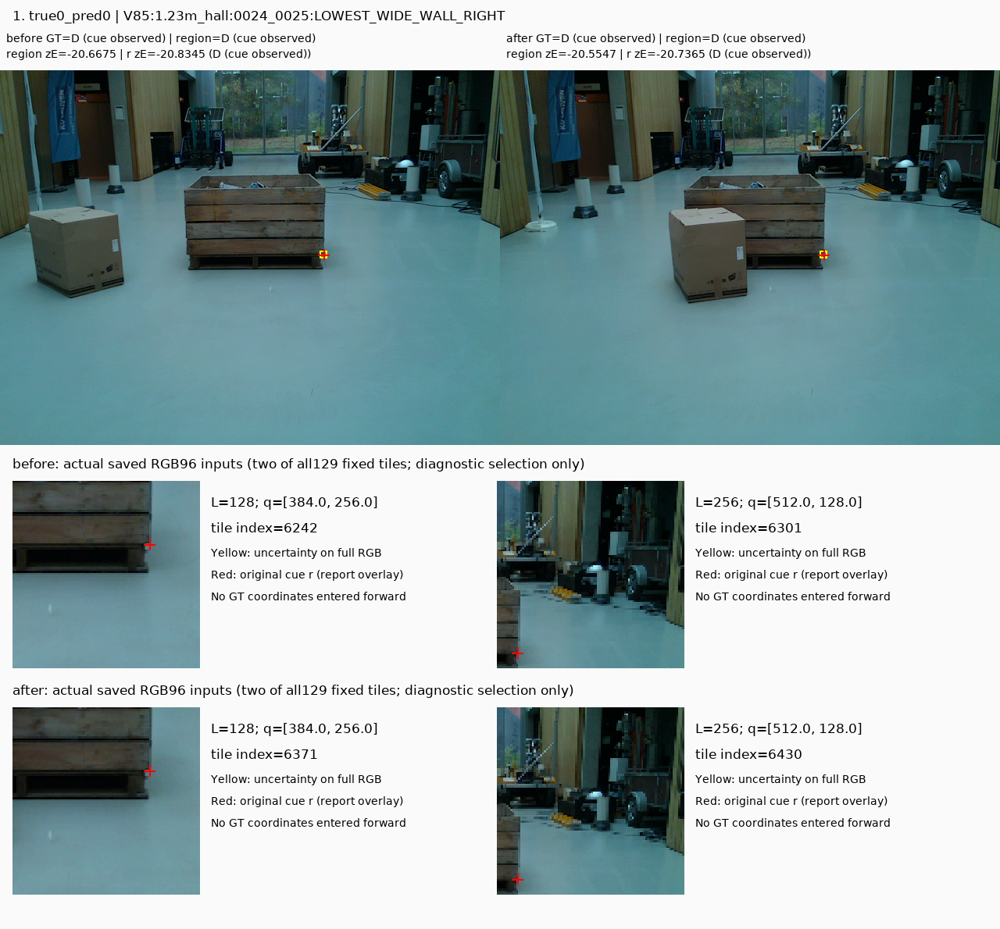

## 원 이미지 10

원문 직전 heading

```text
이번에 실제로 학습한 것
```

원 alt

```text
true0_pred1 · V85:0.55m_hall:0012_0013:UPPER_WALL_LEFT
```

원 HTML caption

```text
true0_pred1 · V85:0.55m_hall:0012_0013:UPPER_WALL_LEFT
```

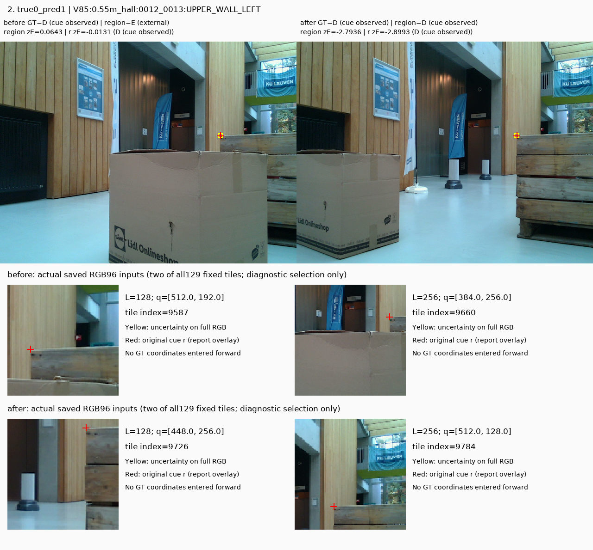

## 원 이미지 11

원문 직전 heading

```text
이번에 실제로 학습한 것
```

원 alt

```text
true1_pred1 · V85:1.92m_hall:0008_0009:BASE_RUNNER_LEFT
```

원 HTML caption

```text
true1_pred1 · V85:1.92m_hall:0008_0009:BASE_RUNNER_LEFT
```

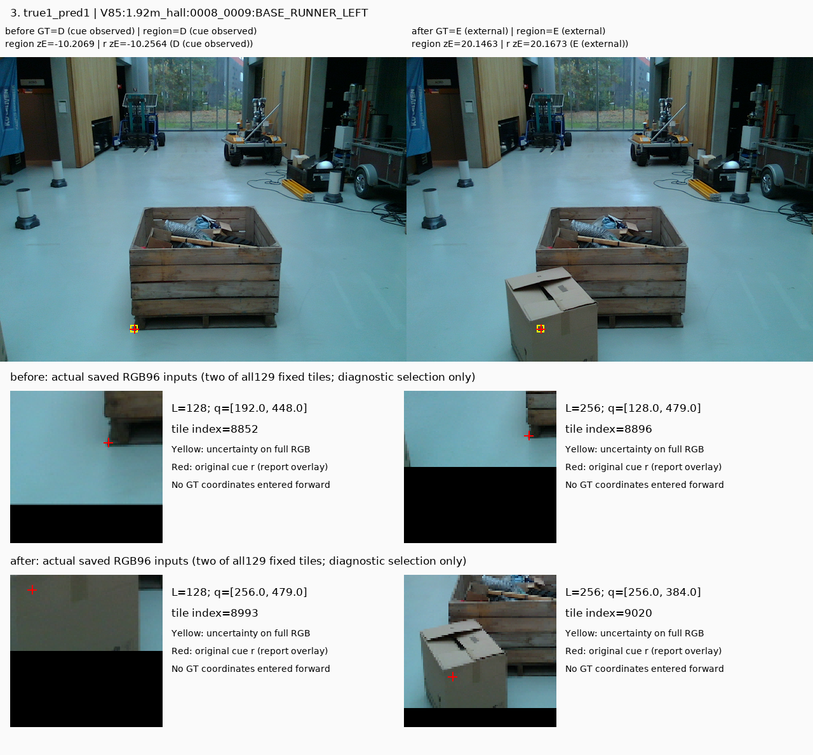
