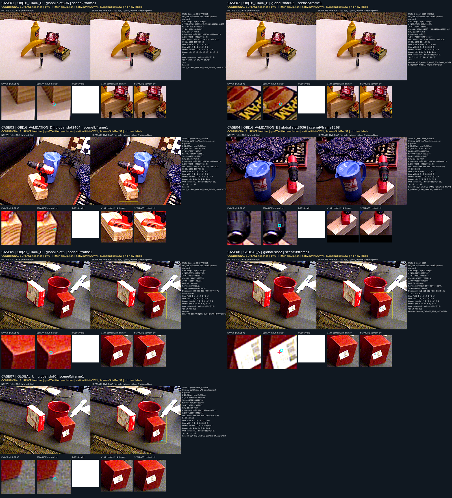

# V114 C12 — 공개 재질 추가와 동결 실사 비교

원문: [query_visibility_material_augmented_query_head_20261023_v114/ROOT_READOUT_KO.html](../../archive/task-2/pallet-keypoint-visibility/query_visibility_material_augmented_query_head_20261023_v114/ROOT_READOUT_KO.html)

원 HTML SHA256: `ae2092656fd4d55a24a06af9bd35f0a0859af7df2cfda7bbf6c123edfa0e4da3`

원 img ordinal 1–1 / 1. 원 순서 유지; 이미지 pixel decode/모델/평가 재실행 없음.

## 원 이미지 1

원문 직전 heading

```text
공개 source의 실제 이미지 근거와 정답 범위
```

원 alt

```text
고정된 공개 material7사례: 원 RGB crop과 target context, D/E/S/U 조건부 표면 teacher
```

원 HTML caption

```text
기존 공개 자료의 고정7사례. 클릭하면 원 contact. Root 실제 관찰 기록
```


