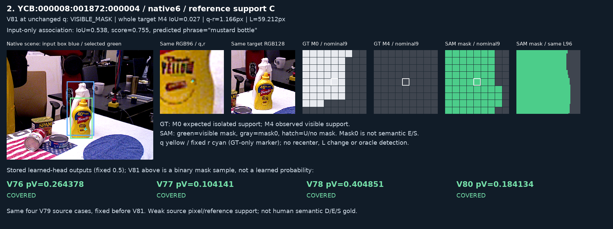

# 가림 판별: V81 진단과 다음 단계

원문: [query_visibility_grounded_target_20261023_v81/ROOT_READOUT_KO.html](../../archive/task-2/pallet-keypoint-visibility/query_visibility_grounded_target_20261023_v81/ROOT_READOUT_KO.html)

원 HTML SHA256: `adb850397435dc5315ab32448957cd52fb9a19b9c6301e8a07d59a5d76ef3f7c`

원 img ordinal 1–1 / 1. 원 순서 유지; 이미지 pixel decode/모델/평가 재실행 없음.

## 원 이미지 1

원문 직전 heading

```text
틀린 마스크는 주로 어느 물체를 보고 있었나
```

원 alt

```text
의도한 흰 용기 대신 앞 노란 병을 선택한 실제 공개 crop
```


