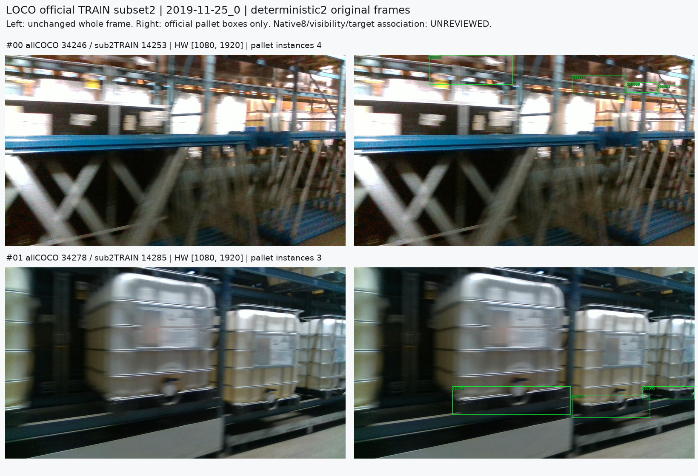
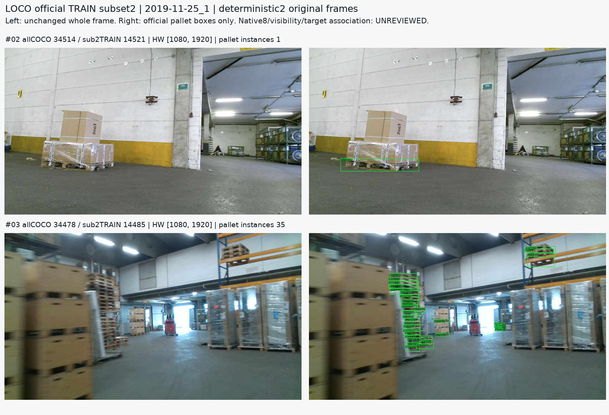
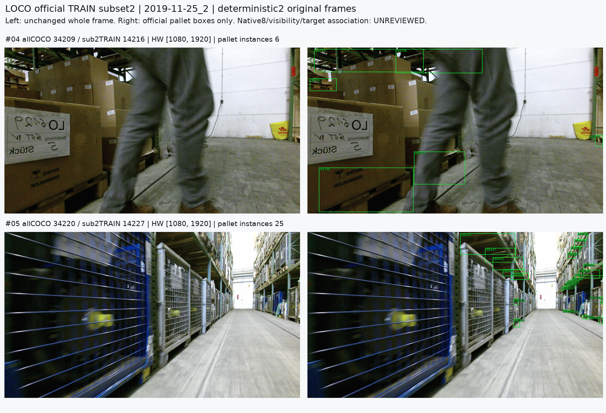
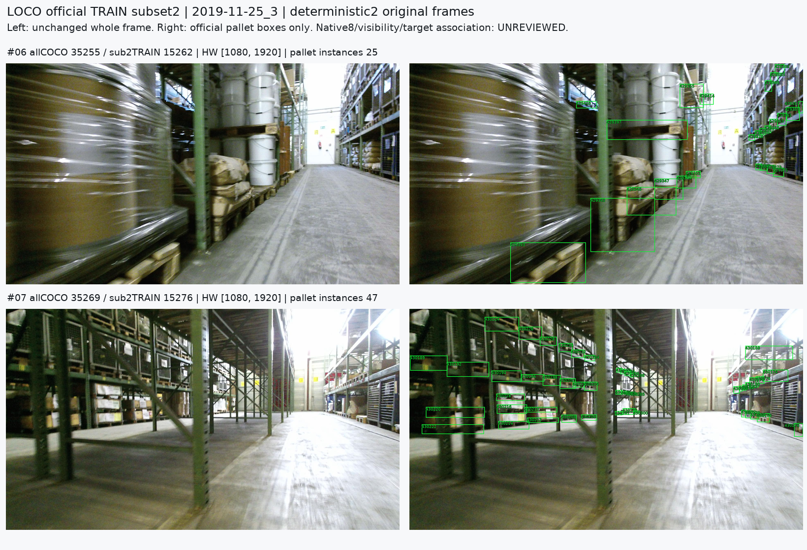
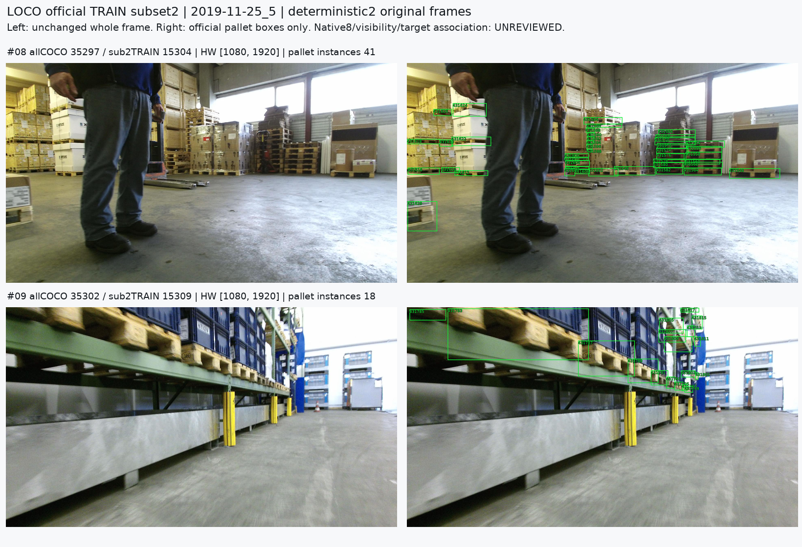
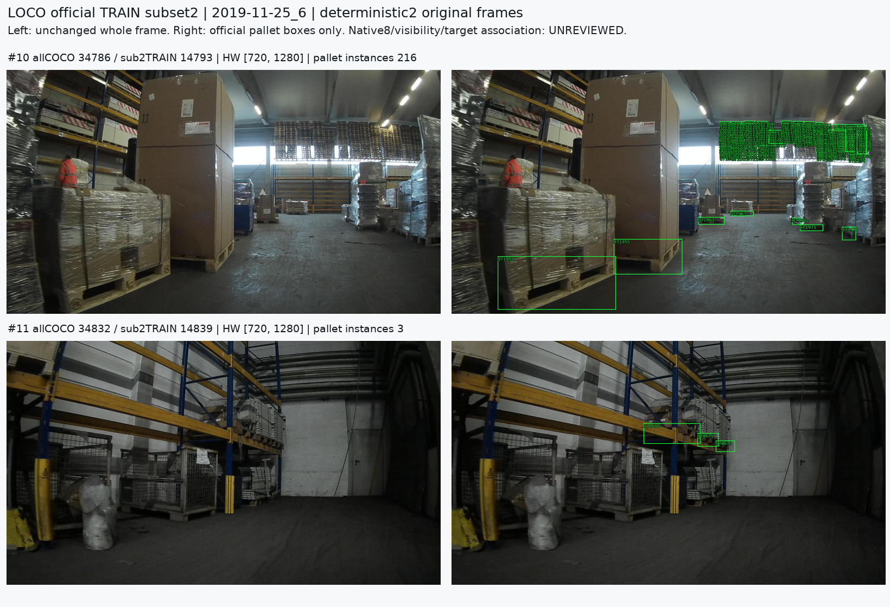

# LOCO fixed12 input feasibility

원문: [query_visibility_public_native_reference_feasibility_20261024_v140/loco_fixed12_intake_v1/INDEX.html](../../archive/task-2/pallet-keypoint-visibility/query_visibility_public_native_reference_feasibility_20261024_v140/loco_fixed12_intake_v1/INDEX.html)

원 HTML SHA256: `da2a3c455fb57e77ec916c24e79f7fa72c11b9755f9858237445da6f16235e64`

원 img ordinal 1–6 / 6. 원 순서 유지; 이미지 pixel decode/모델/평가 재실행 없음.

## 원 이미지 1

원문 직전 heading

```text
2019-11-25_0
```



## 원 이미지 2

원문 직전 heading

```text
2019-11-25_1
```



## 원 이미지 3

원문 직전 heading

```text
2019-11-25_2
```



## 원 이미지 4

원문 직전 heading

```text
2019-11-25_3
```



## 원 이미지 5

원문 직전 heading

```text
2019-11-25_5
```



## 원 이미지 6

원문 직전 heading

```text
2019-11-25_6
```


