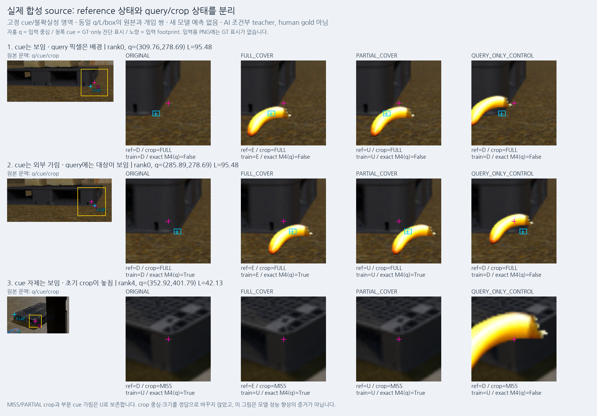
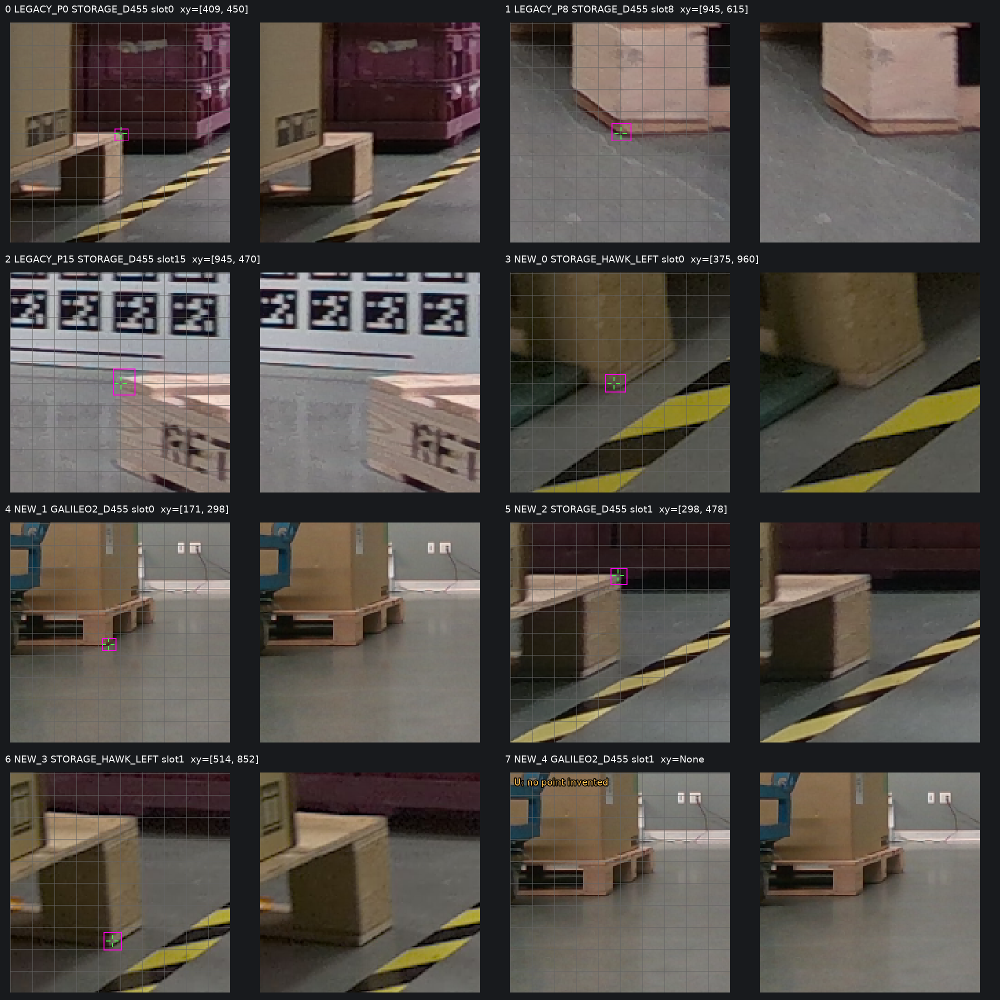

# v71 실제 reference/query 학습 데이터 준비

원문: [query_visibility_reference_jitter_20261023_v71/PROGRESS_KO.html](../../archive/task-2/pallet-keypoint-visibility/query_visibility_reference_jitter_20261023_v71/PROGRESS_KO.html.parts.json)

원 HTML SHA256: `28a6ecd465673e1fbe495087cc386a4b2158eb8caa1907a81ec99b344cc92b42`

원 img ordinal 1–2 / 2. 원 순서 유지; 이미지 pixel decode/모델/평가 재실행 없음.

## 원 이미지 1

원문 직전 heading

```text
1. 실제 만든 합성 reference/query pilot
```

원 alt

```text
동일 q/L/box에서 original / full cover / partial cover / untouched-cue control을 비교했다. 표시된 cue와 영역은 GT-only 진단용이며 모델 입력 PNG에는 들어가지 않는다.
```

원 HTML caption

```text
동일 q/L/box에서 original / full cover / partial cover / untouched-cue control을 비교했다. 표시된 cue와 영역은 GT-only 진단용이며 모델 입력 PNG에는 들어가지 않는다.
```



## 원 이미지 2

원문 직전 heading

```text
3. 실제 낮은 목재 팔레트 cue도 추가
```

원 alt

```text
공개 낮은 목재의 raw/marked crop. 같은 clip·sensor·물리적 cue 반복일 수 있으므로 7개의 독립 reference family로 세지 않는다.
```

원 HTML caption

```text
공개 낮은 목재의 raw/marked crop. 같은 clip·sensor·물리적 cue 반복일 수 있으므로 7개의 독립 reference family로 세지 않는다.
```



원문 HTML이 큰 경우 링크는 원 SHA를 보존하는 무손실 gzip descriptor를 가리킵니다.
